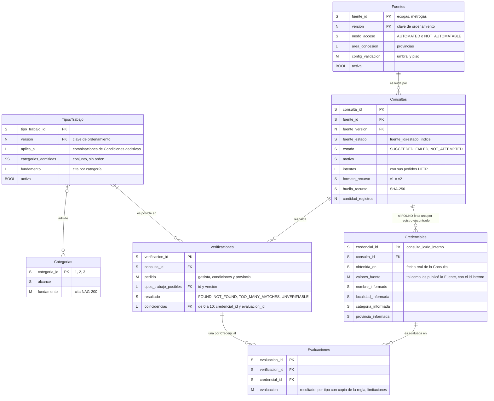
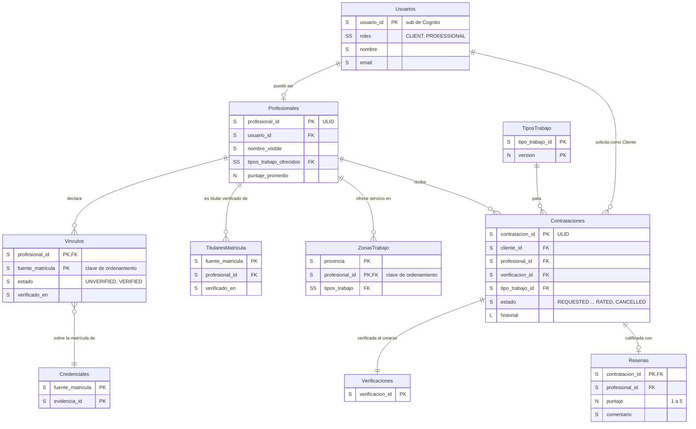

# Base de datos: esquema de colecciones (DynamoDB)

> Documento de diseño · Segunda entrega, corregido según la devolución v3 · Última revisión: 02/11/2026
> Cumple el ítem "Esquema de Base de Datos" de la consigna: tablas, campos, tipos de datos, claves primarias y foráneas, relaciones e índices principales. Por ser una base **no relacional**, se presenta como **esquema de colecciones (tablas) y documentos (ítems)**, más un diagrama entidad-relación lógico.
> Responde también al punto 5 de la devolución v2 ("persistencia de fuente, fecha y resultado de consulta"). Incorpora de la devolución v3 los valores tal como los publica la Fuente en cada Credencial, la Lectura minimizada ([ADR-0006](../docs/adr/0006-lectura-minimizada-y-proteccion-de-la-fuente.md)), las Condiciones decisivas en Verificaciones y Evaluaciones, y la limpieza del versionado (`Categorias` sin versión y sin `vigente_hasta`).
>
> **Claves del P0, implementadas el 02/11/2026 (ADR-0007).** **Ecogas no publica el número de matrícula**: su campo `id` es un identificador interno de la publicación ([ADR-0007](../docs/adr/0007-identificacion-por-nombre-y-localidad.md)). Ninguna tabla del P0 usa la matrícula como clave. La Credencial se identifica por la Consulta que la produjo y el registro de la Fuente (`<consulta_id>#<id_interno>`), y la Verificación y la Evaluación por su propio identificador ([§ 6](#6-tablas-del-p0)). Las tablas de P1 (`Vinculos`, `TitularesMatricula`) quedan como estaban, con esta nota: si se implementaran, se vincularían al registro del gasista, no a una matrícula.

## Índice

1. [Cómo leer este documento](#1-cómo-leer-este-documento)
2. [Por qué DynamoDB y por qué una tabla por entidad](#2-por-qué-dynamodb-y-por-qué-una-tabla-por-entidad)
3. [Convenciones](#3-convenciones)
4. [Diagrama entidad-relación del núcleo (P0)](#4-diagrama-entidad-relación-del-núcleo-p0)
5. [Diagrama entidad-relación completo (P0 a P2)](#5-diagrama-entidad-relación-completo-p0-a-p2)
6. [Tablas del P0](#6-tablas-del-p0)
7. [Tablas del P1](#7-tablas-del-p1)
8. [Tablas del P2](#8-tablas-del-p2)
9. [Patrones de acceso](#9-patrones-de-acceso)
10. [Integridad referencial y escrituras atómicas](#10-integridad-referencial-y-escrituras-atómicas)
11. [Datos personales: qué se guarda y qué no](#11-datos-personales-qué-se-guarda-y-qué-no)
12. [Datos semilla y ejemplos ficticios](#12-datos-semilla-y-ejemplos-ficticios)
13. [Capacidad, costos y retención](#13-capacidad-costos-y-retención)
14. [Archivos de esta carpeta](#14-archivos-de-esta-carpeta)

---

## 1. Cómo leer este documento

- Hay **15 tablas**: **8 del P0** (el núcleo de verificación), descriptas con todo detalle, y **7 de P1 y P2**, modeladas de forma más simple, como se acordó.
- Cada tabla tiene su **definición formal** en [`tablas/`](tablas/): un JSON **válido como entrada de `CreateTable`** de DynamoDB, que declara claves, índices y modo de facturación. Es el equivalente al DDL. Se puede aplicar tal cual en LocalStack (`aws dynamodb create-table --cli-input-json file://database/tablas/Fuentes.json`), y en la implementación se traduce a recursos `aws_dynamodb_table` de Terraform.
- Los **datos iniciales** (configuración de Fuentes, Categorías y Tipos de trabajo) están en [`seed/`](seed/): es el equivalente al DML. Los **ejemplos ficticios** de cada entidad están en [`seed/ejemplos-ficticios/`](seed/ejemplos-ficticios/).
- DynamoDB no aplica un esquema a los atributos que no son clave. **El esquema de cada documento lo garantiza la aplicación**, que valida cada ítem con Zod antes de escribirlo. Las tablas de campos de este documento son ese contrato.

---

## 2. Por qué DynamoDB y por qué una tabla por entidad

**DynamoDB** (decisión D5 de la primera entrega, que se mantiene):

- es la base administrada nativa del modelo serverless elegido: no hay servidor que mantener y escala a cero costo cuando no se usa;
- los **patrones de acceso son pocos y conocidos de antemano** ([§ 9](#9-patrones-de-acceso)), que es la condición para que una base clave-valor funcione bien;
- la mayoría de los datos son **documentos inmutables con historial** (Consultas, Credenciales, Evaluaciones), que se leen por clave y por fecha, sin *joins*;
- funciona igual en LocalStack y en AWS real.

**Una tabla por entidad** en vez de *single-table design* ([ADR-0004](../docs/adr/0004-una-tabla-dynamodb-por-entidad.md)): AWS recomienda una sola tabla con claves sobrecargadas para minimizar lecturas, pero eso hace que el esquema sea difícil de leer y revisar. Para este proyecto, que es académico, tiene volumen bajo y una consigna que pide mostrar tablas, campos, claves y relaciones, **priorizamos la legibilidad del modelo**. El costo es hacer, a veces, dos lecturas donde una tabla única haría una, lo cual es irrelevante con este volumen.

---

## 3. Convenciones

| Tema | Convención |
|---|---|
| Nombres de tablas | Plural, en español, `PascalCase` sin tildes (`TiposTrabajo`, `Resenas`). En la nube llevan el prefijo del entorno: `matricular-<entorno>-<tabla>`. |
| Nombres de atributos | `snake_case`, en español, sin tildes. |
| Tipos | Los de DynamoDB: **S** (string), **N** (número), **BOOL**, **L** (lista), **M** (mapa), **SS** (conjunto de strings, sin orden ni duplicados) y **NULL**. En los diagramas se usan esas mismas siglas. |
| Identificadores | **ULID** (26 caracteres, ordenables por tiempo), generados por la aplicación: `consulta_id`, `verificacion_id`, `evaluacion_id`, `profesional_id` y `contratacion_id`. Las Fuentes, Categorías y Tipos de trabajo usan identificadores legibles (`ecogas`, `artefacto-vivienda-unifamiliar`). |
| Claves compuestas | Separadas con `#`. En el P0 (implementado el 02/11/2026): `credencial_id = <consulta_id>#<id_interno>` y `fuente_estado = <fuente_id>#<estado>` ([ADR-0007](../docs/adr/0007-identificacion-por-nombre-y-localidad.md)). La clave candidata `fuente_gasista` del diseño anterior no se usa: el gasista se busca por palabras, en cualquier orden, y eso no se puede expresar como clave. Las tablas de P1 todavía usan `fuente_matricula`. |
| Fechas | Strings **ISO-8601 en UTC**, con milisegundos (`2026-09-26T18:40:12.345Z`). Se ordenan bien como texto. La interfaz las muestra en hora de Argentina. |
| Provincias | Código normalizado en mayúsculas y sin tildes, del catálogo [`seed/provincias.json`](seed/provincias.json) (`CORDOBA`, `CIUDAD_AUTONOMA_DE_BUENOS_AIRES`). |
| "FK" | DynamoDB no tiene claves foráneas. Una **FK es un atributo que guarda la clave de un ítem de otra tabla**. La aplicación valida que el ítem exista antes de escribir ([§ 10](#10-integridad-referencial-y-escrituras-atómicas)). En los diagramas se marcan como `FK`. |
| Inmutabilidad | Las tablas de evidencia (`Consultas`, `Credenciales`, `Evaluaciones` y `Verificaciones`) **no se modifican nunca**: se escriben una sola vez, con la condición `attribute_not_exists`. |
| Versionado | La configuración (`Fuentes`, `TiposTrabajo`) usa `version` como clave de ordenamiento. Un cambio **agrega una versión**, y la anterior **no se modifica nunca**: tiene `vigente_desde`, y su fin se deduce del `vigente_desde` de la versión siguiente (no hay `vigente_hasta`). `Categorias` **no se versiona**: es un catálogo de tres nombres con su cita, y la regla vive en `TiposTrabajo`. |
| Enumerados | Strings en MAYÚSCULAS y **en inglés** (`SUCCEEDED`, `UNVERIFIABLE`, `COMPATIBLE`). El vocabulario del dominio sigue en español; el significado de cada código está en el [glosario](../CONTEXT.md#códigos-de-estado). |
| Opcionales | Un atributo opcional se guarda como `NULL`, **salvo que sea clave de un índice**: en ese caso se omite, porque DynamoDB no admite `NULL` en una clave de índice (y así los índices dispersos funcionan). |

---

## 4. Diagrama entidad-relación del núcleo (P0)

Diagrama **lógico**: muestra las entidades, sus claves y cómo se referencian. Cada entidad es una tabla de DynamoDB. Solo se muestran los atributos principales; los campos completos están en [§ 6](#6-tablas-del-p0).



Lectura de las cardinalidades más importantes:

- **Consultas → Credenciales (1 a 0..N):** una Consulta exitosa produce una Credencial por cada registro que alguna Verificación encontró. Gracias a la **Ventana de reutilización** ([ADR-0006](../docs/adr/0006-lectura-minimizada-y-proteccion-de-la-fuente.md)), una sola descarga del padrón resuelve todos los gasistas buscados durante 15 minutos. Si dos Verificaciones encuentran el mismo registro sobre la misma Consulta, comparten la Credencial.
- **Consultas → Verificaciones (1 a 0..N):** una Verificación se apoya en una Consulta nueva o en una Consulta exitosa de menos de 15 minutos. Varias Verificaciones pueden compartir la misma Consulta, y la respuesta informa siempre la fecha real de esa Consulta.
- **TiposTrabajo → Verificaciones (1..N a 0..N):** el Cliente no elige un Tipo de trabajo. Las Condiciones decisivas que responde dejan uno o más Tipos de trabajo posibles, y la Verificación guarda cuáles fueron, con su versión.
- **Verificaciones → Credenciales (0 a 10):** solo una Verificación `FOUND` apunta a Credenciales, una por Coincidencia. Con homónimos hay varias, y el Cliente elige con el carné del gasista (INV-17).
- **Verificaciones → Evaluaciones (0 a 10):** una Evaluación por Credencial; sin Credencial no hay Evaluación (INV-2).
- **Credenciales → Evaluaciones (1 a N):** la misma Credencial puede evaluarse para distintos trabajos, y cada resultado es independiente.

---

## 5. Diagrama entidad-relación completo (P0 a P2)

Los módulos P1 (Profesionales y búsqueda) y P2 (usuarios y contratación) se apoyan en el núcleo. Para no repetir, el núcleo aparece resumido.



> La relación **Vínculos → Credenciales** es **lógica**, por `fuente_matricula`: un Vínculo apunta a una matrícula de una Fuente, no a una Credencial en particular. Siempre se usa la evidencia más reciente. **P1 está fuera de la entrega final**: si se implementara, el Vínculo apuntaría al registro del gasista (`fuente_gasista`), porque Ecogas no publica la matrícula ([ADR-0007](../docs/adr/0007-identificacion-por-nombre-y-localidad.md)).

---

## 6. Tablas del P0

> **Implementado el 02/11/2026** ([`backend/compartido/src/adaptadores/dynamodb/`](../backend/compartido/src/adaptadores/dynamodb/)). Qué se crea en AWS y en LocalStack para el P0:
>
> | Almacenamiento | Qué guarda | Definición |
> |---|---|---|
> | Tabla `Consultas` | Cada lectura de una Fuente | [`tablas/Consultas.json`](tablas/Consultas.json) |
> | Tabla `Credenciales` | Evidencia inmutable de cada gasista encontrado | [`tablas/Credenciales.json`](tablas/Credenciales.json) |
> | Tabla `Verificaciones` | Cada pedido, con su resultado y sus Coincidencias | [`tablas/Verificaciones.json`](tablas/Verificaciones.json) |
> | Tabla `Evaluaciones` | La Evaluación de cada Coincidencia, con copia de la regla aplicada | [`tablas/Evaluaciones.json`](tablas/Evaluaciones.json) |
> | Bucket S3 de lecturas | Lecturas minimizadas (`lecturas/<consulta_id>.json.gz`), que vencen al día siguiente por una regla de ciclo de vida | Terraform |
>
> Una prueba ([`esquema-tablas.test.ts`](../backend/compartido/test/adaptadores/esquema-tablas.test.ts)) verifica que estos JSON sean exactamente los que usa el código, así que no se pueden desactualizar.
>
> **Lo que no se crea en el P0, y por qué:**
> - **`Fuentes`, `Categorias`, `TiposTrabajo` y `Provincias`.** Las reglas viajan con el código desde [`seed/`](seed/), se validan con Zod al iniciar y se versionan con git. Una regla cambia con un commit revisado, no con una escritura en la base, y cada Evaluación guarda la copia de la regla que aplicó. Las secciones de abajo quedan como el diseño de esas tablas para cuando haga falta editarlas sin desplegar.
> - **`ResultadosVerificacion`.** En el P0 cada Verificación tiene su propia Consulta (nueva o reutilizada) y guarda su resultado y sus Coincidencias, así que la tabla intermedia no agrega nada. Su información queda absorbida por `Verificaciones`.

### Fuentes

Configuración **versionada** de cada padrón. **No se crea en el P0:** se lee de `seed/fuentes.json`. Definición: [`tablas/Fuentes.json`](tablas/Fuentes.json). Datos: [`seed/fuentes.json`](seed/fuentes.json).

| Clave | Atributo | Tipo |
|---|---|---|
| Partición (PK) | `fuente_id` | S |
| Ordenamiento (SK) | `version` | N |

Índices secundarios: ninguno. Es una tabla chica (unos pocos ítems por Fuente).

| Campo | Tipo | Oblig. | Descripción |
|---|---|---|---|
| `fuente_id` | S | ✔ | Identificador legible: `ecogas`, `metrogas`. |
| `version` | N | ✔ | Versión de la configuración (1, 2, …). |
| `nombre` | S | ✔ | Nombre para mostrar: "Ecogas". |
| `distribuidora` | S | ✔ | Distribuidora que publica el padrón. |
| `licenciatarias` | L\<S\> | ✔ | Licenciatarias que agrupa: "Distribuidora de Gas del Centro", "Distribuidora de Gas Cuyana". |
| `area_concesion` | L\<S\> | ✔ | Códigos de las provincias donde la Distribuidora opera en **todo** el territorio. |
| `area_concesion_parcial` | L\<S\> | ✔ | Provincias donde opera solo en **parte** (por ejemplo, MetroGAS en Buenos Aires). Se usa para el texto de la Limitación de zona: la zona no es un Criterio ([ADR-0005](../docs/adr/0005-zona-como-limitacion-en-el-p0.md)). Puede ser una lista vacía. |
| `modo_acceso` | S | ✔ | `AUTOMATED` \| `NOT_AUTOMATABLE`. |
| `adaptador` | S | ✔ | `ECOGAS_NEXT_RESOURCE` \| `NOT_AUTOMATABLE`. |
| `url_pagina` | S \| NULL | | Página donde el adaptador descubre el recurso. |
| `url_buscador_oficial` | S | ✔ | Buscador público, para mostrarle al Cliente. |
| `config_extraccion` | M \| NULL | | `prefijo_preferido` (S), `max_candidatos` (N), `claves_obligatorias` (L\<S\>), `claves_conocidas` (L\<S\>). |
| `config_reintentos` | M \| NULL | | `max_intentos` (N), `esperas_ms` (L\<N\>), `timeout_pedido_ms` (N), `timeout_consulta_ms` (N). |
| `config_validacion` | M \| NULL | | `umbral_caida` (N, 0 a 1), `piso_registros` (N). |
| `config_proteccion` | M \| NULL | | Protección de la Fuente ([ADR-0006](../docs/adr/0006-lectura-minimizada-y-proteccion-de-la-fuente.md)): `ventana_reutilizacion_s` (N, 900 en Ecogas) y `espera_tras_falla_s` (N, 60 en Ecogas). Nulo en una Fuente no automatizable. |
| `limitaciones` | L\<S\> | ✔ | Textos que se agregan a toda Evaluación sobre esta Fuente. |
| `activa` | BOOL | ✔ | Si se puede usar en nuevas Verificaciones. |
| `vigente_desde` | S | ✔ | Desde cuándo rige esta versión. Deja de regir cuando empieza la versión siguiente. |
| `creada_en` | S | ✔ | Fecha de carga. |

### Categorias

Catálogo de categorías de matrícula **para mostrar** (**no se crea en el P0:** se lee de `seed/categorias.json`). El algoritmo no lo usa para comparar: las reglas están en `TiposTrabajo`. **No tiene ningún campo de orden o nivel, a propósito** (INV-7). **No se versiona** (devolución v3): su clave es solo `categoria_id`, así que no podrían coexistir dos versiones, y no hace falta, porque la regla que importa vive en `TiposTrabajo`. Definición: [`tablas/Categorias.json`](tablas/Categorias.json). Datos: [`seed/categorias.json`](seed/categorias.json).

| Clave | Atributo | Tipo |
|---|---|---|
| PK | `categoria_id` | S (`"1"`, `"2"`, `"3"`, tal como las publica la Fuente) |

| Campo | Tipo | Oblig. | Descripción |
|---|---|---|---|
| `categoria_id` | S | ✔ | Código tal como aparece en el padrón. |
| `nombre` | S | ✔ | "Primera categoría". |
| `alcance` | S | ✔ | Resumen en lenguaje claro de lo que habilita. |
| `fundamento` | M | ✔ | `norma` (S), `articulo` (S), `cita` (S), `url` (S). |

### TiposTrabajo

Reglas de categoría, **versionadas**. **No se crea en el P0:** se lee de `seed/tipos-trabajo.json`. Definición: [`tablas/TiposTrabajo.json`](tablas/TiposTrabajo.json). Datos: [`seed/tipos-trabajo.json`](seed/tipos-trabajo.json). Fundamentos: [`docs/reglas-de-categoria.md`](../docs/reglas-de-categoria.md).

| Clave | Atributo | Tipo |
|---|---|---|
| PK | `tipo_trabajo_id` | S |
| SK | `version` | N |

| Campo | Tipo | Oblig. | Descripción |
|---|---|---|---|
| `tipo_trabajo_id` | S | ✔ | `artefacto-vivienda-unifamiliar`, `artefacto-vivienda-general`, `comercio-artefacto-alto-consumo`. |
| `version` | N | ✔ | Versión de la regla. |
| `codigo` | S | ✔ | Código corto para la documentación: `A1`, `A2`, `B`. |
| `nombre` | S | ✔ | Nombre para el Cliente. |
| `descripcion` | S | ✔ | Explicación en lenguaje claro. |
| `condiciones` | L\<S\> | ✔ | Condiciones técnicas del tipo, en lenguaje claro, con su respaldo normativo. |
| `aplica_si` | L\<M\> | ✔ | Combinaciones de Condiciones decisivas que definen el tipo ([reglas § 3.5](../docs/reglas-de-categoria.md#35-condiciones-decisivas-cómo-se-describe-el-trabajo)). Cada mapa asocia un identificador de Condición decisiva con `SI` o `NO`; el tipo aplica si las respuestas cumplen **alguno** de los mapas. Una condición que no figura en un mapa no importa para ese caso (por ejemplo, `unica_vivienda` en un comercio). [`seed/tipos-trabajo.json`](seed/tipos-trabajo.json) es la única fuente de verdad y se valida con Zod al iniciar. |
| `categorias_admitidas` | SS | ✔ | **Conjunto** de categorías que pueden hacer el trabajo. |
| `fundamento` | L\<M\> | ✔ | Uno por categoría del catálogo: `categoria` (S), `admitida` (BOOL), `norma` (S), `articulo` (S), `cita` (S), `url` (S) y, opcionalmente, `nota` (S) con la explicación de por qué una categoría no está admitida. |
| `limitaciones` | L\<S\> | ✔ | Limitaciones propias del tipo (puede ser una lista vacía). |
| `activo` | BOOL | ✔ | Si se ofrece en nuevas Verificaciones. |
| `vigente_desde` | S | ✔ | Deja de regir cuando empieza la versión siguiente. |
| `creado_en` | S | ✔ | |

El campo `tipo_recomendado_si_duda` de la segunda entrega se elimina: lo reemplaza la regla del No sé sobre las Condiciones decisivas, que evalúa todos los Tipos de trabajo posibles en lugar de sugerir uno.

### Consultas

**Cada lectura de una Fuente**, con sus Intentos. Es la tabla que responde "de dónde lo sabemos y cuándo". Definición: [`tablas/Consultas.json`](tablas/Consultas.json). Ejemplos: [`seed/ejemplos-ficticios/consultas.json`](seed/ejemplos-ficticios/consultas.json).

| Clave | Atributo | Tipo |
|---|---|---|
| PK | `consulta_id` | S |

| Índice (GSI) | PK | SK | Proyección | Para qué |
|---|---|---|---|---|
| `por-fuente` | `fuente_id` | `iniciada_en` | ALL | **Salud de la Fuente**: las últimas Consultas, más nuevas primero (`GET /fuentes/{id}/consultas`). |
| `por-fuente-estado` | `fuente_estado` | `finalizada_en` | ALL | **Última Consulta de la Fuente con un estado dado**: la última `SUCCEEDED` (Ventana de reutilización y cantidad anterior para V5) y la última `FAILED` (espera tras una falla). |

| Campo | Tipo | Oblig. | Descripción |
|---|---|---|---|
| `consulta_id` | S | ✔ | Identificador único. |
| `fuente_id` | S | ✔ | Fuente leída (`ecogas`). |
| `fuente_version` | N | ✔ | Versión de la configuración de la Fuente usada. |
| `fuente_estado` | S | ✔ | `<fuente_id>#<estado>`: clave del índice `por-fuente-estado`. |
| `estado` | S | ✔ | `SUCCEEDED` \| `FAILED` \| `NOT_ATTEMPTED`. |
| `motivo` | S | | Para `FAILED`: `SOURCE_UNAVAILABLE` \| `EXTRACTION_FAILED` \| `INTERRUPTED` (falla de MatriculAR, no de la Fuente). Para `NOT_ATTEMPTED`: `SOURCE_NOT_AUTOMATABLE` \| `SOURCE_RATE_LIMITED`. |
| `detalle` | S | | Descripción de la falla, sin datos personales (por ejemplo, "HTTP 403" o la validación que falló). |
| `iniciada_en` | S | ✔ | Momento en que empezó la lectura. |
| `finalizada_en` | S | ✔ | Momento en que terminó. Es la **fecha real** que se informa en toda Verificación que se apoya en esta Consulta. |
| `intentos` | L\<M\> | ✔ | Cada Intento: `numero` (N), `iniciado_en` (S), `finalizado_en` (S), `error` (S, opcional) y `pedidos` (L\<M\>: `url`, `estado_http` (N o NULL), `bytes`, `ms`, `error`). **Nunca el cuerpo de la respuesta.** Lista vacía si la Consulta es `NOT_ATTEMPTED`. |
| `url_resuelta` | S | | Solo si es `SUCCEEDED`: URL del contenido que trajo los datos. |
| `formato_recurso` | S | | Solo si es `SUCCEEDED`: `v2` (padrón embebido en el HTML, desde el 02/11/2026) o `v1` (archivo JavaScript, hasta septiembre de 2026). |
| `huella_recurso` | S | | Solo si es `SUCCEEDED`: SHA-256 del recurso leído. Permite **reconocer** si dos Consultas leyeron el mismo contenido o si el recurso cambió. **No permite reconstruirlo**: por eso cada Credencial guarda además sus `valores_fuente`. |
| `cantidad_registros` | N | | Solo si es `SUCCEEDED`: registros válidos leídos. La siguiente lectura la usa para V5. |
| `claves_no_esperadas` | L\<S\> | | Solo si es `SUCCEEDED`: claves nuevas detectadas en los registros (por ejemplo, un campo de vigencia). |

Reglas de escritura: la Consulta se escribe **una sola vez, ya finalizada**, con la condición `attribute_not_exists(consulta_id)`, y nunca se modifica. Si la función se corta a mitad de la lectura, no queda una Consulta a medias. Esa falla propia se registra como `FAILED` con motivo `INTERRUPTED` cuando el error llega al caso de uso.

**Lectura minimizada** ([ADR-0006](../docs/adr/0006-lectura-minimizada-y-proteccion-de-la-fuente.md)). Una Consulta exitosa conserva, por cada registro de la Fuente, los campos que forman una Credencial (Identificador interno de la Fuente, nombre, categoría, provincia y localidad), tal como vinieron y normalizados, **sin email, teléfono ni barrio**. Sirve para responder otras Verificaciones durante la Ventana de reutilización (15 minutos) sin volver a descargar el padrón. No es evidencia: la evidencia sigue siendo la Credencial de cada gasista verificado. Con unos 5.000 registros ocupa del orden de 1 MB, más que el límite de 400 KB de un ítem de DynamoDB, así que **se guarda en S3**: objeto `lecturas/<consulta_id>.json.gz` (JSON comprimido con gzip), con la fecha de vencimiento en la metadata `vence-en`. Una regla de ciclo de vida del bucket **lo borra al día siguiente** (prefijo `lecturas/`, 1 día). En el CLI vive en un archivo local que no se versiona, y en las pruebas, en memoria.

**Ventana de reutilización y Protección de la Fuente.** Antes de leer la Fuente, el caso de uso busca en `por-fuente-estado` la última Consulta `SUCCEEDED`: si tiene menos de 15 minutos y su Lectura minimizada existe, la reutiliza. Si no, busca la última `FAILED`: si es posterior a la última exitosa y tiene menos de un minuto, registra una Consulta `NOT_ATTEMPTED` con motivo `SOURCE_RATE_LIMITED`, sin Intentos.

### ResultadosVerificacion

> **No se crea en el P0** (decidido el 02/11/2026). Cada Verificación guarda su resultado, la cantidad de Coincidencias y las referencias a sus Credenciales y Evaluaciones, así que esta tabla no agrega información. Queda el diseño original, por si en P1 la búsqueda necesita resultados por Consulta sin leer cada Verificación.

Un ítem por **Verificación** que se apoyó en cada Consulta: qué permitió afirmar esa lectura sobre el Gasista buscado. Definición: [`tablas/ResultadosVerificacion.json`](tablas/ResultadosVerificacion.json). Ejemplos: [`seed/ejemplos-ficticios/resultados-verificacion.json`](seed/ejemplos-ficticios/resultados-verificacion.json).

| Clave | Atributo | Tipo |
|---|---|---|
| PK | `consulta_id` | S |
| SK | `verificacion_id` | S (candidata) |

| Índice (GSI) | PK | SK | Proyección | Para qué |
|---|---|---|---|---|
| `por-gasista` | `fuente_gasista` | `determinado_en` | ALL | Historial de resultados de un gasista buscado por nombre y localidad, incluidos `NOT_FOUND`, `TOO_MANY_MATCHES` y `UNVERIFIABLE` (que no generan Credencial). Solo tiene ítems si la búsqueda incluyó la localidad. |

| Campo | Tipo | Oblig. | Descripción |
|---|---|---|---|
| `consulta_id` | S | ✔ | FK → `Consultas`. |
| `verificacion_id` | S | ✔ | FK → `Verificaciones`. |
| `fuente_id` | S | ✔ | FK → `Fuentes`. |
| `gasista_buscado` | M | ✔ | `nombre_apellido` (S) y `localidad` (S \| NULL), normalizados. |
| `fuente_gasista` | S \| ausente | | `<fuente_id>#<nombre>#<localidad>`, solo si la búsqueda incluyó la localidad (clave del índice). |
| `resultado` | S | ✔ | `FOUND` \| `NOT_FOUND` \| `TOO_MANY_MATCHES` \| `UNVERIFIABLE`. |
| `cantidad_coincidencias` | N \| NULL | | Si la Consulta fue exitosa: cuántos registros coincidieron (en `TOO_MANY_MATCHES`, más de 10). |
| `determinado_en` | S | ✔ | Igual a `finalizada_en` de la Consulta. |
| `credenciales_ref` | L\<M\> | ✔ | Si es `FOUND`: de 1 a 10 referencias a `Credenciales` (`fuente_gasista` y `evidencia_id`). Vacía en los demás casos. |

### Credenciales

**Evidencia inmutable** de que un gasista figura en una Fuente, según una Consulta. Definición: [`tablas/Credenciales.json`](tablas/Credenciales.json). Ejemplos: [`seed/ejemplos-ficticios/credenciales.json`](seed/ejemplos-ficticios/credenciales.json).

**Clave (ADR-0007, implementada el 02/11/2026).** Como la Fuente no publica la matrícula, la Credencial se identifica por la Consulta que la produjo y el registro de la Fuente: `credencial_id = <consulta_id>#<id_interno>`. Así, dos Verificaciones dentro de la misma Ventana de reutilización que encuentran al mismo registro comparten la misma Credencial, y dos homónimos de la misma localidad (4 casos en la lectura del 02/11) tienen Credenciales distintas.

| Clave | Atributo | Tipo |
|---|---|---|
| PK | `credencial_id` | S (`<consulta_id>#<id_interno>`) |

| Índice (GSI) | PK | SK | Proyección | Para qué |
|---|---|---|---|---|
| `por-fuente` | `fuente_id` | `obtenida_en` | ALL | **Evidencia anterior** de un gasista cuando la Fuente no se puede leer. El nombre se busca con la misma regla que las Coincidencias (todas las palabras, en cualquier orden), que no se puede expresar como clave. Por eso la consulta recorre las Credenciales de la Fuente de la más nueva a la más vieja, **con un tope de 1.000**, y filtra en memoria. Es una **simplificación del P0**: alcanza porque solo hay Credenciales de los gasistas que alguien verificó. Si el volumen crece, se agrega un índice por nombre normalizado. |

| Campo | Tipo | Oblig. | Descripción |
|---|---|---|---|
| `credencial_id` | S | ✔ | `<consulta_id>#<id_interno>`. |
| `fuente_id` | S | ✔ | Fuente de la evidencia. |
| `consulta_id` | S | ✔ | La Consulta que la produjo. |
| `obtenida_en` | S | ✔ | Fecha real de la Consulta (su `finalizada_en`), nunca la del pedido. |
| `id_interno` | S | ✔ | **Identificador interno de la Fuente**: se conserva, pero nunca se presenta como matrícula (INV-16). |
| `nombre_informado` | S | ✔ | Nombre y apellido tal como los publica la Fuente, en mayúsculas. Identifica al gasista junto con la localidad, y el Cliente lo confirma con el carné. |
| `categoria_informada` | S | ✔ | Tal como la publica la Fuente (`"1"`, `"2"`, `"3"`, o lo que venga: una categoría desconocida se conserva y la Evaluación da `INDETERMINATE`). |
| `provincia_informada` | S | ✔ | Código de provincia (el domicilio del matriculado). |
| `localidad_informada` | S | ✔ | En mayúsculas. Forma parte de la identificación. |
| `valores_fuente` | M | ✔ | Los campos `id`, `nombre_apellido`, `categoria`, `provincia` y `localidad` **tal como los publicó la Fuente**, antes de normalizar (en el formato v2, `categoria`, `provincia` y `localidad` son mapas). Permite reconstruir exactamente qué dato leyó el adaptador sin guardar el padrón (devolución v3). **Nunca** incluye email, teléfono ni barrio. |

Reglas: se escribe **una sola vez**, con la condición `attribute_not_exists(credencial_id)`. Si ya existe, no es un error: la misma Consulta y el mismo registro ya produjeron esa Credencial. Nunca se actualiza ni se borra (INV-1). **No existe ningún atributo de contacto** (INV-9).

### Verificaciones

Cada **pedido** de un Cliente, o del propio sistema en P1 y P2: agrupa la Consulta, el resultado y, si corresponde, la Evaluación. Definición: [`tablas/Verificaciones.json`](tablas/Verificaciones.json). Ejemplos: [`seed/ejemplos-ficticios/verificaciones.json`](seed/ejemplos-ficticios/verificaciones.json).

| Clave | Atributo | Tipo |
|---|---|---|
| PK | `verificacion_id` | S |

Índices secundarios: ninguno en el P0. Se accede por su identificador (`GET /verificaciones/{id}`, el enlace para compartir).

| Campo | Tipo | Oblig. | Descripción |
|---|---|---|---|
| `verificacion_id` | S | ✔ | Identificador único. |
| `creada_en` | S | ✔ | Momento del pedido. |
| `pedido` | M | ✔ | Tal como lo hizo el Cliente: `fuente_id` (S), `gasista` (M: `nombre_apellido` y, si vino, `localidad`), `condiciones` (M: las cinco Condiciones decisivas, cada una `SI` \| `NO` \| `NO_SE`) y `provincia_trabajo` (S). |
| `consulta_id` | S | ✔ | La Consulta en la que se apoya. |
| `consulta_reutilizada` | BOOL | ✔ | `true` si se apoya en una Consulta anterior, dentro de la Ventana de reutilización. |
| `resultado` | S | ✔ | `FOUND` \| `NOT_FOUND` \| `TOO_MANY_MATCHES` \| `UNVERIFIABLE`. |
| `cantidad_coincidencias` | N | ✔ | Coincidencias encontradas, también cuando son demasiadas para mostrarlas (`TOO_MANY_MATCHES`). |
| `tipos_trabajo_posibles` | L\<M\> | ✔ | `tipo_trabajo_id`, `version`, `codigo` y `nombre` de cada Tipo de trabajo que dejan abiertos las condiciones. Nunca vacía: si no queda ninguno, el pedido se rechaza con `422 WORK_NOT_COVERED` y no se crea Verificación. |
| `coincidencias` | L\<M\> | ✔ | Solo si es `FOUND`: de 1 a 10 elementos `{ credencial_id, evaluacion_id }`. Vacía en los demás casos. MatriculAR no elige entre ellas (INV-17). |
| `evidencia_previa_ids` | L\<S\> | ✔ | Si es `UNVERIFIABLE`: las Credenciales anteriores del mismo nombre que se mostraron como contexto, sin concluir. Vacía si no hay. |
| `mensaje` | S | ✔ | Texto principal que se mostró al Cliente. |

Reglas: la Verificación y sus Evaluaciones se escriben **juntas**, en una sola transacción (`TransactWriteItems`), cada ítem con `attribute_not_exists`. O se guarda todo o no se guarda nada, y nunca se pisa evidencia.

### Evaluaciones

Resultado de aplicar a una Credencial los Tipos de trabajo posibles, con **copia de cada regla aplicada**. Definición: [`tablas/Evaluaciones.json`](tablas/Evaluaciones.json). Ejemplos: [`seed/ejemplos-ficticios/evaluaciones.json`](seed/ejemplos-ficticios/evaluaciones.json).

| Clave | Atributo | Tipo |
|---|---|---|
| PK | `evaluacion_id` | S |

Índices secundarios: ninguno. Se accede desde la Verificación (`BatchGetItem` con sus `evaluacion_id`).

| Campo | Tipo | Oblig. | Descripción |
|---|---|---|---|
| `evaluacion_id` | S | ✔ | Identificador único. |
| `verificacion_id` | S | ✔ | La Verificación que la produjo. |
| `credencial_id` | S | ✔ | La Credencial evaluada. Una Evaluación por Coincidencia. |
| `evaluacion` | M | ✔ | La Evaluación completa, tal como se mostró. Nunca se recalcula con reglas posteriores. |
| `evaluacion.resultado` | S | ✔ | `COMPATIBLE` \| `INCOMPATIBLE` \| `INDETERMINATE`, según la regla del No sé ([modelo § 6.2](../docs/modelo-de-dominio.md#62-resultado-global)). |
| `evaluacion.criterios` | L\<M\> | ✔ | Un solo Criterio en el P0: `criterio` (`CATEGORIA`), `resultado` (`MET` \| `NOT_MET` \| `INDETERMINATE`), `categoria_informada` y `fundamento` (las citas). No hay Criterio de zona ([ADR-0005](../docs/adr/0005-zona-como-limitacion-en-el-p0.md)). |
| `evaluacion.tipos_trabajo_posibles` | L\<M\> | ✔ | `tipo_trabajo_id`, `version`, `codigo`, `nombre`. |
| `evaluacion.resultados_por_tipo` | L\<M\> | ✔ | Uno por Tipo de trabajo posible: `tipo_trabajo_id`, `tipo_trabajo_version`, `resultado`, `fundamento` (la cita para la categoría informada, o NULL si la categoría es desconocida) y `regla_aplicada` (**copia**: `categorias_admitidas`). |
| `evaluacion.condiciones_que_resuelven` | L\<M\> | ✔ | `condicion_id` y `pregunta` de cada Condición decisiva respondida No sé cuyo valor cambiaría el resultado. Lista vacía si no hay. |
| `evaluacion.limitaciones` | L\<M\> | ✔ | `origen` (`FUENTE` \| `ZONA` \| `TIPO_TRABAJO`) y `texto`. Siempre incluye la de Vigencia y la de zona. |
| `evaluacion.explicacion` | S | ✔ | El texto que se mostró al Cliente. |

---

## 7. Tablas del P1

Modeladas más simples: se detallan al llegar a ese módulo.

### Profesionales

| Clave | Atributo | Tipo |
|---|---|---|
| PK | `profesional_id` | S (ULID) |

GSI `por-usuario`: PK `usuario_id` → el perfil de un usuario.

| Campo | Tipo | Oblig. | Descripción |
|---|---|---|---|
| `profesional_id` | S | ✔ | |
| `usuario_id` | S | ✔ | FK → `Usuarios` (P2; en P1 es el `sub` de Cognito). |
| `nombre_visible` | S | ✔ | Nombre que ve el Cliente. |
| `descripcion` | S | | Presentación libre. |
| `tipos_trabajo_ofrecidos` | SS | ✔ | FK → `TiposTrabajo`. |
| `estado_perfil` | S | ✔ | `ACTIVE` \| `PAUSED`. |
| `puntaje_promedio` | N \| NULL | | Se actualiza al crear una Reseña (P2). |
| `cantidad_resenas` | N | ✔ | |
| `creado_en`, `actualizado_en` | S | ✔ | |

### Vinculos

> **P1, fuera de la entrega final.** Se conserva el diseño de la segunda entrega. Como Ecogas no publica la matrícula ([ADR-0007](../docs/adr/0007-identificacion-por-nombre-y-localidad.md)), si se implementara, `fuente_matricula` pasaría a ser la clave del **registro** del gasista (`fuente_gasista`), y lo mismo en `TitularesMatricula`.

| Clave | Atributo | Tipo |
|---|---|---|
| PK | `profesional_id` | S |
| SK | `fuente_matricula` | S |

GSI `por-matricula`: PK `fuente_matricula`, SK `estado` → listar quiénes declararon una matrícula. Es informativo: **la unicidad del Vínculo verificado la garantiza [`TitularesMatricula`](#titularesmatricula)**, porque un índice secundario es eventualmente consistente y dos confirmaciones simultáneas podrían pasar.

| Campo | Tipo | Oblig. | Descripción |
|---|---|---|---|
| `profesional_id` | S | ✔ | FK → `Profesionales`. |
| `fuente_matricula` | S | ✔ | Matrícula declarada (referencia lógica a `Credenciales`). |
| `estado` | S | ✔ | `UNVERIFIED` \| `VERIFIED`. |
| `metodo` | S | ✔ | `SOURCE_EMAIL_CODE`. |
| `codigo_hash` | S \| NULL | | Hash del código enviado. **Nunca** el código en claro ni el email. |
| `codigo_vence_en` | S \| NULL | | |
| `intentos_codigo` | N | ✔ | Para limitar intentos de adivinar el código. |
| `declarado_en` | S | ✔ | |
| `verificado_en` | S \| NULL | | |

### TitularesMatricula

Garantiza que una matrícula tenga **a lo sumo un** Vínculo `VERIFIED`. Al confirmar un código, una misma transacción (`TransactWriteItems`) pasa el Vínculo a `VERIFIED` y escribe este ítem con la condición `attribute_not_exists(fuente_matricula)`. Si otro Profesional ya verificó esa matrícula, la transacción entera falla y el Vínculo sigue `UNVERIFIED`.

| Clave | Atributo | Tipo |
|---|---|---|
| PK | `fuente_matricula` | S |

| Campo | Tipo | Oblig. | Descripción |
|---|---|---|---|
| `fuente_matricula` | S | ✔ | Matrícula verificada. |
| `profesional_id` | S | ✔ | FK → `Profesionales`: su titular verificado. |
| `verificado_en` | S | ✔ | |

### ZonasTrabajo

Tabla de **búsqueda**: un ítem por provincia y Profesional. Resuelve la búsqueda "Profesionales en esta provincia" sin recorrer toda la base.

| Clave | Atributo | Tipo |
|---|---|---|
| PK | `provincia` | S |
| SK | `profesional_id` | S |

| Campo | Tipo | Oblig. | Descripción |
|---|---|---|---|
| `provincia` | S | ✔ | Código de provincia. |
| `profesional_id` | S | ✔ | FK → `Profesionales`. |
| `localidades` | L\<S\> \| NULL | | Nulo significa toda la provincia. |
| `tipos_trabajo` | SS | ✔ | FK → `TiposTrabajo`: los que ofrece en esa provincia. |
| `actualizado_en` | S | ✔ | |

---

## 8. Tablas del P2

### Usuarios

| Clave | Atributo | Tipo |
|---|---|---|
| PK | `usuario_id` | S (el `sub` de Cognito) |

| Campo | Tipo | Oblig. | Descripción |
|---|---|---|---|
| `usuario_id` | S | ✔ | Identificador de Cognito. **Las contraseñas no se guardan en la base**: las administra Cognito. |
| `roles` | SS | ✔ | `CLIENT`, `PROFESSIONAL`. |
| `nombre` | S | ✔ | |
| `email` | S | ✔ | Email de la cuenta (dato propio del usuario, que él mismo carga). |
| `creado_en` | S | ✔ | |

### Contrataciones

| Clave | Atributo | Tipo |
|---|---|---|
| PK | `contratacion_id` | S (ULID) |

| Índice (GSI) | PK | SK | Para qué |
|---|---|---|---|
| `por-cliente` | `cliente_id` | `creada_en` | "Mis contrataciones" del Cliente. |
| `por-profesional` | `profesional_id` | `creada_en` | Bandeja del Profesional. |

| Campo | Tipo | Oblig. | Descripción |
|---|---|---|---|
| `contratacion_id` | S | ✔ | |
| `cliente_id` | S | ✔ | FK → `Usuarios`. |
| `profesional_id` | S | ✔ | FK → `Profesionales`. |
| `tipo_trabajo_id` | S | ✔ | FK → `TiposTrabajo`. |
| `provincia_trabajo`, `localidad_trabajo` | S | ✔ | |
| `descripcion` | S | ✔ | Qué necesita el Cliente. |
| `verificacion_id` | S | ✔ | FK → `Verificaciones`: la Verificación hecha al crearla. |
| `resultado_al_crear` | S | ✔ | Copia del resultado: `COMPATIBLE`, `INDETERMINATE`, `NOT_FOUND` o `UNVERIFIABLE`. (`INCOMPATIBLE` no llega a crear la Contratación.) |
| `advertencia_aceptada` | BOOL | ✔ | Si el Cliente confirmó pese a una advertencia. |
| `estado` | S | ✔ | `REQUESTED` \| `ACCEPTED` \| `COMPLETED` \| `RATED` \| `CANCELLED`. |
| `historial` | L\<M\> | ✔ | Cada transición: `estado`, `en`, `actor_id`, `motivo`. |
| `creada_en`, `actualizada_en` | S | ✔ | |

Las transiciones se escriben con una actualización **condicionada al estado esperado**, lo que evita que dos transiciones simultáneas se pisen.

### Resenas

| Clave | Atributo | Tipo |
|---|---|---|
| PK | `contratacion_id` | S (una Reseña por Contratación) |

GSI `por-profesional`: PK `profesional_id`, SK `creada_en` → Reseñas de un Profesional.

| Campo | Tipo | Oblig. | Descripción |
|---|---|---|---|
| `contratacion_id` | S | ✔ | FK → `Contrataciones`. |
| `profesional_id` | S | ✔ | FK → `Profesionales`. |
| `cliente_id` | S | ✔ | FK → `Usuarios`. |
| `puntaje` | N | ✔ | Entero de 1 a 5. |
| `comentario` | S | | |
| `creada_en` | S | ✔ | |

---

## 9. Patrones de acceso

Todas las lecturas del sistema, con la tabla o el índice que las resuelve. **Ninguna requiere un `Scan` de una tabla que crezca**: los `Scan` se limitan a las tablas de configuración, que tienen pocos ítems.

| # | Módulo | Patrón | Tabla / índice | Operación |
|---|---|---|---|---|
| AP-01 | P0 | Versión vigente de una Fuente | `Fuentes` | `Query` PK=`fuente_id`, descendente, `Limit 1` |
| AP-02 | P0 | Listar Fuentes activas | `Fuentes` | `Scan` (tabla de configuración) y filtrar la última versión |
| AP-03 | P0 | Listar Categorías | `Categorias` | `Scan` (3 ítems) |
| AP-04 | P0 | Versión vigente de cada Tipo de trabajo (para deducir los Tipos posibles) | `TiposTrabajo` | `Query` PK=`tipo_trabajo_id`, descendente, `Limit 1`, por cada tipo (son tres) |
| AP-05 | P0 | Listar Tipos de trabajo activos | `TiposTrabajo` | `Scan` (tabla de configuración) y filtrar |
| AP-06 | P0 | Registrar una Consulta ya finalizada | `Consultas` | `PutItem` con `attribute_not_exists` |
| AP-07 | P0 | Última Consulta exitosa de una Fuente (Ventana de reutilización y cantidad anterior para V5) | GSI `por-fuente-estado` | `Query` PK=`<fuente_id>#SUCCEEDED`, descendente, `Limit 1` |
| AP-08 | P0 | Guardar una Verificación con sus Evaluaciones | `Verificaciones`, `Evaluaciones` | `TransactWriteItems` ([§ 10](#10-integridad-referencial-y-escrituras-atómicas)) |
| AP-09 | P0 | Guardar una Credencial | `Credenciales` | `PutItem` con `attribute_not_exists` (idempotente) |
| AP-10 | P0 | Evidencia anterior de un gasista (si la Fuente no se puede leer) | GSI `por-fuente` (Credenciales) | `Query` PK=`fuente_id`, descendente, hasta 1.000 ítems, y filtro en memoria por nombre ([§ 6](#credenciales)) |
| AP-11 | P0 | Guardar y leer una Lectura minimizada | Bucket S3 de lecturas | `PutObject` / `GetObject` de `lecturas/<consulta_id>.json.gz` |
| AP-12 | P0 | Obtener una Verificación | `Verificaciones` | `GetItem` |
| AP-13 | P0 | Obtener las Evaluaciones de una Verificación | `Evaluaciones` | `BatchGetItem` por los `evaluacion_id` de sus Coincidencias |
| AP-14 | P0 | Obtener una Consulta o una Credencial (para rearmar una Verificación) | `Consultas`, `Credenciales` | `GetItem` |
| AP-15 | P0 | Últimas Consultas de una Fuente (salud de la Fuente) | GSI `por-fuente` (Consultas) | `Query` PK=`fuente_id`, descendente, `Limit` |
| AP-16 | P1 | Perfil del usuario autenticado | GSI `por-usuario` (Profesionales) | `Query` |
| AP-17 | P1 | Vínculos de un Profesional | `Vinculos` | `Query` PK=`profesional_id` |
| AP-18 | P1 | ¿La matrícula ya tiene un titular verificado? | `TitularesMatricula` | `GetItem` con lectura consistente. La unicidad se garantiza con la escritura condicional al confirmar. |
| AP-19 | P1 | Profesionales en una provincia que ofrecen un tipo de trabajo | `ZonasTrabajo` | `Query` PK=`provincia`, filtro por `tipos_trabajo` |
| AP-20 | P2 | Contrataciones de un Cliente | GSI `por-cliente` | `Query` |
| AP-21 | P2 | Contrataciones de un Profesional | GSI `por-profesional` (Contrataciones) | `Query` |
| AP-22 | P2 | Transición de estado de una Contratación | `Contrataciones` | `UpdateItem` condicional |
| AP-23 | P2 | Reseñas de un Profesional | GSI `por-profesional` (Resenas) | `Query` |
| AP-24 | P2 | Usuario por id | `Usuarios` | `GetItem` |
| AP-25 | P0 | Última Consulta fallida de una Fuente (espera tras una falla) | GSI `por-fuente-estado` | `Query` PK=`<fuente_id>#FAILED`, descendente, `Limit 1` |

Los módulos de P1 y P2 (AP-16 a AP-24) quedan fuera del alcance de la entrega final ([módulos](../docs/modulos.md)). En el P0, las reglas (AP-01 a AP-05) no se leen de DynamoDB: viajan con el código desde [`seed/`](seed/) ([§ 6](#6-tablas-del-p0)).

---

## 10. Integridad referencial y escrituras atómicas

Como DynamoDB no tiene claves foráneas, la integridad la garantiza la aplicación con tres mecanismos:

1. **Validación previa.** Antes de crear una Verificación se validan la Fuente, la provincia, el Gasista buscado y las Condiciones decisivas contra las reglas que viajan con el código. Si la Fuente no existe, el pedido se rechaza con `404`; si el pedido no es válido, con `400`; si las Condiciones decisivas no dejan ningún Tipo de trabajo posible, con `422 WORK_NOT_COVERED`. En todos los casos no se escribe nada y no se consulta la Fuente.
2. **Escrituras en orden de dependencia** (implementado el 02/11/2026). Primero la Consulta, ya finalizada, y su Lectura minimizada en S3; después cada Credencial; por último, en **una sola transacción** (`TransactWriteItems`), la Verificación y sus Evaluaciones. Una Verificación nunca apunta a algo que no existe. Si la función se corta antes del final, puede quedar una Consulta o una Credencial sin Verificación: son evidencia válida por sí mismas, y nunca hay una Verificación a medias.
3. **Escrituras condicionales.** Las condiciones `attribute_not_exists` hacen que la evidencia sea **inmutable** y que un reintento del mismo paso sea **idempotente**: no pisa lo que ya estaba escrito.

En la revalidación de P3, con muchos gasistas por Consulta, los Resultados se escriben en lotes (`BatchWriteItem`), cada uno idempotente. La Consulta se finaliza al final.

---

## 11. Datos personales: qué se guarda y qué no

| Dato | ¿Se guarda? | Dónde | Por qué |
|---|---|---|---|
| Número de matrícula | **No** (la Fuente no lo publica) | — | Ecogas no lo publica; el `id` del padrón es un identificador interno ([ADR-0007](../docs/adr/0007-identificacion-por-nombre-y-localidad.md)). |
| Nombre y apellido buscados por el Cliente | Sí | `Verificaciones.gasista_buscado`, `ResultadosVerificacion.gasista_buscado` | Es el objeto de la verificación: identifica al gasista junto con la localidad. |
| Nombre y apellido que publica la Fuente | **Sí** | `Credenciales.nombre_informado` y `valores_fuente` | Identifica al gasista, y el Cliente lo confirma con el carné. |
| Identificador interno de la Fuente (`id`) | Sí | `Credenciales.valores_fuente` | Para reconstruir qué registro leyó el adaptador. Nunca se muestra como matrícula. |
| Categoría, provincia y localidad informadas | Sí | `Credenciales` (normalizadas y en `valores_fuente`, tal como vinieron) | Necesarias para evaluar, identificar y explicar, y para reconstruir qué leyó el adaptador. |
| Lectura minimizada (identificador interno, nombre, categoría, provincia y localidad de cada registro) | **Temporalmente** | Asociada a la Consulta exitosa | Responde las Verificaciones de los 15 minutos siguientes sin volver a descargar el padrón. **Se descarta al día siguiente** y nunca tiene datos de contacto ([ADR-0006](../docs/adr/0006-lectura-minimizada-y-proteccion-de-la-fuente.md)). |
| Email que publica la Fuente | **No** | — | Solo se usa **en memoria** para enviar el código del Vínculo (P1). |
| Teléfono y barrio que publica la Fuente | **No** | — | No aportan a la verificación. |
| Padrón completo, con datos de contacto | **No** | — | Se procesa en memoria. De la Consulta se guardan la huella SHA-256, los conteos y la Lectura minimizada temporal ([ADR-0002](../docs/adr/0002-consulta-bajo-demanda-sin-copia-del-padron.md), modificado por el [ADR-0006](../docs/adr/0006-lectura-minimizada-y-proteccion-de-la-fuente.md)). |
| Cuerpo de las respuestas HTTP | **No** | — | Solo metadatos del pedido. |
| Cuenta del usuario (nombre, email) | Sí (P2) | `Usuarios` | Dato propio del usuario, necesario para operar su cuenta. |
| Contraseñas | **No** | — | Las administra Cognito. |
| Código de verificación del Vínculo | Solo su hash | `Vinculos.codigo_hash` | |

---

## 12. Datos semilla y ejemplos ficticios

| Archivo | Contenido | ¿Se carga en qué entornos? |
|---|---|---|
| [`seed/fuentes.json`](seed/fuentes.json) | Configuración real de `ecogas` y `metrogas` (versión 1), con la Protección de la Fuente. | Todos. |
| [`seed/categorias.json`](seed/categorias.json) | Catálogo de las 3 categorías con su cita de la NAG-200 (sin versión). | Todos. |
| [`seed/tipos-trabajo.json`](seed/tipos-trabajo.json) | Los 3 Tipos de trabajo (A1, A2, B), con fundamento y Condiciones decisivas. Es la **única fuente de verdad** de las reglas: el dominio lo carga y lo valida con Zod al iniciar. | Todos. |
| [`seed/condiciones-decisivas.json`](seed/condiciones-decisivas.json) | Las cinco Condiciones decisivas: identificador, orden, pregunta y ayuda para el Cliente, y su cita. Como las provincias, es un catálogo que se empaqueta con las funciones. | Se empaqueta con el código. |
| [`seed/provincias.json`](seed/provincias.json) | Catálogo de las 24 provincias (incluida la Ciudad Autónoma de Buenos Aires), con código y nombre. Es un catálogo estático que se empaqueta con las funciones, no una tabla. | Se empaqueta con el código. |
| [`seed/ejemplos-ficticios/`](seed/ejemplos-ficticios/) | Ítems de ejemplo de `Consultas`, `ResultadosVerificacion`, `Credenciales`, `Verificaciones` y `Evaluaciones` para los escenarios S1, S2, S6, S7, S9 y S16 del [modelo de dominio](../docs/modelo-de-dominio.md#9-escenarios). | **Ninguno.** Son documentación y fixtures de tests. **Nunca se cargan en la base de un entorno** (INV-12: el sistema distingue lo que puede conocer de lo que solo simula). |

Los archivos de seed son **listas de ítems en JSON plano**. El script de carga (etapa de implementación) los convierte al formato de DynamoDB y los escribe con `BatchWriteItem`. Para cambiar una regla se agrega un archivo o ítem con una **nueva versión**; nunca se edita una versión que ya se cargó.

---

## 13. Capacidad, costos y retención

- **Modo de facturación:** `PAY_PER_REQUEST` (bajo demanda) en todas las tablas. No hay que estimar capacidad, y con el volumen de un proyecto académico el costo es de centavos (en AWS real lo cubren los créditos del Free plan; ver [arquitectura](../docs/arquitectura.md#7-entornos-y-costos)).
- **Tamaño de los ítems:** el más grande es la Consulta, con hasta 3 Intentos y unos 20 pedidos cada uno, que queda muy por debajo del límite de 400 KB de DynamoDB.
- **Volumen esperado:** una Verificación genera de 3 a 5 ítems de unos pocos KB (Consulta, Resultado y Verificación, más una Credencial y una Evaluación por Coincidencia). Mil Verificaciones ocupan del orden de 10 MB. La Lectura minimizada (del orden de 1 MB por Consulta exitosa) no cuenta: se descarta al día siguiente.
- **Retención:** en el P0 se conserva todo, porque la evidencia histórica es parte del valor del sistema. La política de retención (por ejemplo, archivar Consultas de más de un año) se define en la fase 2.
- **Backups:** la recuperación a un punto en el tiempo (PITR) queda desactivada en el P0 y se evalúa para AWS real en la etapa 4.

---

## 14. Archivos de esta carpeta

```
database/
├── README.md                          este documento (esquema de colecciones)
├── tablas/                            definición de cada tabla (formato CreateTable de DynamoDB)
│   ├── Fuentes.json
│   ├── Categorias.json
│   ├── TiposTrabajo.json
│   ├── Consultas.json
│   ├── ResultadosVerificacion.json
│   ├── Credenciales.json
│   ├── Verificaciones.json
│   ├── Evaluaciones.json
│   ├── Profesionales.json              P1
│   ├── Vinculos.json                   P1
│   ├── TitularesMatricula.json         P1
│   ├── ZonasTrabajo.json               P1
│   ├── Usuarios.json                   P2
│   ├── Contrataciones.json             P2
│   └── Resenas.json                    P2
└── seed/                              datos iniciales (configuración real)
    ├── fuentes.json
    ├── categorias.json
    ├── tipos-trabajo.json
    ├── condiciones-decisivas.json
    ├── provincias.json
    └── ejemplos-ficticios/            solo documentación y tests; nunca se cargan
        ├── README.md
        ├── consultas.json
        ├── resultados-verificacion.json
        ├── credenciales.json
        ├── verificaciones.json
        └── evaluaciones.json
```
