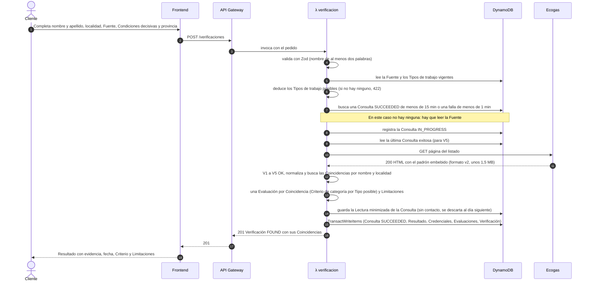
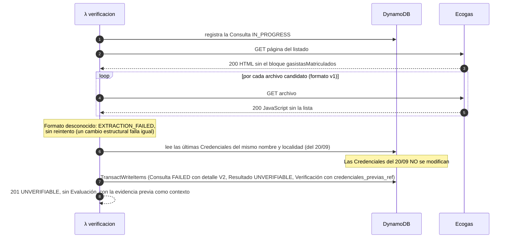
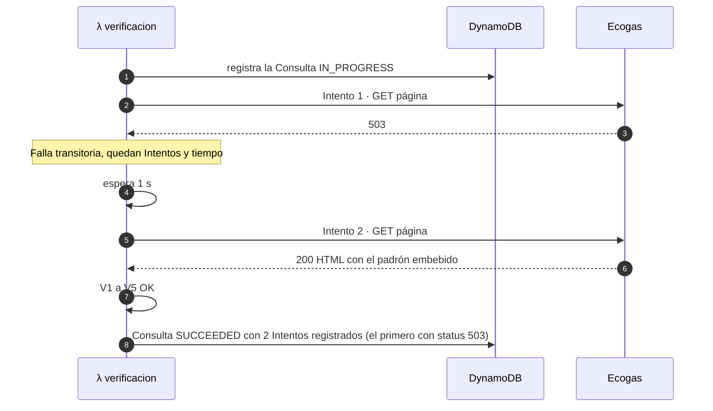
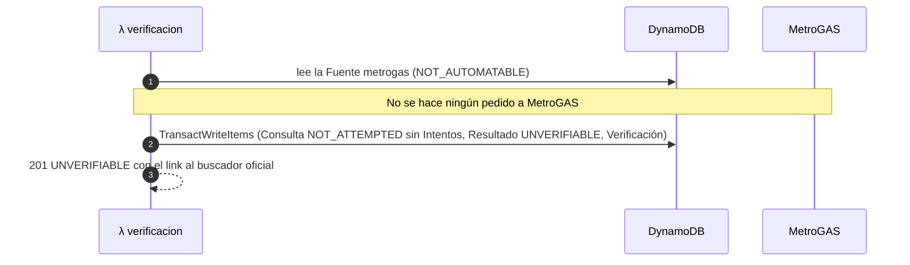
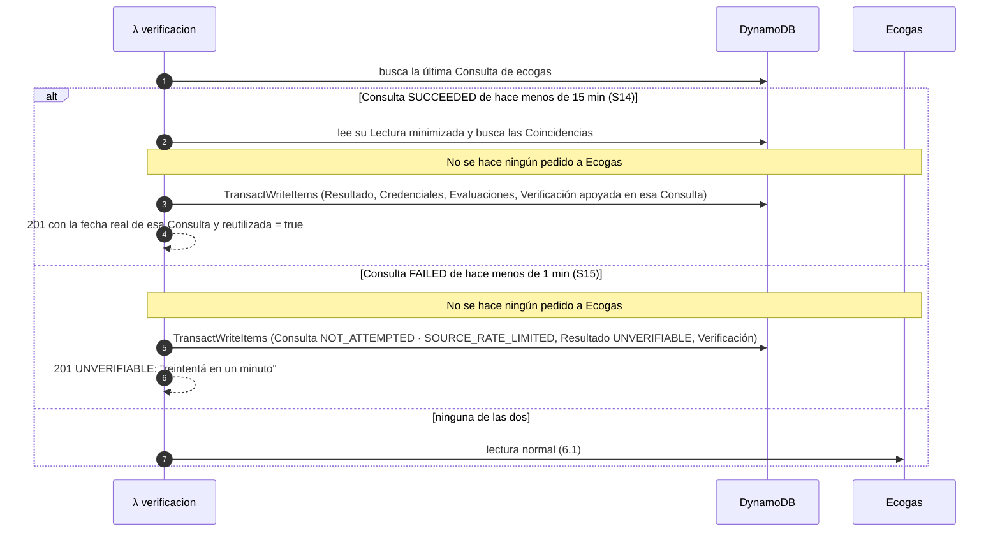

# API

> Documento de diseño · Segunda entrega, corregido según la devolución v3 · Última revisión: 02/11/2026
> Responde al punto 8 de la devolución v2 ("una interfaz mínima o endpoint que permita recorrer el flujo completo"), **a nivel de contrato**. Incorpora de la devolución v3 las Condiciones decisivas, la zona como Limitación ([ADR-0005](adr/0005-zona-como-limitacion-en-el-p0.md)), el nuevo texto de `COMPATIBLE` y la Protección de la Fuente ([ADR-0006](adr/0006-lectura-minimizada-y-proteccion-de-la-fuente.md)). Incorpora el hallazgo del 02/11: el gasista se busca por **nombre y localidad**, porque Ecogas no publica el número de matrícula ([ADR-0007](adr/0007-identificacion-por-nombre-y-localidad.md)).
> Relacionados: [modelo de dominio](modelo-de-dominio.md) · [fuentes y adaptadores](fuentes-y-adaptadores.md) · [base de datos](../database/README.md) · [pantalla del frontend](../frontend/README.md)

## Índice

1. [Convenciones](#1-convenciones)
2. [Endpoints del P0](#2-endpoints-del-p0)
3. [POST /verificaciones](#3-post-verificaciones)
4. [Resto de los endpoints del P0](#4-resto-de-los-endpoints-del-p0)
5. [Errores](#5-errores)
6. [Secuencias](#6-secuencias)
7. [Endpoints de P1 y P2 (resumen)](#7-endpoints-de-p1-y-p2-resumen)

---

## 1. Convenciones

| Tema | Convención |
|---|---|
| Base | `https://<api-id>.execute-api.<región>.amazonaws.com/v1`. En local es la URL que expone LocalStack. `v1` es el *stage* de API Gateway. |
| Formato | JSON en UTF-8. Los nombres de campos en `snake_case`, iguales a los de la base. |
| Fechas | ISO-8601 en UTC con milisegundos. La interfaz las muestra en hora de Argentina. |
| Identificadores | ULID (26 caracteres). |
| Autenticación | **P0: ninguna.** La consulta de un gasista en un padrón público es pública. P1 y P2 usan un token de Cognito en `Authorization: Bearer …`. |
| Límite de uso | Throttling de API Gateway en `POST /verificaciones` (configurable). Si se excede, responde `429`. **Protege a MatriculAR, no a la Fuente.** |
| Protección de la Fuente | Independiente del límite de uso: una Consulta exitosa responde todas las Verificaciones de los 15 minutos siguientes (Ventana de reutilización), y después de una falla se espera un minuto antes de volver a leer la Fuente. Así, por muchos pedidos que lleguen, MatriculAR descarga el padrón de Ecogas como máximo una vez cada 15 minutos mientras funcione ([ADR-0006](adr/0006-lectura-minimizada-y-proteccion-de-la-fuente.md)). |
| Tiempo de respuesta | Una lectura de Ecogas tardó unos 14 s el 02/11/2026. Una Verificación que reutiliza una Consulta responde en menos de un segundo. El límite de 29 s de API Gateway es un punto pendiente ([P-4](fuentes-y-adaptadores.md#9-puntos-pendientes)). |
| CORS | Solo el origen del frontend. |
| Validación | Zod, con esquemas compartidos con el frontend. |

> **Principio clave: una Fuente que falla no es un error HTTP.** Si Ecogas no responde o cambió su formato, `POST /verificaciones` responde **`201 Created`** con una Verificación cuyo `resultado_verificacion` es `UNVERIFIABLE`. Es un resultado del dominio, y el cliente tiene que mostrarlo. Los códigos `4xx` quedan para los errores del pedido y los `5xx` para las fallas del propio MatriculAR.

---

## 2. Endpoints del P0

| Método | Ruta | Para qué | Caso de uso |
|---|---|---|---|
| `POST` | `/verificaciones` | **El recorrido completo:** deduce los Tipos de trabajo posibles, consulta la Fuente (o reutiliza una Consulta reciente), busca al gasista, guarda la evidencia, evalúa y responde. | Verificar |
| `GET` | `/verificaciones/{verificacion_id}` | Volver a ver una Verificación (enlace para compartir). | Consultar |
| `GET` | `/credenciales/{fuente_id}?nombre_apellido=&localidad=` | Historial de evidencia de un gasista, buscado por nombre y localidad: Credenciales y Resultados de verificación. | Consultar historial |
| `GET` | `/fuentes` | Fuentes activas, con modo de acceso, Área de concesión y link al buscador oficial. | Listar |
| `GET` | `/fuentes/{fuente_id}/consultas` | **Salud de la Fuente:** últimas Consultas con estado, motivo, registros, formato del recurso y huella. | Informar fallas |
| `GET` | `/tipos-trabajo` | Tipos de trabajo activos, con condiciones y categorías admitidas, y las cinco Condiciones decisivas con su pregunta para el Cliente. | Listar |
| `GET` | `/categorias` | Catálogo de categorías con su alcance y su cita. | Listar |
| `GET` | `/provincias` | Catálogo de provincias (para el formulario). | Listar |

---

## 3. POST /verificaciones

### 3.1 Pedido

El Cliente **identifica al gasista por nombre y apellido**, y opcionalmente por localidad: el padrón de Ecogas no publica el número de matrícula ([ADR-0007](adr/0007-identificacion-por-nombre-y-localidad.md)). **No elige un Tipo de trabajo**: describe el trabajo respondiendo las cinco Condiciones decisivas, y el sistema deduce qué Tipos de trabajo son posibles ([reglas § 3.5](reglas-de-categoria.md#35-condiciones-decisivas-cómo-se-describe-el-trabajo)).

```json
{
  "fuente_id": "ecogas",
  "gasista": {
    "nombre_apellido": "Persona Ficticia Uno",
    "localidad": "Río Cuarto"
  },
  "condiciones": {
    "comercio_o_industria": "NO",
    "unica_vivienda": "SI",
    "consumo_total_hasta_5m3h": "SI",
    "artefacto_mas_de_50000": "NO",
    "gas_natural_red_baja_presion": "SI"
  },
  "provincia_trabajo": "CORDOBA"
}
```

| Campo | Tipo | Reglas |
|---|---|---|
| `fuente_id` | string | Debe existir y estar activa (`GET /fuentes`). |
| `gasista.nombre_apellido` | string | **Al menos dos palabras** (nombre y apellido), de 2 a 120 caracteres. Se normaliza: mayúsculas, sin tildes, espacios colapsados. |
| `gasista.localidad` | string, opcional | Si viene, la Coincidencia exige la misma localidad (normalizada). Sirve para separar homónimos. |
| `condiciones` | objeto | Las cinco Condiciones decisivas, todas obligatorias, cada una `"SI"`, `"NO"` o `"NO_SE"`. Si las respuestas no dejan ningún Tipo de trabajo posible, se responde `422 WORK_NOT_COVERED` **sin consultar la Fuente**. |
| `provincia_trabajo` | string | Código del catálogo (`GET /provincias`). Se usa para la Limitación de zona, no para el resultado. |

**Coincidencia:** un registro de la Fuente cuyo nombre normalizado contiene **todas las palabras buscadas, en cualquier orden** (y la localidad, si vino). "Persona Uno" encuentra a "PERSONA FICTICIA UNO".

### 3.2 Respuesta `201 Created`

La forma es **siempre la misma**. Los campos que no aplican al resultado vienen en `null` o en una lista vacía.

| Campo | Tipo | Cuándo tiene valor |
|---|---|---|
| `verificacion_id` | string | Siempre. |
| `solicitada_en` | string | Siempre. |
| `pedido` | objeto | Siempre: los datos del pedido, normalizados, con el nombre de la Fuente, el Gasista buscado, las Condiciones decisivas respondidas y la provincia. |
| `tipos_trabajo_posibles` | lista | Siempre: los Tipos de trabajo que dejan abiertos las Condiciones decisivas (`tipo_trabajo_id`, `codigo`, `nombre`, `version`). |
| `resultado_verificacion` | `FOUND` \| `NOT_FOUND` \| `TOO_MANY_MATCHES` \| `UNVERIFIABLE` | Siempre. |
| `mensaje` | string | Siempre: el texto principal para el Cliente. Dice qué sabemos, de dónde y de cuándo. |
| `consulta` | objeto | Siempre: `consulta_id`, `estado`, `motivo_falla`, `detalle_falla`, `iniciada_en`, `finalizada_en`, `cantidad_intentos`, `registros_extraidos`, `formato_recurso`, `huella_recurso` y `reutilizada` (`true` si la Verificación se apoya en una Consulta anterior dentro de la Ventana de reutilización). Las fechas son siempre las **reales de la Consulta**, no las del pedido. |
| `coincidencias` | lista | Solo si es `FOUND`: **de 1 a 10** elementos `{ credencial, evaluacion }`. Si hay más de uno, el Cliente elige con el carné del gasista: **MatriculAR nunca elige**. Vacía en los demás resultados. |
| `coincidencias[].credencial` | objeto | `nombre_informado`, `categoria_informada`, `provincia_informada`, `localidad_informada`, `valores_fuente` (los valores tal como los publicó la Fuente, antes de normalizar, incluido el `id` como **Identificador interno de la Fuente**, nunca como matrícula), `consultada_en`, `fuente`. |
| `coincidencias[].evaluacion` | objeto | `evaluacion_id`, `resultado`, `resultados_por_tipo` (el Criterio de categoría para cada Tipo de trabajo posible, con su fundamento y la versión de la regla), `condiciones_que_resuelven` (las Condiciones decisivas respondidas No sé que cambiarían el resultado; vacía si no hay), `explicacion` y `limitaciones`. |
| `credenciales_previas` | lista | Solo si es `UNVERIFIABLE` y existen Credenciales anteriores del mismo nombre y localidad. Tienen la misma forma que `credencial` y **se muestran como contexto, no como conclusión**. |
| `buscador_oficial` | string \| null | Si es `UNVERIFIABLE`, `NOT_FOUND` o `TOO_MANY_MATCHES`: el link para buscar a mano. |

### 3.3 Ejemplos

**S1: `COMPATIBLE`**

```json
{
  "verificacion_id": "01M3FG90YXY7272A3GE1EMHHVQ",
  "solicitada_en": "2026-09-26T18:40:10.205Z",
  "pedido": {
    "fuente": { "fuente_id": "ecogas", "nombre": "Ecogas" },
    "gasista": { "nombre_apellido": "PERSONA FICTICIA UNO", "localidad": "RIO CUARTO" },
    "condiciones": {
      "comercio_o_industria": "NO",
      "unica_vivienda": "SI",
      "consumo_total_hasta_5m3h": "SI",
      "artefacto_mas_de_50000": "NO",
      "gas_natural_red_baja_presion": "SI"
    },
    "provincia_trabajo": { "codigo": "CORDOBA", "nombre": "Córdoba" }
  },
  "tipos_trabajo_posibles": [
    { "tipo_trabajo_id": "artefacto-vivienda-unifamiliar", "codigo": "A1", "nombre": "Conexión o reemplazo de un artefacto en una vivienda unifamiliar", "version": 1 }
  ],
  "resultado_verificacion": "FOUND",
  "mensaje": "PERSONA FICTICIA UNO (Río Cuarto) figura en el padrón de Ecogas (consulta del 26/09/2026 15:40) con categoría 2ª. La categoría informada es compatible con este tipo de trabajo según la regla aplicada. La vigencia de la matrícula no pudo verificarse.",
  "consulta": {
    "consulta_id": "01M3FG90YX2CPVTY9M7AM85DXW",
    "estado": "SUCCEEDED",
    "motivo_falla": null,
    "detalle_falla": null,
    "iniciada_en": "2026-09-26T18:40:10.205Z",
    "finalizada_en": "2026-09-26T18:40:24.345Z",
    "cantidad_intentos": 1,
    "registros_extraidos": 5031,
    "formato_recurso": "v2",
    "huella_recurso": "adbd…44b6",
    "reutilizada": false
  },
  "coincidencias": [
    {
      "credencial": {
        "fuente": { "fuente_id": "ecogas", "nombre": "Ecogas" },
        "nombre_informado": "PERSONA FICTICIA UNO",
        "categoria_informada": "2",
        "provincia_informada": "CORDOBA",
        "localidad_informada": "RIO CUARTO",
        "valores_fuente": { "id": 1203, "nombre_apellido": "Persona Ficticia Uno", "categoria": { "numero": "2", "nombre": "Categoría 2" }, "provincia": { "nombre": "CORDOBA" }, "localidad": { "nombre": "RIO CUARTO" } },
        "consultada_en": "2026-09-26T18:40:24.345Z"
      },
      "evaluacion": {
        "evaluacion_id": "01M3FG9331HHQC18K52PVWXD4Y",
        "resultado": "COMPATIBLE",
        "resultados_por_tipo": [
          {
            "tipo_trabajo_id": "artefacto-vivienda-unifamiliar",
            "tipo_trabajo_version": 1,
            "resultado": "COMPATIBLE",
            "criterio_categoria": { "resultado": "MET", "categoria_informada": "2", "fundamento": "La categoría 2ª está admitida para este tipo de trabajo (NAG-200, 8.3.1)." },
            "regla_aplicada": { "categorias_admitidas": ["1", "2", "3"], "fundamento": ["…"] }
          }
        ],
        "condiciones_que_resuelven": [],
        "explicacion": "La categoría informada (2ª) es compatible con este tipo de trabajo según la regla aplicada (NAG-200, 8.3.1). La vigencia de la matrícula no pudo verificarse.",
        "limitaciones": [
          "La Fuente no informa la vigencia de la matrícula. Según la NAG-200 la matrícula se renueva todos los años y vence el 31 de marzo; figurar en el padrón no prueba que esté renovada. Para confirmarlo, pedile al gasista su carné con la matrícula actualizada (NAG-200, 8.6.1).",
          "Ecogas no publica el número de matrícula: la identificación es por nombre y localidad. Confirmala con el carné del gasista.",
          "La Fuente no permite determinar si la matrícula habilita a trabajar en Córdoba.",
          "La provincia que publica Ecogas corresponde al domicilio del matriculado, no a la zona donde puede trabajar.",
          "El padrón de Ecogas es una publicación web sin fecha de actualización: esta evidencia refleja lo publicado en el momento de la consulta.",
          "Esta evaluación se basa en lo que respondiste sobre el trabajo: …"
        ]
      }
    }
  ],
  "credenciales_previas": [],
  "buscador_oficial": null
}
```

**S16: dos homónimos** (fragmento). Se buscó "Persona Ficticia Siete" sin localidad, y hay dos registros con ese nombre.

```json
{
  "resultado_verificacion": "FOUND",
  "mensaje": "Hay 2 gasistas que coinciden con «PERSONA FICTICIA SIETE» en el padrón de Ecogas (consulta del 26/09/2026 15:40). Elegí el que corresponde con su carné.",
  "coincidencias": [
    { "credencial": { "nombre_informado": "PERSONA FICTICIA SIETE", "categoria_informada": "2", "localidad_informada": "VILLA MARIA" }, "evaluacion": { "resultado": "COMPATIBLE" } },
    { "credencial": { "nombre_informado": "PERSONA FICTICIA SIETE", "categoria_informada": "3", "localidad_informada": "RIO TERCERO" }, "evaluacion": { "resultado": "COMPATIBLE" } }
  ]
}
```

**S6: `NOT_FOUND`** (se muestran solo los campos que cambian). El pedido llegó a las 15:45, cinco minutos después de S1, así que se apoya en la misma Consulta y el mensaje informa la fecha real de esa lectura.

```json
{
  "resultado_verificacion": "NOT_FOUND",
  "mensaje": "Nadie con el nombre PERSONA FICTICIA CUATRO figura en el padrón de Ecogas según la consulta exitosa del 26/09/2026 15:40. Revisá cómo está escrito el nombre. Esto no dice nada sobre otras distribuidoras.",
  "consulta": { "estado": "SUCCEEDED", "iniciada_en": "2026-09-26T18:40:10.205Z", "registros_extraidos": 5031, "cantidad_intentos": 1, "reutilizada": true },
  "coincidencias": [],
  "credenciales_previas": [],
  "buscador_oficial": "https://www.ecogas.com.ar/hogares-comercios/tramites-y-servicios/listado-de-gasistas-matriculados"
}
```

**S17 (b): `TOO_MANY_MATCHES`** (fragmento)

```json
{
  "resultado_verificacion": "TOO_MANY_MATCHES",
  "mensaje": "Hay más de 10 gasistas que coinciden con «PEREZ JUAN» en el padrón de Ecogas. Agregá la localidad o el nombre completo.",
  "consulta": { "estado": "SUCCEEDED", "reutilizada": true },
  "coincidencias": []
}
```

**S7: `UNVERIFIABLE` porque cambió el recurso** (el camino de error)

```json
{
  "resultado_verificacion": "UNVERIFIABLE",
  "mensaje": "No pudimos consultar el padrón de Ecogas (26/09/2026 15:30): el formato del recurso cambió. No podemos afirmar nada con evidencia de hoy. Última evidencia disponible: figuraba con categoría 2ª según la consulta del 20/09/2026.",
  "consulta": {
    "estado": "FAILED",
    "motivo_falla": "EXTRACTION_FAILED",
    "detalle_falla": { "validacion": "V2", "descripcion": "La página no contiene el bloque gasistasMatriculados y ningún archivo referenciado tiene la lista de registros (formato desconocido)." },
    "cantidad_intentos": 1,
    "registros_extraidos": null
  },
  "coincidencias": [],
  "credenciales_previas": [
    {
      "nombre_informado": "PERSONA FICTICIA UNO",
      "categoria_informada": "2",
      "provincia_informada": "CORDOBA",
      "localidad_informada": "RIO CUARTO",
      "consultada_en": "2026-09-20T13:05:02.140Z"
    }
  ],
  "buscador_oficial": "https://www.ecogas.com.ar/hogares-comercios/tramites-y-servicios/listado-de-gasistas-matriculados"
}
```

**S9: `UNVERIFIABLE` porque MetroGAS no es automatizable**

```json
{
  "resultado_verificacion": "UNVERIFIABLE",
  "mensaje": "MetroGAS no permite consultas automáticas: su buscador exige un captcha. Podés verificar la matrícula manualmente en el buscador oficial.",
  "consulta": { "estado": "NOT_ATTEMPTED", "motivo_falla": "SOURCE_NOT_AUTOMATABLE", "cantidad_intentos": 0 },
  "coincidencias": [],
  "credenciales_previas": [],
  "buscador_oficial": "https://www.metrogas.com.ar/colaboradores/listado-de-gasistas-con-matricula/"
}
```

**S5: trabajo fuera del Área de concesión** (fragmento). La zona no cambia el resultado: es una Limitación.

```json
{
  "resultado_verificacion": "FOUND",
  "coincidencias": [
    {
      "evaluacion": {
        "resultado": "COMPATIBLE",
        "resultados_por_tipo": [
          { "tipo_trabajo_id": "artefacto-vivienda-unifamiliar", "resultado": "COMPATIBLE", "criterio_categoria": { "resultado": "MET", "categoria_informada": "3" } }
        ],
        "condiciones_que_resuelven": [],
        "limitaciones": [
          "La Fuente no informa la vigencia de la matrícula. …",
          "Buenos Aires está fuera del área de concesión de Ecogas; el gasista podría estar registrado en otra distribuidora que MatriculAR no consultó.",
          "…"
        ]
      }
    }
  ]
}
```

**S11: `INDETERMINATE` porque el Cliente respondió No sé** (fragmento). Categoría 3ª y No sé en `unica_vivienda`: el trabajo puede ser A1 o A2.

```json
{
  "tipos_trabajo_posibles": [
    { "tipo_trabajo_id": "artefacto-vivienda-unifamiliar", "codigo": "A1" },
    { "tipo_trabajo_id": "artefacto-vivienda-general", "codigo": "A2" }
  ],
  "resultado_verificacion": "FOUND",
  "mensaje": "PERSONA FICTICIA TRES (Córdoba) figura en el padrón de Ecogas (consulta del 26/09/2026 15:50) con categoría 3ª. No podemos concluir si es compatible: si el terreno tiene una única vivienda, la categoría informada sería compatible; si no, no lo sería.",
  "coincidencias": [
    {
      "evaluacion": {
        "resultado": "INDETERMINATE",
        "resultados_por_tipo": [
          { "tipo_trabajo_id": "artefacto-vivienda-unifamiliar", "resultado": "COMPATIBLE", "criterio_categoria": { "resultado": "MET", "categoria_informada": "3" } },
          { "tipo_trabajo_id": "artefacto-vivienda-general", "resultado": "INCOMPATIBLE", "criterio_categoria": { "resultado": "NOT_MET", "categoria_informada": "3" } }
        ],
        "condiciones_que_resuelven": ["unica_vivienda"]
      }
    }
  ]
}
```

Con la misma respuesta y un gasista de **2ª** (S12), las dos combinaciones dan `COMPATIBLE`, así que el resultado es `COMPATIBLE` y `condiciones_que_resuelven` queda vacía.

**S15: `UNVERIFIABLE` por la Protección de la Fuente** (fragmento). Una lectura de Ecogas falló hace menos de un minuto.

```json
{
  "resultado_verificacion": "UNVERIFIABLE",
  "mensaje": "Ecogas se consultó hace instantes sin éxito; reintentá en un minuto.",
  "consulta": { "estado": "NOT_ATTEMPTED", "motivo_falla": "SOURCE_RATE_LIMITED", "cantidad_intentos": 0, "reutilizada": false },
  "coincidencias": []
}
```

**S13: trabajo no cubierto** (`422`, no se consulta la Fuente)

```json
{ "error": { "codigo": "WORK_NOT_COVERED", "mensaje": "Este tipo de trabajo todavía no está cubierto; MatriculAR solo evalúa conexiones de artefactos en viviendas y comercios con gas natural por red.", "detalles": [] } }
```

**S17 (a): nombre incompleto** (`400`, no se consulta la Fuente)

```json
{ "error": { "codigo": "VALIDATION_ERROR", "mensaje": "Escribí al menos nombre y apellido.", "detalles": [ { "campo": "gasista.nombre_apellido", "problema": "menos de dos palabras" } ] } }
```

Los ítems completos tal como se guardan están en [`database/seed/ejemplos-ficticios/`](../database/seed/ejemplos-ficticios/).

---

## 4. Resto de los endpoints del P0

### GET /verificaciones/{verificacion_id}

Devuelve la misma forma que `POST /verificaciones`. Es **de solo lectura**: no vuelve a consultar la Fuente. La interfaz lo muestra con la fecha original ("Verificación del 26/09/2026 15:40").

- `404` si no existe.

### GET /credenciales/{fuente_id}?nombre_apellido=&localidad=

Historial de todo lo que MatriculAR supo de un gasista, del más reciente al más antiguo. Se identifica por **nombre y localidad normalizados**, no por matrícula ([ADR-0007](adr/0007-identificacion-por-nombre-y-localidad.md)):

```json
{
  "fuente_id": "ecogas",
  "nombre_apellido": "PERSONA FICTICIA UNO",
  "localidad": "RIO CUARTO",
  "resultados": [
    { "determinado_en": "2026-09-26T18:40:24.345Z", "resultado": "FOUND", "consulta_id": "…", "categoria_informada": "2" },
    { "determinado_en": "2026-09-26T18:30:06.950Z", "resultado": "UNVERIFIABLE", "consulta_id": "…", "motivo": "EXTRACTION_FAILED" },
    { "determinado_en": "2026-09-20T13:05:02.140Z", "resultado": "FOUND", "consulta_id": "…", "categoria_informada": "2" }
  ]
}
```

- `nombre_apellido` es obligatorio; `localidad` también, para no mezclar homónimos.
- Paginado con `?limite=` (por defecto 20) y `?cursor=`.
- Un gasista que nunca se consultó devuelve la lista vacía, no un `404`. "No hay historial" es un dato válido.

### GET /fuentes

```json
[
  {
    "fuente_id": "ecogas", "nombre": "Ecogas", "modo_acceso": "AUTOMATED",
    "area_concesion": ["CORDOBA", "CATAMARCA", "LA_RIOJA", "MENDOZA", "SAN_JUAN", "SAN_LUIS"],
    "buscador_oficial": "https://www.ecogas.com.ar/…", "version": 1
  },
  {
    "fuente_id": "metrogas", "nombre": "MetroGAS", "modo_acceso": "NOT_AUTOMATABLE",
    "area_concesion": ["CIUDAD_AUTONOMA_DE_BUENOS_AIRES"],
    "buscador_oficial": "https://www.metrogas.com.ar/colaboradores/listado-de-gasistas-con-matricula/", "version": 1
  }
]
```

La configuración interna (tiempos, umbrales) no se expone.

### GET /fuentes/{fuente_id}/consultas

**Salud de la Fuente**, que cubre el paso "informar" del mecanismo que pidió el tutor. Devuelve las últimas Consultas (por defecto 20) **sin datos de gasistas**:

```json
[
  { "consulta_id": "…", "iniciada_en": "2026-11-02T02:32:12.000Z", "estado": "SUCCEEDED", "registros_extraidos": 4836, "formato_recurso": "v2", "huella_recurso": "…", "cantidad_intentos": 1 },
  { "consulta_id": "…", "iniciada_en": "2026-09-26T18:30:05.120Z", "estado": "FAILED", "motivo_falla": "EXTRACTION_FAILED", "validacion": "V2", "cantidad_intentos": 1 }
]
```

### GET /tipos-trabajo · GET /categorias · GET /provincias

Devuelven la versión vigente de cada ítem, tal como están en [`database/seed/`](../database/seed/), sin los campos internos. `GET /tipos-trabajo` incluye además las cinco Condiciones decisivas (`condicion_id` y pregunta para el Cliente), que el frontend usa para armar el formulario.

---

## 5. Errores

Formato único:

```json
{ "error": { "codigo": "VALIDATION_ERROR", "mensaje": "El campo gasista.nombre_apellido es obligatorio.", "detalles": [ { "campo": "gasista.nombre_apellido", "problema": "requerido" } ] } }
```

| HTTP | `codigo` | Cuándo |
|---|---|---|
| 400 | `VALIDATION_ERROR` | El pedido no cumple el esquema: por ejemplo, el nombre tiene menos de dos palabras, falta una Condición decisiva o tiene un valor distinto de `SI`, `NO` o `NO_SE`. |
| 400 | `SOURCE_INACTIVE` | La Fuente existe, pero no está activa. |
| 404 | `SOURCE_NOT_FOUND` / `VERIFICATION_NOT_FOUND` | El identificador no existe. |
| 422 | `WORK_NOT_COVERED` | Las Condiciones decisivas no dejan ningún Tipo de trabajo posible. **No se consulta la Fuente** y no se crea Verificación. |
| 429 | (API Gateway) | Se excedió el límite de uso de la API. No tiene relación con la Protección de la Fuente, que se informa como `201` con `SOURCE_RATE_LIMITED`. |
| 500 | `INTERNAL_ERROR` | Falla de MatriculAR: por ejemplo, no se pudo escribir en la base. **La Consulta queda registrada** como `IN_PROGRESS` y, al vencer su plazo, se lee como `FAILED` con motivo `INTERRUPTED` (no se le atribuye a la Fuente). |

**Nunca** se responde `5xx` porque la Fuente falló. Eso es `201` con `UNVERIFIABLE`. Lo mismo vale cuando rige la Protección de la Fuente. Y **demasiadas coincidencias no es un error**: es `201` con `TOO_MANY_MATCHES`.

---

## 6. Secuencias

### 6.1 Camino normal (S1)



### 6.2 Camino de error: extracción fallida (S7)

Es el camino que pidió el tutor: *fuente modificada o no disponible → extracción fallida → resultado NO VERIFICABLE, sin borrar ni transformar incorrectamente la última evidencia válida disponible*.



### 6.3 Falla transitoria con reintento exitoso (fixture F13)



### 6.4 Fuente no automatizable (S9)



### 6.5 Ventana de reutilización y Protección de la Fuente (S14 y S15)



Si dos Verificaciones llegan a la vez sin Consulta reciente, las dos podrían leer la Fuente. En el P0 se acepta ese caso raro. Si apareciera en la práctica, se evita con una escritura condicional que reserve la lectura.

---

## 7. Endpoints de P1 y P2 (resumen)

**Fuera del alcance de la entrega final** (ver [módulos](modulos.md)). Se dejan como referencia del diseño. Todos requieren un token de Cognito. Si se implementan, la búsqueda usará las Condiciones decisivas en lugar de `tipo_trabajo_id`, el Profesional se vinculará a su **registro** en la Fuente (no a un número de matrícula, que Ecogas no publica), y el Vínculo `VERIFIED` significa vínculo verificado mediante el email publicado por la Fuente, no titularidad.

| Método | Ruta | Módulo | Para qué |
|---|---|---|---|
| `POST` | `/profesionales` | P1 | Crear el perfil del Profesional autenticado. |
| `GET` / `PATCH` | `/profesionales/yo` | P1 | Ver y editar el perfil propio. |
| `POST` | `/profesionales/yo/vinculos` | P1 | Declarar su registro en una Fuente (`fuente_id`, nombre y localidad). Queda `UNVERIFIED`. |
| `POST` | `/profesionales/yo/vinculos/{vinculo_id}/codigo` | P1 | Enviar el código al email que publica la Fuente en ese registro. |
| `POST` | `/profesionales/yo/vinculos/{vinculo_id}/confirmacion` | P1 | Confirmar el código. Si es correcto, pasa a `VERIFIED`. |
| `PUT` | `/profesionales/yo/zonas` | P1 | Declarar provincias, localidades y tipos de trabajo ofrecidos. |
| `GET` | `/busqueda?tipo_trabajo_id=&provincia=` | P1 | Profesionales con Vínculo verificado que ofrecen ese trabajo en esa provincia, **con una Verificación del momento** (una Consulta por Fuente para todos los candidatos). `?incluir_no_verificados=true` agrega los que tienen el Vínculo sin verificar, marcados como tales. |
| `POST` | `/contrataciones` | P2 | Crear una Contratación. Hace una Verificación nueva: si da `INCOMPATIBLE`, responde `409`. Con `INDETERMINATE`, `NOT_FOUND` o `UNVERIFIABLE`, exige `advertencia_aceptada: true`. |
| `GET` | `/contrataciones?rol=cliente\|profesional` | P2 | Contrataciones propias. |
| `POST` | `/contrataciones/{id}/transiciones` | P2 | `{ "a": "ACCEPTED" \| "COMPLETED" \| "CANCELLED" }`, validado contra la máquina de estados. |
| `POST` | `/contrataciones/{id}/resena` | P2 | Reseña (puntaje de 1 a 5 y comentario). Pasa la Contratación a `RATED`. |
| `GET` | `/profesionales/{id}/resenas` | P2 | Reseñas públicas de un Profesional. |
