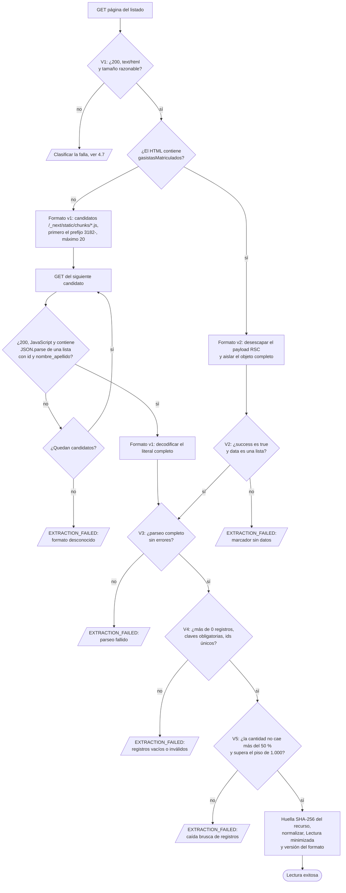

# Fuentes y adaptadores

> Documento de diseño · Segunda entrega, corregido según la devolución v3 · Última revisión: 02/11/2026
> Responde a los puntos 4 ("adaptador Ecogas integrado al backend"), 5 ("persistencia de fuente, fecha y resultado de consulta") y 7 ("manejo controlado del fallo de extracción") de la devolución v2, **a nivel de diseño**. Incorpora el relevamiento del 02/11/2026: Ecogas cambió la forma de publicar el padrón y **no publica el número de matrícula** ([ADR-0007](adr/0007-identificacion-por-nombre-y-localidad.md)).
> Vocabulario: [`CONTEXT.md`](../CONTEXT.md). Modelo: [`modelo-de-dominio.md`](modelo-de-dominio.md). Decisiones: [ADR-0001](adr/0001-sin-colas-reintentos-sincronicos.md), [ADR-0002](adr/0002-consulta-bajo-demanda-sin-copia-del-padron.md), [ADR-0006](adr/0006-lectura-minimizada-y-proteccion-de-la-fuente.md), [ADR-0007](adr/0007-identificacion-por-nombre-y-localidad.md).

## Índice

1. [Qué problema resuelve un adaptador](#1-qué-problema-resuelve-un-adaptador)
2. [El puerto de Fuentes](#2-el-puerto-de-fuentes)
3. [Fuentes del P0](#3-fuentes-del-p0)
4. [Adaptador de Ecogas](#4-adaptador-de-ecogas)
5. [Adaptador de MetroGAS (no automatizable)](#5-adaptador-de-metrogas-no-automatizable)
6. [Cómo se prueba](#6-cómo-se-prueba)
7. [Cómo se agrega una Fuente nueva](#7-cómo-se-agrega-una-fuente-nueva)
8. [Uso responsable de las Fuentes](#8-uso-responsable-de-las-fuentes)
9. [Puntos pendientes](#9-puntos-pendientes)

---

## 1. Qué problema resuelve un adaptador

Cada Distribuidora publica su padrón de una manera distinta. La investigación encontró:

- una página HTML con el padrón embebido (Ecogas desde el 02/11/2026; antes, un archivo JavaScript estático que había que descubrir);
- una API protegida con captcha (MetroGAS);
- un listado HTML paginado por partido (Naturgy BAN, sin evaluar todavía).

Esas fuentes **no tienen contrato**: pueden cambiar de URL, de formato o de orden de campos en cualquier momento. Ecogas lo hizo **tres veces** entre el 04/09 y el 02/11/2026 ([§ 4.1](#41-historial-de-la-fuente)).

El adaptador **aísla** esa variabilidad. El resto del sistema (Consultas, Credenciales, Evaluaciones) no sabe cómo está hecho el sitio de cada Distribuidora. Solo recibe una de dos respuestas:

- **Lectura exitosa:** la Lectura minimizada (todos los registros, crudos y normalizados, sin datos de contacto), más los metadatos de la lectura.
- **Lectura fallida:** un motivo (`SOURCE_UNAVAILABLE` o `EXTRACTION_FAILED`) y el detalle de cada Intento.

**Responsabilidad central** (devolución v2): *si la Fuente cambia su URL, el orden de los campos o la estructura del recurso, MatriculAR no debe interpretar "se encontraron cero matriculados". Debe producir FUENTE NO CONSULTABLE o EXTRACCIÓN FAILED.*

---

## 2. El puerto de Fuentes

El núcleo define **una interfaz** (el *puerto*) y cada mecanismo de publicación tiene **un adaptador** que la implementa. La decisión D4 de la primera entrega se mantiene en su espíritu ("integrar un padrón nuevo es escribir un adaptador, no tocar el pipeline"), pero ahora los adaptadores son **reales**.

| Operación del puerto | Entrada | Salida | Quién la usa |
|---|---|---|---|
| `leer` | Versión de la configuración de la Fuente | **Lectura exitosa:** la **Lectura minimizada** (por cada registro: Identificador interno de la Fuente, nombre, categoría, provincia y localidad, tal como vinieron y normalizados), más los metadatos (URL resuelta, versión del formato del recurso, huella del recurso, cantidad de registros, resumen, Intentos). **Lectura fallida:** motivo, detalle e Intentos. **No realizada:** la Fuente no es automatizable. | Caso de uso *Verificar* (P0), *Revalidar* (P3), *Buscar* (P1) |
| `obtenerContactoParaVinculo` | Configuración de la Fuente y **un** registro | El email que publica la Fuente en ese registro, **en memoria y sin persistir**, o "sin email". | Caso de uso *Verificar Vínculo* (P1, fuera de la entrega final) |

La **búsqueda del Gasista buscado** dentro de la Lectura minimizada no es del adaptador: es del dominio, porque es la misma para cualquier Fuente ([§ 4.5](#45-búsqueda-del-gasista)).

| Adaptador | Mecanismo | Fuentes que lo usan |
|---|---|---|
| `EcogasRecursoNext` | Página HTML de Next.js. Reconoce dos formatos: el padrón embebido en el payload de React Server Components (**versión 2**, desde el 02/11/2026) o un archivo JavaScript referenciado por la página (**versión 1**, hasta el 26/09/2026). | `ecogas` |
| `NoAutomatizable` | No hace ningún pedido; siempre responde "no realizada". | `metrogas` |

Reglas del puerto:

1. **El adaptador nunca devuelve datos de contacto** en `leer`. Email, teléfono y barrio se descartan dentro del adaptador (INV-9).
2. **El adaptador no decide nada del dominio.** No evalúa categorías ni zonas, ni busca gasistas: solo lee, valida y normaliza.
3. **El adaptador no decide cuándo leer.** La Ventana de reutilización y la Protección de la Fuente son del caso de uso: el adaptador solo se invoca cuando hay que leer de verdad ([ADR-0006](adr/0006-lectura-minimizada-y-proteccion-de-la-fuente.md)).
4. **El adaptador no escribe en la base.** Devuelve los Intentos y los metadatos, y es el caso de uso el que los persiste en la Consulta.
5. **Un resultado vacío nunca es "éxito sin registros".** Si no hay registros, es `EXTRACTION_FAILED` (INV-4).
6. **El Identificador interno de la Fuente nunca se presenta como matrícula** (INV-16).

---

## 3. Fuentes del P0

La configuración de cada Fuente es un **dato versionado** (tabla `Fuentes`, cargada desde [`database/seed/fuentes.json`](../database/seed/fuentes.json)). Cambiar un parámetro, como el umbral o los tiempos, no requiere tocar código.

| Parámetro | `ecogas` | `metrogas` |
|---|---|---|
| Distribuidora | Ecogas (Distribuidora de Gas del Centro y Distribuidora de Gas Cuyana) | MetroGAS |
| Área de concesión | Córdoba, Catamarca, La Rioja, Mendoza, San Juan, San Luis | CABA y parte del conurbano (no interviene en Evaluaciones) |
| Modo de acceso | `AUTOMATED` | `NOT_AUTOMATABLE` |
| Adaptador | `EcogasRecursoNext` | `NoAutomatizable` |
| URL de la página | `https://www.ecogas.com.ar/hogares-comercios/tramites-y-servicios/listado-de-gasistas-matriculados` | — |
| URL del buscador oficial (para el Cliente) | la misma | `https://www.metrogas.com.ar/colaboradores/listado-de-gasistas-con-matricula/` |
| Prefijo de archivo preferido (solo formato v1) | `3182-` | — |
| Claves obligatorias del registro | `id`, `nombre_apellido`, `categoria`, `provincia`, `localidad` (en v2, `categoria.numero`, `provincia.nombre` y `localidad.nombre`) | — |
| Claves conocidas (se leen y se descartan) | `correo_electronico`, `telefono`, `barrio` | — |
| Máximo de Intentos | 3 | — |
| Esperas entre Intentos | 1 s y 2 s | — |
| Tiempo máximo por pedido HTTP | **20 s** (era 6 s; la página tardó 13,6 s el 02/11) | — |
| Tiempo máximo de la Consulta | **45 s** (era 24 s) | — |
| Umbral de caída de registros | 50 % | — |
| Piso absoluto de registros | 1.000 | — |
| Ventana de reutilización / espera tras una falla | 15 min / 1 min | — |
| Limitaciones que agrega | Vigencia no informada; **no publica el número de matrícula**; provincia informada = domicilio; fuente web no contractual | Fuente no consultable automáticamente (captcha) |

---

## 4. Adaptador de Ecogas

### 4.1 Historial de la Fuente

Todos los relevamientos se hicieron con pedidos mínimos y **sin guardar datos personales**: solo conteos, tamaños, nombres de claves y huellas.

| Fecha | Qué encontramos | Consecuencia |
|---|---|---|
| 04/09/2026 | Prueba técnica: un archivo `3182-ad3160686a0b7005.js` con la lista. 4.512 registros. | Primer prototipo (investigación, Python). |
| 26/09/2026 | La URL de la prueba devolvía **404** con una página HTML, el orden de las claves había cambiado y el archivo era otro (`3182-5194f519f6f9f5b0.js`, 1,1 MB). 5.031 registros. | Validaciones V1–V5 y descubrimiento del recurso desde el HTML (errata E9). |
| **02/11/2026** | **Los datos ya no están en un archivo JavaScript**: vienen **dentro del HTML** de la página. Cambió la forma de los registros, el `id` resultó ser un **identificador interno** y la página tardó 13,6 s. 4.836 registros. | Formato v2 del recurso ([§ 4.2](#42-el-recurso-hoy-formato-v2)), identificación por nombre ([ADR-0007](adr/0007-identificacion-por-nombre-y-localidad.md), errata E12) y tiempos nuevos. |

**Relevamiento del 02/11/2026** (script [`scripts/probar-ecogas.sh`](../scripts/probar-ecogas.sh) y análisis local de la página descargada, fuera del repositorio):

| Hecho | Detalle |
|---|---|
| Identificación | La página respondió **HTTP 200** a un `User-Agent` identificado (`MatriculAR/0.1 (proyecto final UTN; contacto: …)`), **desde una IP residencial**. Ecogas no bloqueó a un cliente que se identifica honestamente. |
| **Desde una IP de nube** | Con el **mismo** `User-Agent`, desde un runner de GitHub Actions (Azure, 40.80.212.128), la página respondió **HTTP 403**, con 118 bytes y en 0,4 s ([workflow](../.github/workflows/probar-ecogas.yml), ejecución del 02/11/2026 03:27 UTC). Un rechazo inmediato y mínimo como ese es típico de un firewall de aplicación que filtra IPs de datacenter. Se temía que AWS también estuviera bloqueado (P-2). |
| **Desde AWS** (10/11/2026) | Con el mismo `User-Agent`, la función Lambda desplegada en **`us-east-2`** leyó la página completa: **HTTP 200**, formato v2, **4.836 registros**, en unos **1,5 s**. **AWS no está bloqueado** (P-2 resuelto). |
| Página | **1.514.746 bytes**, descargada en **13,6 s**. Referencia 15 archivos `/_next/static/chunks/*.js`, y **ninguno** contiene el padrón. |
| Dónde están los datos | Embebidos en el HTML, dentro del payload de **React Server Components** (`self.__next_f.push`), como un string con las comillas escapadas (`\"`). El bloque es `gasistasMatriculados: { success, message, data: [...] }`. |
| Forma del registro | `id` **numérico**; `nombre_apellido`; `categoria: { numero, nombre }` (por ejemplo `"1"` y `"Categoría 1"`); `provincia: { nombre }`; `localidad: { nombre }`; `barrio` (`null`); `correo_electronico`; `telefono`. |
| El `id` no es la matrícula | Los 4.836 `id` son **1, 2, 3… 4836**, consecutivos y sin huecos: una numeración interna de la publicación. **Ninguna clave contiene el número de matrícula.** El buscador oficial filtra por provincia, localidad, categoría y nombre y apellido, nunca por matrícula. |
| Registros | **4.836** (−3,9 % respecto del 26/09). |
| Categorías | 1ª: 1.575 · 2ª: 2.164 · 3ª: 1.097 |
| Provincias | Córdoba 3.141 · Mendoza 1.189 · San Luis 227 · San Juan 209 · Catamarca 37 · La Rioja 33 |
| Homónimos | **12 nombres repetidos** (24 registros). **4** de ellos repiten también la localidad. |
| Fechas | Ninguna, igual que antes. |

### 4.2 El recurso hoy (formato v2)

El adaptador pide **solo la página**: en el formato v2 el padrón viene en el mismo HTML, así que una lectura es **un solo pedido**.

1. **Localizar el bloque.** Se busca la clave `gasistasMatriculados` dentro de los fragmentos `self.__next_f.push([1, "…"])` del HTML.
2. **Desescapar.** Cada fragmento es un string de JavaScript: se decodifica completo (comillas `\"`, `\\`, `\uNNNN`) antes de parsear. Igual que en el formato v1, **no se parsea registro por registro**, porque ese método perdía registros con tildes o Ñ sin avisar.
3. **Parsear con Zod** el objeto `{ success, message, data }` y cada registro de `data`.
4. **Validar** (V1 a V5, [§ 4.4](#44-las-cinco-validaciones)).
5. **Normalizar** y armar la Lectura minimizada, descartando email, teléfono y barrio.

**Formato v1 (hasta el 26/09/2026).** La página referenciaba un archivo `/_next/static/chunks/3182-*.js` con la lista como un literal `JSON.parse('[{"id":"…`, con escapes `\xNN`, `\\` y `\'`. El archivo de la página (`page-*.js`) también mencionaba `"nombre_apellido"`, pero como definición de columnas, sin datos. El adaptador **conserva** la lectura de este formato: si Ecogas volviera a él, o publicara una mezcla, el adaptador lo reconoce.

### 4.3 Algoritmo de lectura

Cada **Intento** ejecuta la secuencia completa. El adaptador **detecta qué formato encuentra**; si no reconoce ninguno, es `EXTRACTION_FAILED`, **nunca** "0 matriculados".

Detalles:

- **La versión del formato queda registrada** en la Consulta (`formato_recurso`: `v1` o `v2`). Si Ecogas cambia de formato, el historial de Consultas lo muestra.
- **La huella** se calcula sobre el contenido que tiene los datos: el HTML completo en v2 y el archivo en v1.
- **Formato v1, candidatos.** El prefijo preferido (`3182-`) es solo una optimización. Si cambia, el adaptador recorre los demás candidatos sin fallar.

### 4.4 Las cinco validaciones

Una lectura es exitosa **solo si pasan las cinco**. Si falla cualquiera, la Consulta es `FAILED` con motivo `EXTRACTION_FAILED`, y se guarda **cuál** validación falló y por qué.

| # | Validación | Qué evita | Evidencia real |
|---|---|---|---|
| **V1** | La respuesta es **200**, el tipo de contenido es el esperado (HTML para la página, JavaScript para un archivo v1) y el tamaño es razonable. | Tomar una página de error como si fuera el recurso. | El 26/09 la URL vieja devolvía 404 con cuerpo HTML. |
| **V2** | Aparece el **marcador** de los datos: en v2, `gasistasMatriculados` con `success: true` y `data` como lista; en v1, el `JSON.parse` de una lista con `id` y `nombre_apellido`. | Tomar algo que menciona los nombres de las claves pero no tiene datos. | En v1, el archivo de la página contenía `"nombre_apellido"` como columna. |
| **V3** | El bloque **completo** se desescapa y se parsea sin errores. | Extracciones parciales silenciosas. | Parsear fragmento por fragmento perdía 342 registros (26/09). |
| **V4** | Hay **más de 0 registros**, todos tienen las **claves obligatorias** (con la forma del formato detectado), los `id` son **únicos** y no vacíos. | "0 matriculados" y cambios de estructura, como una clave renombrada o convertida en objeto. | El 26/09 cambió el orden de las claves; el 02/11 `categoria`, `provincia` y `localidad` pasaron a ser objetos. |
| **V5** | La cantidad **no cae más de un 50 %** respecto de la última Consulta exitosa de la Fuente y **supera el piso absoluto** de 1.000 registros. | Extracciones truncadas o un recurso reemplazado por otro más chico. | 4.512 → 5.031 → 4.836: variaciones de menos del 12 %. |

Controles adicionales, que **no hacen fallar** la lectura y quedan registrados en la Consulta:

- **Claves no esperadas:** si aparece una clave nueva (por ejemplo, un campo de vigencia o de matrícula), se registra en `claves_no_esperadas` para revisarla. Podría cambiar las reglas.
- **Resumen:** conteo de registros por categoría y por provincia. No contiene datos personales y permite detectar cambios de estructura.

### 4.5 Búsqueda del gasista

Como la Fuente **no publica la matrícula**, el Cliente busca por **nombre y apellido** (al menos dos palabras) y, si quiere, por **localidad** ([ADR-0007](adr/0007-identificacion-por-nombre-y-localidad.md)). La búsqueda la hace el dominio sobre la Lectura minimizada:

- Se normalizan el texto buscado y los nombres de la Fuente: mayúsculas, sin tildes y con los espacios colapsados.
- Una **Coincidencia** es un registro cuyo nombre contiene **todas las palabras buscadas**, en cualquier orden. Si el Cliente indicó la localidad, la localidad normalizada también tiene que coincidir.
- **De 1 a 10 Coincidencias:** `FOUND`, con una Credencial y una Evaluación por cada una. El Cliente elige con el carné del gasista; MatriculAR nunca elige.
- **Ninguna:** `NOT_FOUND`. **Más de 10:** `TOO_MANY_MATCHES`, sin Credenciales, pidiendo la localidad o el nombre completo.

El **Identificador interno de la Fuente** (`id`) se conserva en `valores_fuente`, pero **no se usa para buscar ni para identificar**: es una numeración de la publicación y puede cambiar.

### 4.6 Normalización

| Campo de la Fuente (v2) | Campo de la Credencial | Transformación |
|---|---|---|
| `id` | — (solo en `valores_fuente`, como Identificador interno de la Fuente) | No se normaliza ni se muestra como matrícula (INV-16). |
| `nombre_apellido` | `nombre_informado` | Espacios colapsados y en mayúsculas. **Se guarda** para que el Cliente pueda confirmar que la Credencial corresponde a la persona que tiene enfrente, y para buscar. |
| `categoria.numero` (v1: `categoria`) | `categoria_informada` | Texto tal como viene (`"1"`, `"2"`, `"3"`). **No se convierte a número** (INV-7). Si no está en el catálogo, el Criterio de categoría es `INDETERMINATE`. |
| `provincia.nombre` (v1: `provincia`) | `provincia_informada` | Mayúsculas, sin tildes, y se mapea al catálogo de provincias. Se muestra como "provincia informada por la Fuente". |
| `localidad.nombre` (v1: `localidad`) | `localidad_informada` | Mayúsculas, sin tildes, espacios colapsados. |
| `correo_electronico` | — | **Se descarta** en el adaptador. Solo `obtenerContactoParaVinculo` lo lee, en memoria (P1). |
| `telefono` | — | **Se descarta.** |
| `barrio` | — | **Se descarta.** |

Además de la versión normalizada, cada registro de la Lectura minimizada y cada Credencial conservan **`valores_fuente`**: los campos `id`, `nombre_apellido`, `categoria`, `provincia` y `localidad` **tal como vinieron de la Fuente** (en v2, con su forma de objeto), antes de normalizar. Así se puede reconstruir exactamente qué dato leyó el adaptador sin guardar el padrón ni datos de contacto (devolución v3). Si la normalización tuviera un error, el valor original sigue disponible.

### 4.7 Clasificación de fallas y reintentos

Mecanismo acordado con el tutor: **registrar el intento → detectar el error → reintentar → conservar el estado del fallo → informar**, sin colas ([ADR-0001](adr/0001-sin-colas-reintentos-sincronicos.md)).

| Situación | Motivo | ¿Se reintenta? | Por qué |
|---|---|---|---|
| Error de red, DNS o conexión rechazada | `SOURCE_UNAVAILABLE` | **Sí** | Transitorio. |
| Tiempo agotado de un pedido (más de 20 s) | `SOURCE_UNAVAILABLE` | **Sí**, si queda presupuesto | Transitorio. |
| HTTP 5xx | `SOURCE_UNAVAILABLE` | **Sí** | Falla del servidor, usualmente transitoria. |
| HTTP 429 (demasiados pedidos) | `SOURCE_UNAVAILABLE` | **Sí**, respetando `Retry-After` si entra en el presupuesto de tiempo | Transitorio, pero indica que conviene espaciar. |
| HTTP 403 (bloqueo por detección de bots) | `SOURCE_UNAVAILABLE` | **No** | Reintentar insistiría contra una protección. |
| HTTP 404 o 410 de la página del listado | `EXTRACTION_FAILED` | **No** | La página cambió de dirección: es un cambio estructural. |
| Formato desconocido (ni v2 ni v1) | `EXTRACTION_FAILED` | **No** | Cambio estructural: fallaría igual en cada Intento. |
| Falla V2, V3, V4 o V5 | `EXTRACTION_FAILED` | **No** | Ídem. |
| Se agota el tiempo total de la Consulta (45 s) | `SOURCE_UNAVAILABLE` | **No quedan Intentos** | Se respeta el tiempo máximo de la función (ver P-4). |

Política de Intentos: **hasta 3**, con esperas de **1 s** antes del segundo y **2 s** antes del tercero. Un Intento solo arranca si queda en el presupuesto **al menos el tiempo máximo de un pedido** (`timeout_pedido_ms`, 20 s), y cada pedido usa como límite el menor entre 20 s y el tiempo que quede. En el peor caso (tiempos agotados): 20 s + 1 s + 20 s = 41 s; quedan 4 s y **el tercer Intento no arranca**. En la práctica, con una página que tarda unos 14 s, entran dos Intentos.

### 4.8 Qué se registra

Todo queda en la **Consulta** (ver [`database/README.md`](../database/README.md#consultas)):

| Nivel | Qué se guarda |
|---|---|
| Consulta | Fuente y **versión de su configuración**, origen (Verificación, revalidación o búsqueda), `iniciada_en`, `finalizada_en`, estado, motivo, detalle de la falla (qué validación y qué se esperaba), URL resuelta del recurso, **formato del recurso** (`v1` o `v2`), **huella SHA-256 del recurso**, bytes, registros extraídos, resumen por categoría y provincia, claves no esperadas. |
| Intento | Número, `iniciado_en`, duración, resultado (éxito o motivo), si se reintentó, y la lista de **pedidos HTTP**. |
| Pedido HTTP | URL, método, código de estado, tipo de contenido, bytes, duración y error de red, si lo hubo. **Nunca el cuerpo de la respuesta.** |
| Lectura minimizada | Solo si la Consulta es `SUCCEEDED`: los registros sin datos de contacto, crudos y normalizados. Responde las Verificaciones de los 15 minutos siguientes y **se descarta al día siguiente**. |
| Resultado de verificación | Uno por cada Verificación que se apoyó en la Consulta: `FOUND` (con sus Coincidencias), `NOT_FOUND`, `TOO_MANY_MATCHES` o `UNVERIFIABLE`. |

La **huella del recurso** (el hash SHA-256 del contenido descargado) permite **reconocer** si dos Consultas leyeron el mismo contenido o si el recurso cambió. **No permite reconstruir el recurso** si desapareció: un hash no se puede revertir. Por eso cada Credencial conserva además sus `valores_fuente`, tal como los publicó la Fuente.

**La Consulta se registra en estado `IN_PROGRESS` antes del primer pedido**, así el intento queda asentado aunque la función se interrumpa. Una Consulta que sigue `IN_PROGRESS` después de su plazo máximo se interpreta como `FAILED` con motivo `INTERRUPTED`: es una falla de MatriculAR (por ejemplo, la base no respondió), no de la Fuente, y no cuenta en la salud de la Fuente.

### 4.9 Qué pasa con la evidencia anterior cuando falla una lectura

Una lectura fallida **no toca** ninguna Credencial existente (INV-1). La Verificación responde `UNVERIFIABLE` y adjunta las últimas Credenciales disponibles **del mismo nombre y localidad**, **con su fecha**, como contexto, **sin usarlas para concluir** (ver [modelo § 5](modelo-de-dominio.md#5-not_found-frente-a-unverifiable)).

---

## 5. Adaptador de MetroGAS (no automatizable)

| Hecho | Evidencia |
|---|---|
| El buscador público consulta un endpoint JSON (`…/rankingnoauth/all`) que devuelve el padrón completo de CABA. | Investigación, § 3. |
| Cada pedido exige un token de **reCAPTCHA** válido. | Prueba del 04/09/2026: sin token y con un token inválido → `401 RECAPTCHA-NOT-VALID`. |
| Resolver o evitar el captcha **no corresponde**: es una protección activa cuyo propósito es impedir consultas automáticas. | Decisión del equipo, validada por el tutor. |

Por eso el adaptador `NoAutomatizable`:

1. **no hace ningún pedido** a MetroGAS;
2. responde "no realizada": la Consulta queda `NOT_ATTEMPTED`, sin Intentos, y el Resultado de verificación es `UNVERIFIABLE`;
3. aporta la URL del **buscador oficial** para que el Cliente verifique a mano.

MetroGAS se modela como Fuente, en lugar de omitirla, por dos razones: el Cliente puede preguntar por ella, y el sistema tiene que poder decir *"no pudimos consultar"* en vez de *"no está"*. Si MetroGAS ofreciera algún día un acceso para terceros, se cambia el adaptador de la Fuente con una nueva versión de su configuración.

---

## 6. Cómo se prueba

Las pruebas del adaptador **no dependen de Ecogas**: usan **fixtures** (archivos de prueba) derivados de la estructura real, con **datos ficticios**. Una prueba de humo aparte, manual y opcional, verifica contra la fuente real.

| Fixture | Qué simula | Resultado esperado |
|---|---|---|
| F1 | **Formato v2** correcto (estructura del 02/11/2026: payload RSC con `gasistasMatriculados`) | Lectura exitosa, `formato_recurso: v2` |
| F2 | **Formato v1** correcto (estructura del 26/09/2026: archivo con `JSON.parse`) | Lectura exitosa, `formato_recurso: v1` |
| F3 | v2 con **tildes y Ñ** escapadas | Lectura exitosa, sin perder registros |
| F4 | v1 con el recurso en **otro prefijo** (no `3182-`) | Lectura exitosa, recorriendo candidatos |
| F5 | **Formato desconocido**: la página no tiene `gasistasMatriculados` y ningún archivo tiene el `JSON.parse` | `EXTRACTION_FAILED` (formato desconocido), nunca "0 matriculados" |
| F6 | La página del listado devuelve **404 con HTML** | `EXTRACTION_FAILED` (V1), sin reintento |
| F7 | v2 con `success: false` o sin `data` | `EXTRACTION_FAILED` (V2) |
| F8 | v2 con el payload **truncado** | `EXTRACTION_FAILED` (V3) |
| F9 | v2 con `data` **vacía** | `EXTRACTION_FAILED` (V4) |
| F10 | v2 con registros **sin `categoria`** o con `categoria` como texto en vez de objeto | `EXTRACTION_FAILED` (V4) |
| F11 | v2 con el 40 % de los registros de la Consulta anterior | `EXTRACTION_FAILED` (V5) |
| F12 | Tiempo agotado en todos los Intentos posibles | `SOURCE_UNAVAILABLE`, Intentos registrados |
| F13 | 503 y después 200; o 403 | Lectura exitosa en el Intento 2; con 403, `SOURCE_UNAVAILABLE` sin reintento |
| F14 | v2 con una **categoría desconocida** (`"4"`) y una clave nueva (`matricula`) | Lectura exitosa: la categoría llega tal cual (el dominio da `INDETERMINATE`) y la clave queda en `claves_no_esperadas` |

Además, se prueba que **ninguna** salida de `leer` contenga email, teléfono ni barrio (INV-9), y que el `id` nunca aparezca como matrícula (INV-16).

**Cómo se arman los fixtures.** El recurso real trae emails y teléfonos de miles de personas, así que **nunca entra al repositorio**. Los fixtures son sintéticos: copian la estructura exacta de cada formato (v2: los fragmentos `self.__next_f.push` con el bloque `gasistasMatriculados` escapado; v1: las etiquetas `<script src>` y el `JSON.parse('[{"id":…`) con nombres ficticios ("PERSONA FICTICIA UNO"…) y localidades reales. Un script (`scripts/anonimizar-fixture`) toma el recurso real y reemplaza los datos, para regenerarlos si Ecogas cambia. La prueba contra la Ecogas real se corre solo a mano (`npm run test:fuente-real`) y nunca en CI.

**Casos que pidió la devolución v3**, y qué prueba los demuestra:

| Caso | Fixtures o tests |
|---|---|
| Cambio de URL o de estructura | F2 → F1 (cambio real del 26/09 al 02/11), F4, F5, F6 |
| Extracción incompleta | F7, F8, F9, F10, F11 |
| Categoría desconocida | F14, S10 del [modelo](modelo-de-dominio.md#9-escenarios), test del dominio |
| Incertidumbre de zona | S4 y S5 del modelo, test del dominio (Limitación de zona) |

---

## 7. Cómo se agrega una Fuente nueva

1. **Investigar** la Fuente con el método de la investigación: dónde publica, qué protege, qué campos expone y qué no. **Verificar qué significa cada campo** antes de usarlo: el `id` de Ecogas se tomó como matrícula sin comprobarlo (errata E12).
2. **Decidir el modo de acceso.** Si hay captcha o una protección activa, es `NOT_AUTOMATABLE` y no hace falta programar nada.
3. Si es automatizable y el mecanismo es nuevo, **escribir un adaptador** que implemente el puerto, con sus propias validaciones y fixtures.
4. **Cargar la configuración** como una nueva Fuente en `database/seed/fuentes.json`, con su Área de concesión y sus Limitaciones.
5. **Documentar** los hallazgos en este archivo.

Candidatas para fases posteriores (sin evaluar todavía): Naturgy BAN (listado HTML por partido, con columna "Org Emisor de Matricula"), Litoral Gas y Camuzzi.

---

## 8. Uso responsable de las Fuentes

- **Formulación prudente** (devolución v2): Ecogas *"resultó técnicamente accesible en las condiciones ensayadas"* (04/09, 26/09 y 02/11/2026). Es una **fuente web no contractual** cuya URL y estructura pueden cambiar. Eso no determina las condiciones permitidas para una explotación periódica, que **se consultaron a Ecogas** ([`consulta-a-ecogas.md`](consulta-a-ecogas.md)).
- **Identificación honesta**: desde el 02/11/2026 todas las pruebas se identifican con un `User-Agent` propio y un contacto. La prueba técnica de septiembre simulaba un navegador; eso no se repite.
- **Una descarga por Consulta**, sin pedidos en paralelo contra la misma Fuente.
- **Protección de la Fuente** (devolución v3, [ADR-0006](adr/0006-lectura-minimizada-y-proteccion-de-la-fuente.md)): MatriculAR no amplifica consultas anónimas contra un tercero. Una Consulta exitosa responde todas las Verificaciones de los **15 minutos** siguientes (Ventana de reutilización), así que Ecogas recibe como máximo una descarga cada 15 minutos mientras funcione. Después de una falla se espera **1 minuto** antes de volver a leer; mientras tanto, la Consulta queda `NOT_ATTEMPTED` con motivo `SOURCE_RATE_LIMITED`. Toda respuesta informa la fecha real de la Consulta. Los dos valores son configuración de la Fuente y se ajustan cuando Ecogas responda la consulta.
- **El límite de uso de la API** (throttling de API Gateway) protege a MatriculAR. **No** es la protección de la Fuente.
- **El padrón completo no se guarda** ([ADR-0002](adr/0002-consulta-bajo-demanda-sin-copia-del-padron.md), modificado por el [ADR-0006](adr/0006-lectura-minimizada-y-proteccion-de-la-fuente.md)): se procesa en memoria. Se persisten la Lectura minimizada (sin contacto, se descarta al día siguiente), las Credenciales de los gasistas verificados y los metadatos de la Consulta.
- **Los datos de contacto nunca se persisten** (INV-9).
- **MetroGAS no se consulta automáticamente** y el captcha no se intenta resolver ni evitar.

---

## 9. Puntos pendientes

| # | Punto | Qué falta | Mientras tanto |
|---|---|---|---|
| P-1 | **Cómo se identifica el adaptador ante Ecogas.** La prueba técnica envió un `User-Agent` de navegador. | La respuesta de Ecogas sobre las condiciones de uso (pregunta 5, enviada con la frecuencia y el origen concretos). | El adaptador se identifica con un `User-Agent` propio de MatriculAR y un contacto. **El 02/11/2026 Ecogas respondió 200 a ese `User-Agent`** desde una IP residencial. Si algún día lo bloquea, la Consulta da `SOURCE_UNAVAILABLE` (403) y el sistema sigue siendo coherente. |
| P-2 | ~~**Pedidos desde IPs de nube.**~~ El 02/11, Ecogas respondió **403** a un runner de GitHub Actions (Azure) y **200** a una IP residencial, con el mismo `User-Agent` identificado. | **Resuelto el 10/11/2026:** desde AWS (`us-east-2`) Ecogas responde 200 y la función lee el padrón completo ([§ 4.1](#41-historial-de-la-fuente)). Sigue pendiente pedir a Ecogas autorización explícita para el acceso automatizado ([consulta](consulta-a-ecogas.md), pregunta 5). | MatriculAR **no intenta eludir ningún bloqueo**: nada de User-Agent de navegador ni proxies residenciales. Si Ecogas bloqueara a AWS, la Consulta queda `FAILED` con `SOURCE_UNAVAILABLE` (403, sin reintento) y la respuesta es `UNVERIFIABLE`. |
| P-3 | ~~Reutilizar el recurso descargado para Verificaciones casi simultáneas.~~ | **Resuelto** por el [ADR-0006](adr/0006-lectura-minimizada-y-proteccion-de-la-fuente.md): Ventana de reutilización de 15 minutos con Lectura minimizada. | — |
| P-4 | **El tiempo de la Consulta (45 s) supera el límite por defecto de API Gateway REST (29 s).** La página tardó 13,6 s el 02/11. | **Decisión del 02/11:** la integración queda en **29 s** (`timeout_integracion_ms` del módulo [`infra/modulos/api`](../infra/modulos/api/main.tf)) y la función en 60 s. Un pedido que tarda más de 29 s recibe un `504` de API Gateway, pero **la función sigue y registra la Consulta**, y el siguiente pedido la reutiliza dentro de la Ventana de reutilización. Si en AWS pasa seguido, se pide el aumento de la cuota de integración de la cuenta (las API REST regionales lo permiten) y se sube la variable. **En AWS, el 10/11/2026 la lectura tardó unos 1,5 s**, muy por debajo del límite. | En LocalStack no hay límite de 29 s. Si hiciera falta respetarlo estrictamente, el presupuesto de la Consulta es configuración y se puede bajar a 27 s (un Intento de 20 s, sin reintento completo). |
| P-5 | **Ecogas no publica el número de matrícula** ([ADR-0007](adr/0007-identificacion-por-nombre-y-localidad.md)). | La respuesta a la pregunta 6 de la [consulta](consulta-a-ecogas.md). | Identificación por nombre y localidad, con su Limitación. |
