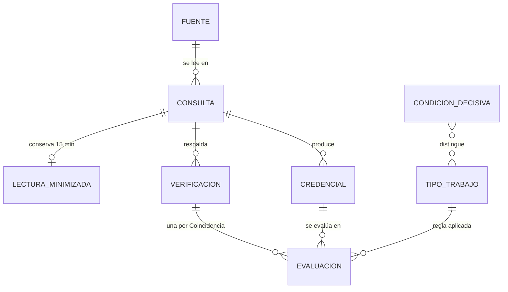
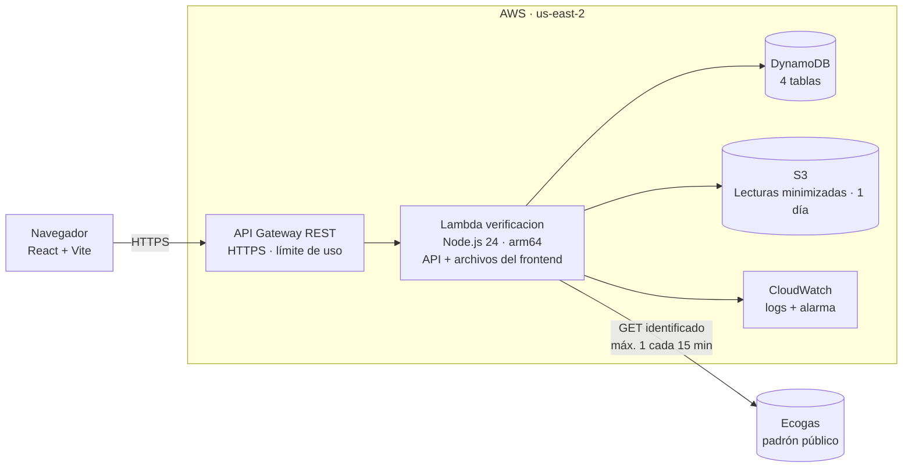
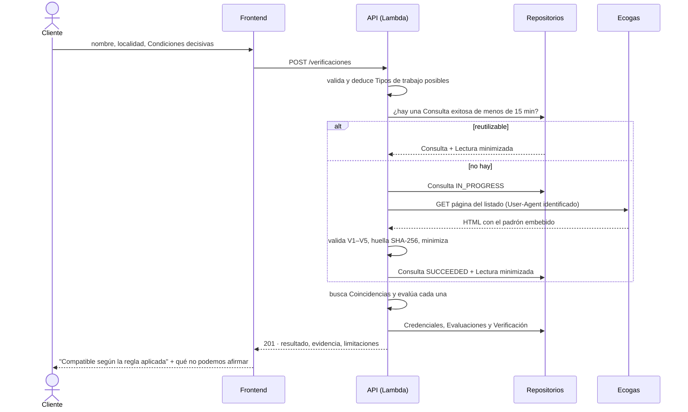
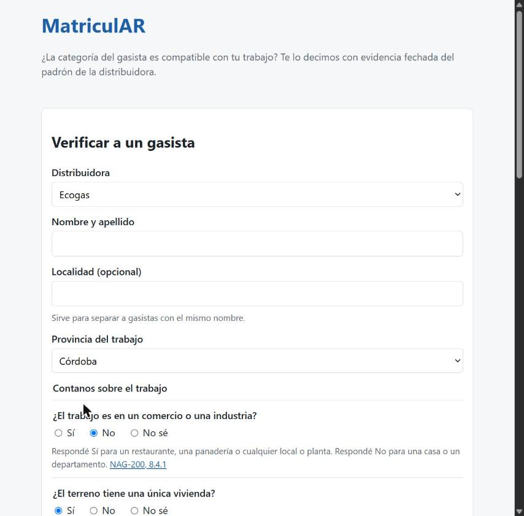
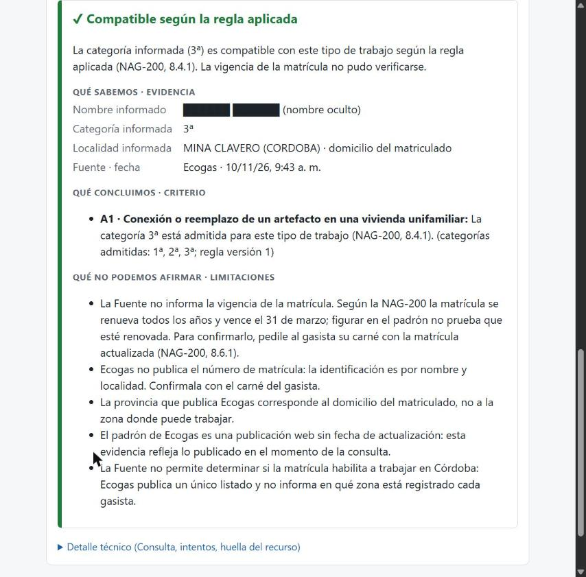
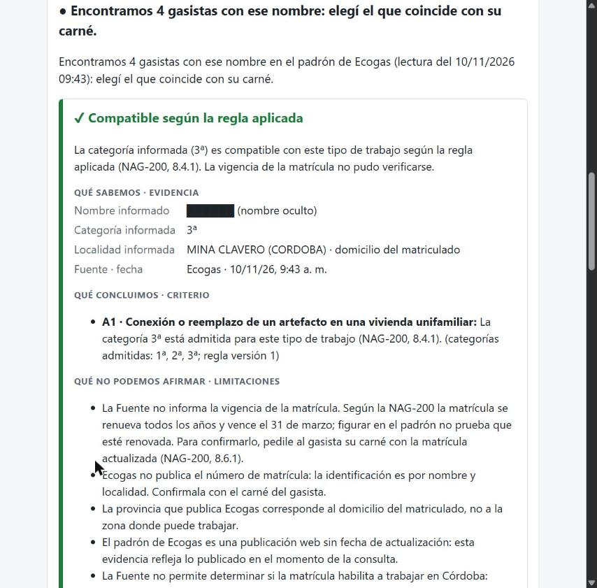

<div class="portada">

<p class="institucion">Universidad Tecnológica Nacional<br/>Tecnicatura Universitaria en Programación</p>

<p class="materia">Proyecto Final</p>

# MatriculAR

<p class="subtitulo">Verificación de la categoría de gasistas matriculados con evidencia fechada y citable</p>

<p class="informe">Informe Final</p>

| | |
|---|---|
| **Grupo** | 209 |
| **Integrantes** | Iván Daniliuk · Nicolás Gabriel Demiryi |
| **Tutor** | Oscar |
| **Año** | 2026 |
| **Sistema en línea** | [https://b2u5pup2gd.execute-api.us-east-2.amazonaws.com/v1/](https://b2u5pup2gd.execute-api.us-east-2.amazonaws.com/v1/) |
| **Repositorio** | [https://github.com/IvanDaniliuk01/MatriculAR](https://github.com/IvanDaniliuk01/MatriculAR) |
| **Video de presentación** | [https://youtu.be/TYZmj-MVu3k](https://youtu.be/TYZmj-MVu3k) |

</div>

## Índice

1. [Problema y contexto](#1-problema-y-contexto)
2. [Objetivos y alcance](#2-objetivos-y-alcance)
3. [Análisis y modelo](#3-análisis-y-modelo)
4. [Arquitectura y tecnologías](#4-arquitectura-y-tecnologías)
5. [Implementación](#5-implementación)
6. [Pruebas y validación](#6-pruebas-y-validación)
7. [Resultados y conclusiones](#7-resultados-y-conclusiones)
8. [Limitaciones y trabajo futuro](#8-limitaciones-y-trabajo-futuro)
9. [Organización del trabajo](#9-organización-del-trabajo)
10. [Referencias](#10-referencias)

---

## 1. Problema y contexto

### 1.1 Situación que dio origen al proyecto

En Argentina, cualquier trabajo sobre una instalación interna de gas tiene que hacerlo un **instalador matriculado**. Las matrículas no las otorga un organismo único: las otorga cada **distribuidora** en su zona (Ecogas, MetroGAS, Naturgy BAN, Camuzzi, Litoral Gas), bajo las normas técnicas que fija el ente regulador (ENARGAS, hoy ENRGE). Cada distribuidora publica su padrón a su manera: una página web con el listado (Ecogas), un buscador protegido con captcha (MetroGAS), un listado por partido (Naturgy BAN).

Además, la matrícula **no es una sola cosa**. La norma NAG-200 (capítulo VIII) define tres categorías con alcances distintos: la 3ª solo puede trabajar en viviendas unifamiliares de bajo consumo, la 2ª amplía a otras viviendas y la 1ª es la única habilitada, por ejemplo, para un comercio con un artefacto de más de 50.000 kcal/h. "Tiene matrícula" no alcanza: la pregunta real es **si tiene la categoría para este trabajo**.

Quien contrata a un gasista hoy tiene que: averiguar qué distribuidora corresponde a su zona, encontrar el buscador, interpretar la categoría que figura y leer la NAG-200 para saber si esa categoría alcanza. Ninguno de los buscadores oficiales explica qué trabajos habilita cada categoría ni informa si la matrícula está vigente.

### 1.2 Usuarios y actores

| Actor | Rol en el problema | En el sistema entregado |
|---|---|---|
| **Cliente** | Persona, administración de consorcio o comercio que necesita contratar a un gasista y quiere saber si puede hacer el trabajo. | Usuario de la pantalla de verificación. No necesita cuenta. |
| **Gasista** | Instalador matriculado por una distribuidora, con una categoría. | Aparece como **Credencial** leída del padrón público. El perfil del profesional quedó fuera del alcance (fase 2). |
| **Distribuidora** | Otorga la matrícula y publica el padrón. | Es la **Fuente** de la evidencia. En esta entrega, Ecogas (automatizable) y MetroGAS (no automatizable: solo se muestra el enlace a su buscador). |
| **Ente regulador** | Fija la norma técnica (NAG-200) que define qué habilita cada categoría. | Sus normas son la base de las reglas, con cita por artículo. |
| **Equipo MatriculAR** | Mantiene las reglas y la configuración de las Fuentes. | Las reglas viven versionadas en `database/seed/`. |

### 1.3 Evidencia que respalda el problema

El problema se validó con **evidencia pública y verificable**. No se realizaron entrevistas ni encuestas a usuarios: eso se declara como limitación (§ 8). La investigación completa, con 26 fuentes fechadas, está en el archivo [`investigacion/evidencia-del-problema.md`](../investigacion/evidencia-del-problema.md) del repositorio. Lo principal:

- **El riesgo es real, medido y en aumento.** Según el Boletín Epidemiológico Nacional (BEN) del Ministerio de Salud, entre 2019 y 2025 se notificaron **9.693 eventos** de intoxicación o exposición a monóxido de carbono y **55 fallecidos**; entre los casos con fuente informada, las estufas a gas fueron el 32,1 % y las cocinas, anafes u hornos el 15,8 % (BEN N° 802, 07/04/2026). En 2026 hubo **608 casos hasta la semana 24, contra una mediana de 356** para el mismo período: "por encima de lo esperado" (BEN N° 814, 29/06/2026). En la región Cuyo, zona de Ecogas, el índice epidémico acumulado hasta la semana 17 fue de **4,9** (Mendoza 4,3; San Luis 4,7) (BEN N° 808, 18/05/2026).
- **Las autoridades exigen un matriculado.** El mismo BEN reproduce la recomendación del ENARGAS: las instalaciones "siempre deben ser realizadas por un gasista matriculado". Lo repiten el ENARGAS en sus páginas de seguridad, MetroGAS (gacetilla del 21/05/2026) y Ecogas en su campaña 2026.
- **Hay casos judiciales con instaladores sin matrícula.** La explosión de la Escuela 49 de Moreno (2018, dos muertos) terminó con el gasista condenado a 5 años; los funcionarios lo habían designado "a pesar de su falta de matrícula habilitante" (Ministerio Público de la Provincia de Buenos Aires, 19/10/2023). En la zona de Ecogas: una explosión en la Ciudad de Mendoza en 2022 con una víctima fatal, causada por alguien que "no era gasista matriculado" (Diario UNO, 26/03/2023), y cuatro muertes por CO en Godoy Cruz en 2007 (Sitio Andino, 12/06/2012).
- **Verificar es difícil.** El ENARGAS respondió en 2022 que "no cuenta con un registro de gasistas matriculados". La base unificada nacional creada por la Res. 219/2022 fue derogada por la **Res. ENARGAS 21/2025** (Boletín Oficial, 16/01/2025). Los buscadores de Ecogas, MetroGAS y Naturgy, revisados el 10/11/2026, **no explican qué trabajos habilita cada categoría ni informan vigencia**, y el de Ecogas no muestra el número de matrícula.

**Qué no está respaldado y por eso no se afirma:** ninguna estadística oficial registra quién hizo la instalación, así que no se puede decir qué proporción de los accidentes se debe a gasistas sin matrícula. Tampoco se encontraron casos públicos de "categoría insuficiente": ese punto se sostiene con la norma (NAG-200), no con noticias. Y hay casos con gasistas matriculados que también terminaron mal (Bariloche 2020, Rosario 2013), lo que muestra que **la matrícula es necesaria pero no suficiente**. Por eso MatriculAR informa evidencia y limitaciones, y nunca emite una garantía.

### 1.4 Necesidad concreta

> No existe una herramienta que informe, con evidencia fechada y trazable, si la categoría de un gasista que figura en el padrón de una distribuidora es compatible con un trabajo concreto, distinguiendo lo que se sabe de lo que no se puede verificar.

---

## 2. Objetivos y alcance

### 2.1 Objetivo general

Construir un sistema que, a partir del nombre de un gasista y de la descripción de un trabajo, consulte el padrón público de la distribuidora y responda **qué sabemos, de qué fuente, cuándo lo consultamos, qué podemos concluir y qué no podemos afirmar**.

### 2.2 Objetivos específicos

1. Leer el padrón real de Ecogas de forma robusta: detectar cambios de estructura y no confundir nunca una falla de lectura con "no está matriculado".
2. Traducir la NAG-200 a reglas versionadas, cada una con su cita, y aplicarlas sin pedirle al Cliente que conozca la norma.
3. Conservar la evidencia de cada consulta (fecha, intentos, huella del recurso leído) de forma inmutable.
4. Declarar explícitamente las limitaciones: vigencia, zona y número de matrícula.
5. Desplegar el sistema en la nube con infraestructura como código.

### 2.3 Alcance implementado

El diseño original tenía cuatro módulos priorizados (P0 a P3). Tras la devolución de la segunda entrega, el alcance de la entrega final se recortó **al P0, el núcleo de verificación**, que se entrega completo:

| Implementado y probado | Detalle |
|---|---|
| Verificación de un gasista | Búsqueda por nombre y localidad, Coincidencias (incluidos homónimos), Credencial y Evaluación por Tipo de trabajo. |
| Condiciones decisivas | Cinco preguntas Sí / No / No sé que deducen el Tipo de trabajo, con su cita. |
| Adaptador real de Ecogas | Lectura del formato actual y del anterior, cinco validaciones, reintentos, clasificación de fallas. |
| MetroGAS como Fuente no automatizable | No se consulta; se informa `NOT_ATTEMPTED` y el enlace al buscador oficial. |
| Ventana de reutilización y Protección de la Fuente | Una lectura cada 15 minutos como máximo; espera de 1 minuto después de una falla. |
| Evidencia persistente | Consultas, Credenciales, Verificaciones y Evaluaciones en DynamoDB; Lecturas minimizadas en S3, que se borran al día siguiente. |
| API REST | Diez rutas (verificaciones, catálogos, salud de la Fuente, historial de un gasista). |
| Frontend | Una pantalla React: formulario y resultado con evidencia, criterio y limitaciones. |
| Despliegue en AWS | Terraform, región `us-east-2`, con alarma de fallas y alerta de presupuesto. |
| Ejecución local | CLI (`npm run verificar`) y servidor local (`npm run servir`). |

### 2.4 Lo que quedó fuera y por qué

| Recortado | Motivo |
|---|---|
| **P1 · Perfil de profesionales y búsqueda** | La devolución v3 pidió priorizar el recorrido vertical del núcleo. Además, Ecogas no publica el número de matrícula, lo que obliga a rediseñar el Vínculo entre un profesional y su registro (ADR-0007). |
| **P2 · Contratación y reseñas** | Depende de P1 y de autenticación (Cognito). |
| **P3 · Revalidación diaria y notificaciones** | Depende de P1. Además, automatizar lecturas periódicas requiere la conformidad de Ecogas (consulta pendiente). |
| **Otras distribuidoras** | MetroGAS tiene captcha y no se elude. Las demás requieren investigación propia de sus fuentes. |
| **LocalStack** | Quedó configurado (docker-compose y Terraform del entorno local), pero no se llegó a ejecutar; la integración se probó directamente en AWS. |

---

## 3. Análisis y modelo

### 3.1 Principales entidades

El vocabulario del dominio está fijado en un glosario (`CONTEXT.md`) que se usa igual en el código, la API y la documentación. Las entidades del P0:

| Entidad | Qué representa |
|---|---|
| **Fuente** | El padrón público de una distribuidora, con su modo de acceso (`AUTOMATED` o `NOT_AUTOMATABLE`). |
| **Consulta** | Una lectura de la Fuente en un momento dado: estado (`SUCCEEDED`, `FAILED`, `NOT_ATTEMPTED`), motivo de falla, Intentos, cantidad de registros, formato del recurso y **huella SHA-256** del contenido leído. |
| **Lectura minimizada** | Lo que se conserva de una Consulta exitosa para reutilizarla 15 minutos: solo los campos que forman una Credencial, sin datos de contacto. Vence al día siguiente. |
| **Credencial** | Evidencia de que un gasista figura en la Fuente según una Consulta: nombre, categoría, provincia y localidad, tal como se publicaron y normalizados. No tiene estado de aptitud. |
| **Verificación** | El pedido de un Cliente: Gasista buscado, Condiciones decisivas, provincia del trabajo, la Consulta en la que se apoya y su resultado (`FOUND`, `NOT_FOUND`, `TOO_MANY_MATCHES`, `UNVERIFIABLE`). |
| **Evaluación** | La aplicación de las reglas de cada Tipo de trabajo posible a una Credencial: `COMPATIBLE`, `INCOMPATIBLE` o `INDETERMINATE`, con el resultado del Criterio de categoría, su fundamento y las Limitaciones. |
| **Tipo de trabajo** | Un trabajo documentado (A1, A2, B) con sus **Categorías admitidas** y la cita normativa de cada una. |
| **Condición decisiva** | Pregunta sobre el trabajo, respondida Sí, No o No sé, que distingue un Tipo de trabajo de otro. |



<p class="pie">Figura 1. Entidades del P0 y sus relaciones.</p>

### 3.2 Reglas de negocio relevantes

1. **La ausencia de evidencia no se convierte en certeza.** Si la Fuente no se pudo leer, el resultado es `UNVERIFIABLE`, nunca "no encontrado". Si hay una Credencial anterior, se muestra con su fecha como "última evidencia disponible", pero **no se usa para concluir**.
2. **El Cliente no elige el Tipo de trabajo: responde Condiciones decisivas.** Con las respuestas se deducen los Tipos de trabajo posibles. Un **No sé nunca se toma como Sí**: deja abiertos todos los Tipos compatibles con las demás respuestas.
3. **Resultado con No sé.** Si quedan varios Tipos posibles: `COMPATIBLE` si todos admiten la categoría, `INCOMPATIBLE` si ninguno, `INDETERMINATE` si algunos sí y otros no. En ese caso, la respuesta dice **qué dato lo resolvería**.
4. **Trabajo no cubierto.** Si las respuestas dejan algún escenario sin regla documentada (por ejemplo, gas envasado), la Verificación se rechaza con `WORK_NOT_COVERED` **antes** de descargar el padrón.
5. **Categoría desconocida.** Si la Fuente publica una categoría que no está en el catálogo, el Criterio es `INDETERMINATE`: nunca un sí ni un no.
6. **Homónimos.** Si hay varias Coincidencias, se muestran todas, cada una con su Evaluación, y se pide elegir con el carné del gasista: **MatriculAR nunca elige**. Con más de 10 coincidencias se pide precisar la búsqueda (`TOO_MANY_MATCHES`).
7. **La zona y la vigencia no son Criterios, son Limitaciones.** La Fuente no informa ninguna de las dos, así que se declaran en cada Evaluación y no participan del resultado (ADR-0003, ADR-0005).
8. **La evidencia es inmutable.** Cada registro se escribe una sola vez (escritura condicional); una falla nunca pisa evidencia anterior, y una Evaluación conserva la versión de la regla que aplicó.

Las reglas de categoría vigentes, todas con cita a la NAG-200:

| Tipo de trabajo | Cuándo aplica | Categorías admitidas |
|---|---|---|
| **A1** · Conexión o reemplazo de un artefacto en una vivienda unifamiliar | No es comercio ni industria; única vivienda en el terreno; consumo total hasta 5 m³/h; ningún artefacto de más de 50.000 kcal/h; gas natural por red, baja presión | 1ª, 2ª y 3ª (NAG-200, 8.2.1, 8.3.1 y 8.4.1) |
| **A2** · Conexión o reemplazo de un artefacto en otras viviendas | No es comercio; departamento o casa con consumo mayor a 5 m³/h; resto igual a A1 | 1ª y 2ª |
| **B** · Comercio con un artefacto de alto consumo | Comercio o industria con algún artefacto de más de 50.000 kcal/h, gas natural por red | Solo 1ª |

### 3.3 Decisiones de modelado importantes

Las decisiones difíciles de revertir quedaron registradas como ADR (Architecture Decision Records) en `docs/adr/`:

| ADR | Decisión | Por qué |
|---|---|---|
| 0001 | Sin colas: reintentos sincrónicos. | El tutor pidió primero el mecanismo más simple que permita registrar, reintentar e informar. Las condiciones que justificarían colas quedaron escritas. |
| 0002 y 0006 | Consulta bajo demanda, sin copia del padrón; Lectura minimizada de 1 día y Protección de la Fuente. | No mantener una base propia de datos personales y no amplificar pedidos contra Ecogas. |
| 0003 | Credencial separada de Evaluación, y la vigencia nunca se afirma. | Una misma Credencial puede ser compatible con un trabajo y no con otro. Ninguna Fuente publica la vigencia. |
| 0004 | Una tabla de DynamoDB por entidad. | Patrones de acceso simples y legibles para un equipo que aprende DynamoDB. |
| 0005 | La zona es una Limitación, no un Criterio. | Ecogas publica un único listado y no informa en qué distribuidora está registrado cada gasista. |
| 0007 | Identificación por nombre y localidad. | Ecogas **no publica el número de matrícula** (hallazgo del 02/11/2026): su campo `id` es una numeración interna (1, 2, 3… 4.836). |

---

## 4. Arquitectura y tecnologías

### 4.1 Arquitectura final

El sistema es **serverless en AWS** y, por dentro, sigue una **arquitectura hexagonal** (puertos y adaptadores): un dominio puro en el centro, los casos de uso alrededor y adaptadores para HTTP, DynamoDB, S3 y cada Fuente.



<p class="pie">Figura 2. Componentes desplegados.</p>

| Componente | Responsabilidad |
|---|---|
| **Frontend (React + Vite)** | Formulario con las Condiciones decisivas que da la API y presentación del resultado: evidencia, criterio, qué lo resolvería y limitaciones. |
| **API Gateway REST** | Único punto de entrada, con HTTPS. Una ruta explícita por endpoint de la API (el contrato se ve en el código) y límite de uso propio en `POST /verificaciones` (5 pedidos por segundo, ráfaga de 10). |
| **Lambda `verificacion`** | Valida el pedido, ejecuta el caso de uso *Verificar* y los catálogos, y **sirve el build del frontend** en la raíz de la API. |
| **DynamoDB** | Evidencia: Consultas, Credenciales, Verificaciones y Evaluaciones. Facturación bajo demanda, recuperación a un punto en el tiempo y protección contra borrado. |
| **S3** | Lecturas minimizadas, con una regla de ciclo de vida que las borra al día siguiente. |
| **CloudWatch** | Logs estructurados en JSON (14 días) y una alarma si la Fuente falla 3 veces o más en 15 minutos. |

Dentro de la función, las capas respetan una regla: **las dependencias apuntan hacia el dominio**. El dominio no conoce AWS, HTTP ni Ecogas. Eso permitió desarrollar primero el recorrido completo en local, con repositorios en memoria y en archivo, y después agregar DynamoDB y S3 **sin cambiar los casos de uso**.

### 4.2 Tecnologías y por qué

| Capa | Tecnología | Por qué | Alternativa descartada |
|---|---|---|---|
| Lenguaje | **TypeScript 7** | Mismo lenguaje en frontend y backend; el dominio es un conjunto de estados enumerados, donde un error de tipos es un error de interpretación. | Python (el de la investigación inicial): dos lenguajes y sin tipos compartidos. |
| Runtime | **Node.js 24** (`nodejs24.x`) | Versión LTS soportada por Lambda durante toda la vida del proyecto. | Node 22: se depreca en 2027. |
| Frontend | **React 19 + Vite 8** | Una pantalla con un resultado rico; React ya estaba declarado y Vite da un entorno rápido. | Plantillas del lado del servidor: no hay servidor. |
| Validación | **Zod** | Valida los pedidos de la API y cada registro de la Fuente. | Validación manual: se duplica y diverge. |
| Base de datos | **DynamoDB** | Pocos patrones de acceso, conocidos; evidencia inmutable leída por clave y fecha, sin *joins*; nativa del modelo serverless. | PostgreSQL/RDS: requiere un servidor y rompe el modelo. |
| Infraestructura | **Terraform** | Todo como código: el entorno se recrea con un comando. | CDK o SAM: Terraform ya estaba declarado y es agnóstico del proveedor. |
| Pruebas | **Vitest** | Rápido, nativo para TypeScript y ESM. | Jest: configuración extra. |
| Lint y formato | **Biome** | Una sola herramienta que no depende de la API de TypeScript 7. | ESLint + typescript-eslint: todavía no funciona con TypeScript 7.0. |
| Empaquetado | **esbuild** | Un único archivo por función con el AWS SDK incluido (1,2 MB). | `tsc` solo: no genera un paquete por función. |
| Nube | **AWS** (plan gratuito) | Ejercitar la arquitectura serverless, objetivo del proyecto desde la primera entrega; costo esperado nulo. | PaaS (Render, Railway): no ejercita esa arquitectura. |

**Integraciones.** La única integración externa es la **Fuente de Ecogas**: el adaptador descarga la página pública del listado y extrae el padrón embebido en el HTML. MetroGAS se modela como Fuente no automatizable: el sistema no le hace pedidos y solo muestra el enlace a su buscador.

### 4.3 Dos decisiones del despliegue

- **La API sirve el frontend.** El sitio web estático de S3 solo sirve HTTP, y los navegadores actuales lo bloquean o lo advierten como inseguro. En lugar de sumar CloudFront, la misma función devuelve los archivos del build de React en la raíz de la API, que ya tiene HTTPS. Resultado: **un único enlace seguro**, y la página llama a la API desde el mismo origen. Las rutas de la API tienen prioridad sobre el comodín de los archivos, y un archivo fuera del build nunca se sirve (está probado).
- **Región `us-east-2`.** La cuenta del plan gratuito de AWS con "Projects" aplica una política de la organización que **solo permite crear recursos en la región elegida para el proyecto**. El primer intento, en `us-east-1`, fue rechazado al crear las tablas, los buckets y la API; se comprobó la región permitida creando y borrando una tabla de prueba.

### 4.4 Seguridad y consideraciones relevantes

| Tema | Medida |
|---|---|
| **Autenticación y autorización** | El P0 consulta un padrón público y no tiene cuentas: la API es pública y de solo consulta. La autenticación (Cognito) está diseñada para P1 y P2. |
| **Mínimo privilegio** | El rol de la función solo puede `GetItem`, `PutItem`, `Query`, `BatchGetItem` y `ConditionCheckItem` sobre sus tablas, y leer y escribir en el prefijo `lecturas/` del bucket. **No puede borrar ni modificar** registros. |
| **Inmutabilidad y concurrencia** | Todas las escrituras son condicionales (`attribute_not_exists`): dos pedidos simultáneos no pueden pisar la misma evidencia, y repetir un paso es idempotente. |
| **Validación de entradas** | Todo pedido se valida con Zod antes de llegar al caso de uso; el nombre se normaliza y se exige nombre y apellido. |
| **Límite de uso** | Throttling de API Gateway: protege a MatriculAR de abusos. |
| **Protección de la Fuente** | Independiente del límite de uso: como máximo una descarga del padrón cada 15 minutos y una espera de 1 minuto después de una falla. MatriculAR no amplifica pedidos contra Ecogas. |
| **Identificación honesta** | El adaptador se identifica con un `User-Agent` propio (`MatriculAR/0.1 (proyecto final UTN; contacto: …)`). No se eluden bloqueos ni captchas: nada de `User-Agent` de navegador ni proxies. |
| **Datos personales** | Nunca se guardan el email, el teléfono ni el barrio que publica la Fuente, ni una copia permanente del padrón. La Lectura minimizada se borra al día siguiente. El repositorio no contiene datos reales del padrón: las pruebas usan fixtures con personas ficticias. |
| **Secretos** | El P0 no tiene secretos de aplicación. Las credenciales de AWS son temporales (`aws login`) y viven en la máquina del operador, nunca en el repositorio. |
| **Costos** | Alerta de presupuesto de USD 5 creada por el mismo Terraform. |

---

## 5. Implementación

### 5.1 Principales módulos

```
backend/
├── compartido/src/
│   ├── dominio/        busqueda · clasificacion · condiciones · evaluacion · reglas
│   ├── aplicacion/     verificar (caso de uso)
│   ├── puertos/        lector de Fuente · repositorios · reloj
│   └── adaptadores/    fuentes/ecogas · dynamodb · archivo · memoria · http
└── verificacion/src/
    ├── handlers/       api (Lambda) · rutas · dto · sitio (frontend)
    ├── cli.ts          npm run verificar
    └── servidor-local  npm run servir
frontend/src/           pantallas/Verificar · componentes · api/cliente
infra/                  módulos tablas · lecturas · funcion · api · observabilidad
database/               esquema de las tablas y seed de reglas
```

| Módulo | Qué hace |
|---|---|
| `dominio/clasificacion` | Deduce los Tipos de trabajo posibles a partir de las Condiciones decisivas; detecta trabajos no cubiertos. |
| `dominio/evaluacion` | Aplica el Criterio de categoría a cada Tipo posible, arma el resultado global y las Limitaciones. |
| `dominio/busqueda` | Normaliza nombres (mayúsculas, tildes, Ñ) y encuentra Coincidencias por palabras completas. |
| `adaptadores/fuentes/ecogas` | Descarga la página, detecta el formato, desescapa el payload, valida (V1 a V5), calcula la huella y descarta los datos de contacto. |
| `aplicacion/verificar` | Orquesta: valida, clasifica, decide si reutiliza una Consulta o si rige la Protección de la Fuente, lee, busca, evalúa y guarda. |
| `adaptadores/dynamodb` | Repositorios sobre DynamoDB y S3, con escrituras condicionales. |
| `handlers/rutas` y `dto` | Traducen HTTP ↔ caso de uso con la forma de `docs/api.md`. Una falla de la Fuente responde `201` con `UNVERIFIABLE`, nunca un error 5xx. |

### 5.2 Recorrido principal: verificar a un gasista



<p class="pie">Figura 3. Secuencia de una Verificación.</p>

Otros recorridos que el sistema resuelve:

- **Homónimos:** devuelve todas las Coincidencias, cada una con su Evaluación, y pide elegir con el carné.
- **Condiciones con No sé:** si la respuesta depende del dato que falta, el resultado es `INDETERMINATE` y la pantalla muestra qué pregunta lo resolvería.
- **Fuente caída o con otra estructura:** `UNVERIFIABLE`, con el motivo y la última evidencia disponible marcada como "no se usa para concluir".
- **Salud de la Fuente:** `GET /fuentes/ecogas/consultas` lista las últimas lecturas con estado, cantidad de registros y huella.

### 5.3 Capturas del sistema en línea

Tomadas del sistema en línea el 10/11/2026.



<p class="pie">Figura 4. Formulario con las Condiciones decisivas, cada una con su ayuda y su cita a la NAG-200.</p>



<p class="pie">Figura 5. Resultado "Compatible según la regla aplicada" para un gasista de 3ª en una vivienda unifamiliar, con la evidencia, el criterio y las limitaciones. Los nombres de gasistas reales están ocultos.</p>



<p class="pie">Figura 6. Búsqueda con homónimos ("Encontramos 4 gasistas con ese nombre"), con la primera Coincidencia expandida: cada una tiene su propia Evaluación. Los nombres de gasistas reales están ocultos.</p>

### 5.4 Dificultades técnicas y cómo se resolvieron

| Dificultad | Cómo se resolvió |
|---|---|
| **Ecogas cambió la forma de publicar el padrón dos veces.** En septiembre el archivo con la lista cambió de nombre y de orden de claves; el 02/11/2026 los datos dejaron de estar en un archivo JavaScript y pasaron a venir **embebidos en el HTML** de la página. | El adaptador **descubre** el recurso en lugar de usar una URL fija, reconoce los dos formatos y aplica **cinco validaciones**. Cualquier formato desconocido es `EXTRACTION_FAILED` → `UNVERIFIABLE`, nunca "0 matriculados". El formato leído queda registrado en cada Consulta. |
| **Ecogas no publica el número de matrícula.** El campo `id` parecía la matrícula, pero son números consecutivos del 1 al 4.836. | Identificación por **nombre y localidad**, con manejo explícito de homónimos y una Limitación que lo declara (ADR-0007). Se corrigió la documentación anterior (errata E12). |
| **Bloqueo desde la nube.** El 02/11/2026, desde GitHub Actions (Azure), Ecogas respondió **403** con el mismo `User-Agent` que desde una IP residencial recibía 200. | No se intentó eludir. Se diseñó el resultado `UNVERIFIABLE` para ese caso y se planteó al tutor. Al desplegar se comprobó que **desde AWS Ecogas sí responde**: la Lambda leyó el padrón completo (4.836 registros) en unos 1,5 s. |
| **La lectura puede tardar más de lo que admite API Gateway.** El 02/11 la página tardó 13,6 s desde una conexión residencial, y el presupuesto de reintentos es de 45 s, contra 29 s de API Gateway. | La función tiene 60 s y **termina de registrar la Consulta** aunque API Gateway corte a los 29 s; el pedido siguiente la reutiliza dentro de la Ventana de reutilización. |
| **Restricción de región del plan gratuito.** | Diagnóstico con la documentación de AWS sobre las políticas de los proyectos y una prueba controlada; despliegue en `us-east-2`. |
| **HTTP del sitio web de S3.** | La API sirve el frontend con HTTPS (§ 4.3). |
| **Parsear el padrón registro por registro perdía datos.** En septiembre, ese método perdió 342 registros con tildes o Ñ sin avisar. | Se decodifica el bloque **completo** y se valida (V3). Hay pruebas específicas de tildes y Ñ. |

---

## 6. Pruebas y validación

### 6.1 Qué se probó

El desarrollo se hizo con **TDD**, empezando por el dominio. Las pruebas no dependen de AWS ni de Ecogas: los adaptadores se prueban con *fixtures* (copias reducidas y anonimizadas de la página real) y un servidor HTTP falso. GitHub Actions ejecuta lint, chequeo de tipos y todas las pruebas en cada push, para el backend y el frontend.

| Archivo de pruebas | Pruebas | Qué cubre |
|---|---:|---|
| `dominio/evaluacion` | 20 | Criterio de categoría, No sé, categoría desconocida, zona como Limitación, cómo se expresa el resultado. |
| `dominio/clasificacion` | 9 | Deducción del Tipo de trabajo; trabajos no cubiertos; respuestas incompletas. |
| `dominio/busqueda` | 9 | Normalización, palabras completas, homónimos, máximo de coincidencias. |
| `dominio/reglas` | 4 | Coherencia del seed de reglas: superposiciones, citas faltantes, condiciones inexistentes. |
| `aplicacion/verificar` | 17 | Recorrido completo, Protección de la Fuente, ausencia de evidencia, pedidos rechazados. |
| `recorrido` | 4 | Recorrido de punta a punta sobre un fixture de la página real. |
| `adaptadores/extraccion-ecogas` | 16 | Formatos actual y anterior, datos de contacto descartados, cambios de estructura, V5. |
| `adaptadores/lector-ecogas` | 12 | Descubrimiento del recurso, 403, 404, reintentos y presupuesto de tiempo. |
| `adaptadores/repositorios-*` | 18 | Contrato común de repositorios en memoria y en archivo (9 + 9). |
| `adaptadores/esquema-tablas` | 2 | El esquema documentado de las tablas coincide con el código. |
| `verificacion/rutas` | 23 | Contrato HTTP: códigos 201, 400, 404, 422, 500; catálogos; CORS. |
| `verificacion/sitio` | 6 | La API sirve el frontend: redirección, tipos, caché, rutas fuera del build. |
| **Backend** | **140** | Más el archivo de integración con DynamoDB y S3, que se omite por defecto porque necesita credenciales de AWS. Corrido a mano contra AWS real (us-east-2) el 10/11/2026: sus **9 pruebas pasaron**. |
| `frontend/verificar` | 8 | Formulario, envío, validaciones, Fuente caída, error 422, resolución de la URL de la API. |
| **Total** | **148** | Todas pasan. |

### 6.2 Cómo se comprueban las reglas críticas

| Regla crítica | Cómo se demuestra |
|---|---|
| **Evaluación por categoría** | "2ª en una casa sola es COMPATIBLE, con su fundamento"; "3ª en un departamento es INCOMPATIBLE, citando por qué"; "2ª en un comercio con horno industrial es INCOMPATIBLE". |
| **No sé → INDETERMINATE** | "3ª es INDETERMINATE e informa qué dato lo resolvería"; "2ª es COMPATIBLE: todos los Tipos posibles la admiten, así que el dato no cambia la respuesta". |
| **Categoría desconocida** | Las categorías «4», «» , «PRIMERA» y « 2» dan `INDETERMINATE`, nunca un sí ni un no. |
| **Homónimos** | "Con homónimos devuelve todas las Coincidencias: MatriculAR nunca elige"; en el recorrido, cada homónimo tiene su propia Evaluación. |
| **Reutilización de 15 minutos** | Con un reloj falso: "dentro de la Ventana no vuelve a leer, e informa la fecha real de la lectura"; "pasada la ventana vuelve a leer". |
| **Protección después de una falla** | "Después de una falla espera un minuto: mientras tanto, SOURCE_RATE_LIMITED". |
| **Fuente caída → UNVERIFIABLE** | "Si la Fuente bloquea el pedido (403) es UNVERIFIABLE, y la evidencia anterior se muestra sin usarse para concluir"; "si Ecogas cambió la estructura es UNVERIFIABLE, nunca NOT_FOUND"; en la API, "si la Fuente falla responde 201 UNVERIFIABLE, nunca 5xx". |
| **Integración externa robusta** | Siete casos de cambio de estructura y extracción incompleta terminan en `EXTRACTION_FAILED`; una falla transitoria (503) se reintenta y un 403 no. |
| **Privacidad** | "Nunca conserva email, teléfono ni barrio". |
| **Seguridad del sitio** | "No sirve archivos fuera del build" (intentos con `../`). |

### 6.3 Evidencia de funcionamiento con el caso real

Además de las pruebas automáticas, el sistema se probó contra la **Fuente real**, el 10/11/2026:

- **En local** (`npm run servir` + frontend, desde una conexión residencial): una verificación leyó el padrón de Ecogas y mostró una Coincidencia con su Evaluación, el dato que la resolvería y las cinco Limitaciones.
- **En AWS**, desde la Lambda en `us-east-2`: la Consulta terminó `SUCCEEDED` con **4.836 registros**, formato `v2`, en un intento y unos **1,5 s**. Una búsqueda por un nombre común devolvió **4 homónimos**, cada uno con su Evaluación. Desde el navegador, con HTTPS, la verificación de un gasista de 3ª para un trabajo A1 dio **"Compatible según la regla aplicada"**, con la evidencia, el criterio y las limitaciones.
- **Catálogos y salud de la Fuente** en línea: responden en menos de 1 s; `GET /fuentes/ecogas/consultas` muestra la Consulta con su huella.

**Validación con usuarios:** no se realizó (§ 8).

---

## 7. Resultados y conclusiones

### 7.1 Qué resuelve el proyecto

MatriculAR responde en segundos una pregunta que hoy requiere encontrar el buscador correcto, interpretar una categoría y leer una norma técnica: **¿la categoría de este gasista alcanza para este trabajo?** Y la responde de una forma que ningún buscador oficial ofrece:

- con la **fuente y la fecha real** de la evidencia, y la huella del recurso leído;
- con el **fundamento normativo** de la conclusión (artículo de la NAG-200);
- separando lo que se sabe de lo que **no se puede afirmar** (vigencia, zona, número de matrícula);
- sin pedirle al Cliente que conozca la norma: el Cliente describe su trabajo con preguntas simples.

### 7.2 Qué cambió respecto de la situación inicial

| Antes | Con MatriculAR |
|---|---|
| Buscar el padrón de la distribuidora y leer la NAG-200 para interpretar la categoría. | Una pantalla: nombre, cinco preguntas, resultado con fundamento. |
| "Figura en el listado" se lee como "está habilitado". | El resultado dice explícitamente que la vigencia no se pudo verificar y que la identificación es por nombre. |
| Si el buscador falla o cambia, no hay forma de saberlo. | Una falla es `UNVERIFIABLE`, nunca "no está matriculado"; la salud de la Fuente es visible y hay una alarma. |

### 7.3 Aprendizajes y decisiones relevantes

- **Leer una fuente inestable es el verdadero desafío técnico.** Entre septiembre y noviembre de 2026, Ecogas cambió dos veces la forma de publicar el padrón. Las validaciones y la regla "la ausencia de evidencia no se convierte en certeza" fueron más importantes que cualquier pieza de infraestructura.
- **El orden "recorrido local primero, infraestructura después"**, que pidió el tutor, funcionó: gracias a la arquitectura hexagonal, pasar de repositorios en archivo a DynamoDB fue agregar adaptadores, sin tocar el dominio.
- **Verificar supuestos contra la realidad cambia el diseño.** Que el `id` de Ecogas no fuera la matrícula obligó a rediseñar la identificación; que AWS sí pudiera leer la Fuente cambió el pronóstico del despliegue.
- **La nube real tiene restricciones que la documentación genérica no muestra** (región del proyecto, HTTP del sitio estático). Resolverlas con evidencia (pruebas controladas, documentación oficial) fue parte del trabajo.

---

## 8. Limitaciones y trabajo futuro

### 8.1 Limitaciones conocidas

| Limitación | Consecuencia |
|---|---|
| **La Fuente no publica el número de matrícula.** | La identificación es por nombre y localidad; con homónimos, el Cliente tiene que confirmar con el carné del gasista. |
| **Ninguna Fuente informa la vigencia.** | Un resultado `COMPATIBLE` no afirma que la matrícula esté renovada. |
| **La zona no se puede verificar.** | Ecogas publica un único listado; la provincia que informa es el domicilio del gasista, no dónde puede trabajar. |
| **Solo Ecogas se consulta automáticamente.** | MetroGAS tiene captcha y no se elude: se muestra el enlace a su buscador. Las demás distribuidoras no están integradas. |
| **Dependencia de una fuente externa sin acuerdo formal.** | Si Ecogas cambia la página o bloquea a AWS, el sistema responde `UNVERIFIABLE` (diseñado así). La consulta sobre las condiciones de uso no tuvo respuesta todavía. |
| **Solo tres Tipos de trabajo documentados (A1, A2, B).** | Otros trabajos (gas envasado, comercio sin artefactos de alto consumo) se rechazan como `WORK_NOT_COVERED`. |
| **Límite de 29 s de API Gateway.** | Si la lectura tardara más, el Cliente recibe un error de tiempo, aunque la Consulta queda registrada y el pedido siguiente la reutiliza. |
| **No hubo validación con usuarios.** | El problema se validó con evidencia pública; la usabilidad y la comprensión del resultado no se probaron con personas reales. |
| **La integración con DynamoDB y S3 no corre en CI.** | Las 9 pruebas de contrato contra DynamoDB y S3 se ejecutan a mano (`npm run test:aws`): el 10/11/2026 pasaron contra AWS real (us-east-2), con tablas y bucket temporales propios que se borran al terminar. No corren en cada push porque necesitan credenciales de AWS. LocalStack no se ejecutó. |
| **Plan gratuito de AWS de 6 meses** (hasta el 10/05/2027). | Para la mesa de examen posterior a esa fecha, hay que pasar a un plan pago o volver a desplegar con Terraform. |

### 8.2 Implementado y probado frente a proyectado

| Funcionalidad | Estado |
|---|---|
| Verificación con Condiciones decisivas, Evaluación y Limitaciones | **Implementado y probado** (pruebas automáticas y caso real) |
| Adaptador de Ecogas con validaciones y reintentos | **Implementado y probado** |
| Ventana de reutilización y Protección de la Fuente | **Implementado y probado** |
| API REST, frontend y despliegue en AWS con HTTPS | **Implementado y probado en línea** |
| Persistencia en DynamoDB y S3 | **Implementado**; probado con el recorrido real en AWS, sin prueba automática en CI |
| Entorno local con LocalStack | **Configurado, no ejecutado** |
| Perfil de profesionales y Vínculo con su registro (P1) | **Proyectado** (diseño en `docs/`, a revisar por ADR-0007) |
| Contratación y reseñas (P2) | **Proyectado** |
| Revalidación diaria y notificaciones (P3) | **Proyectado**; requiere la conformidad de Ecogas |
| Otras distribuidoras y otras profesiones matriculadas | **Proyectado**; requiere investigar cada fuente |
| Validación con usuarios (encuesta o prueba de uso) | **Proyectado** |

### 8.3 Evolución futura

- **Validación con usuarios:** una prueba de uso con personas que contratan gasistas y con administraciones de consorcio, para medir si el resultado se entiende.
- **Acuerdo con las distribuidoras:** la consulta enviada a Ecogas sobre las condiciones de uso; con su conformidad, la revalidación periódica (P3).
- **Alta de profesionales con documentación:** que el gasista suba su carné y el sistema compare los datos con el padrón. Hay que tener en cuenta que un documento subido no prueba por sí mismo la validez de la matrícula.
- **Más Tipos de trabajo y más Fuentes**, siempre con cita normativa y sin eludir protecciones.
- **Pruebas de integración automáticas** contra un entorno de AWS separado del de producción.

---

## 9. Organización del trabajo

El grupo está formado por Iván Daniliuk y Nicolás Gabriel Demiryi. El historial de Git registra un aporte de Nicolás en la etapa de investigación de fuentes (09/09/2026). En la etapa final, de implementación y despliegue (noviembre de 2026), Nicolás dejó de participar y de responder a las comunicaciones del grupo; Iván completó la implementación, el despliegue en AWS y este informe.

---

## 10. Referencias

**Documentación del proyecto** (en el repositorio): glosario (`CONTEXT.md`), `docs/arquitectura.md`, `docs/modelo-de-dominio.md`, `docs/reglas-de-categoria.md`, `docs/fuentes-y-adaptadores.md`, `docs/api.md`, `database/README.md`, `docs/adr/` (ADR-0001 a 0007) e `investigacion/`.

**Norma:** ENARGAS, NAG-200, capítulo VIII (categorías de instaladores). [https://www.enargas.gob.ar/secciones/normativa/pdf/normas-tecnicas/NAG-200.pdf](https://www.enargas.gob.ar/secciones/normativa/pdf/normas-tecnicas/NAG-200.pdf)

**Evidencia del problema:**

1. Ministerio de Salud, Boletín Epidemiológico Nacional N° 802 (07/04/2026). [PDF](https://www.argentina.gob.ar/sites/default/files/2026/01/ben_802_vf_20260407_742026.pdf)
2. Ministerio de Salud, Boletín Epidemiológico Nacional N° 808 (18/05/2026). [PDF](https://www.argentina.gob.ar/sites/default/files/2026/01/ben-808-se-18-20260521.pdf)
3. Ministerio de Salud, Boletín Epidemiológico Nacional N° 814 (29/06/2026). [PDF](https://www.argentina.gob.ar/sites/default/files/2026/01/ben_814_se_24_vf.pdf)
4. ENARGAS, Preguntas frecuentes de seguridad en el hogar. [Enlace](https://www.enargas.gob.ar/secciones/seguridad-en-el-hogar/preguntas-frecuentes.php)
5. ENARGAS, respuesta a pedido de acceso a la información (18/08/2022). [Enlace](https://www.enargas.gob.ar/secciones/transparencia/solicitar-informacion.php)
6. Boletín Oficial, Resolución ENARGAS 21/2025 (16/01/2025). [Enlace](https://www.boletinoficial.gob.ar/detalleAviso/primera/319711/20250116)
7. MetroGAS, gacetilla de prevención de monóxido de carbono (21/05/2026). [PDF](https://www.metrogas.com.ar/assets/media/2026/06/Gacetilla_prevencion_Monoxido-2-1.pdf)
8. CIJur, Ministerio Público de la Provincia de Buenos Aires, caso Escuela 49 de Moreno (19/10/2023). [Enlace](https://cijur.mpba.gov.ar/novedad/4989)
9. Diario UNO, explosión en la Ciudad de Mendoza (26/03/2023). [Enlace](https://www.diariouno.com.ar/policiales/la-explosion-y-muerte-una-mujer-ciudad-que-la-justicia-compara-el-atentado-rio-tercero-n1085285)
10. Sitio Andino, muertes por monóxido en Godoy Cruz (12/06/2012). [Enlace](https://www.sitioandino.com.ar/n/40418-muertes-por-monoxido-absolvieron-a-la-acusada-y-el-caso-quedo-sin-responsables/)
11. Diario Río Negro, caso Bariloche (06/08/2020). [Enlace](https://www.rionegro.com.ar/monoxido-de-carbono-los-acusan-de-homicidio-culposo-por-la-muerte-de-un-nino-1455767/)
12. La Capital, caso Salta 2141, Rosario (02/07/2019). [Enlace](https://www.lacapital.com.ar/la-ciudad/condenaron-al-gasista-carlos-garcia-cuatro-anos-prision-y-el-resto-los-acusados-fueron-absueltos-n2509397.html)
13. Ecogas, listado de gasistas matriculados (consultado el 10/11/2026). [Enlace](https://www.ecogas.com.ar/hogares-comercios/tramites-y-servicios/listado-de-gasistas-matriculados)

**AWS:** Managed policies for your organization (políticas de los proyectos del plan gratuito). [Enlace](https://docs.aws.amazon.com/accounts/latest/reference/scps-and-rcps-for-projects.html)
