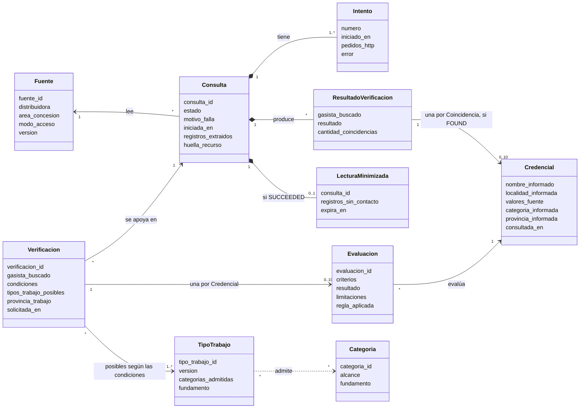
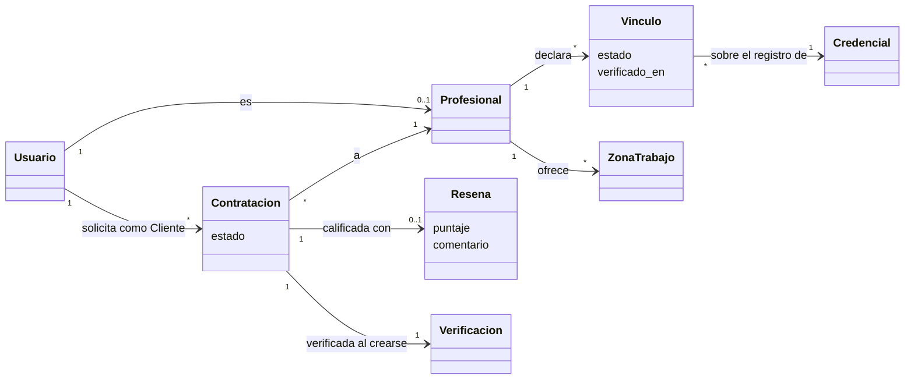
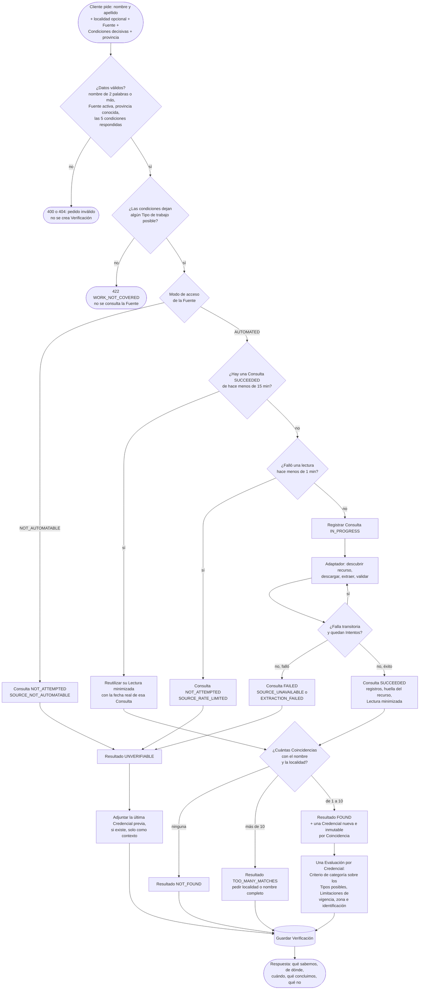
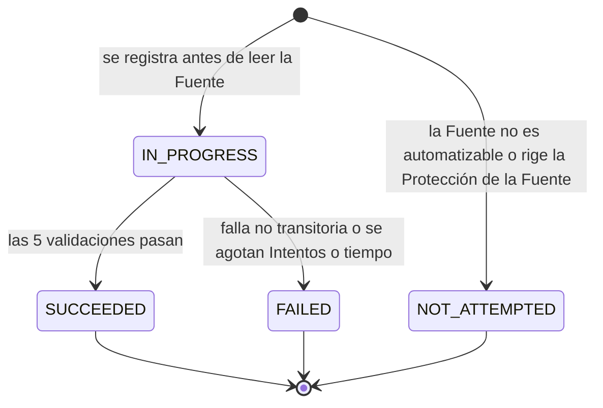
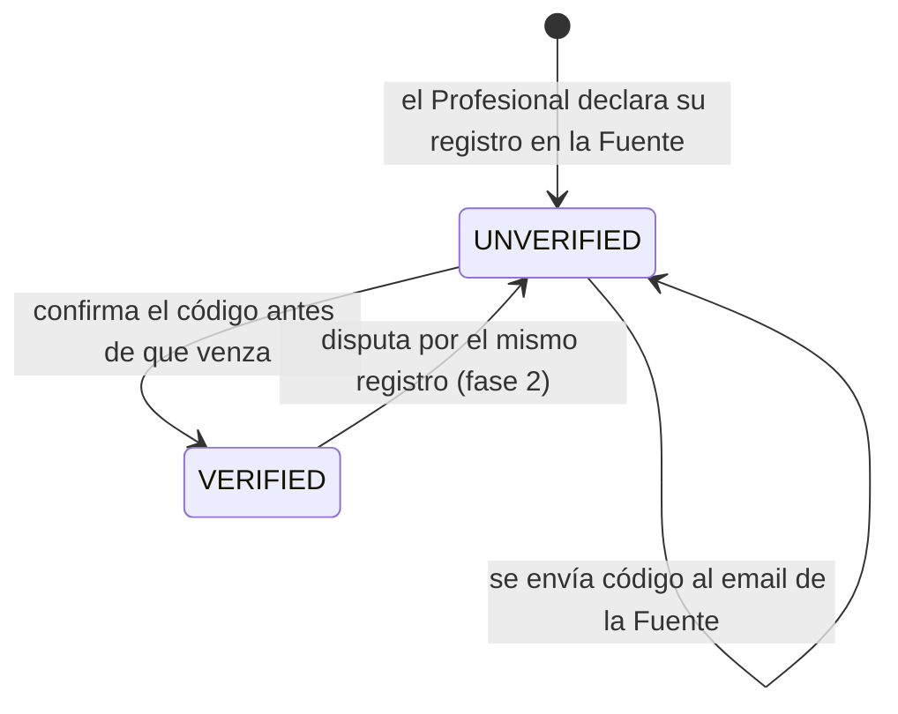
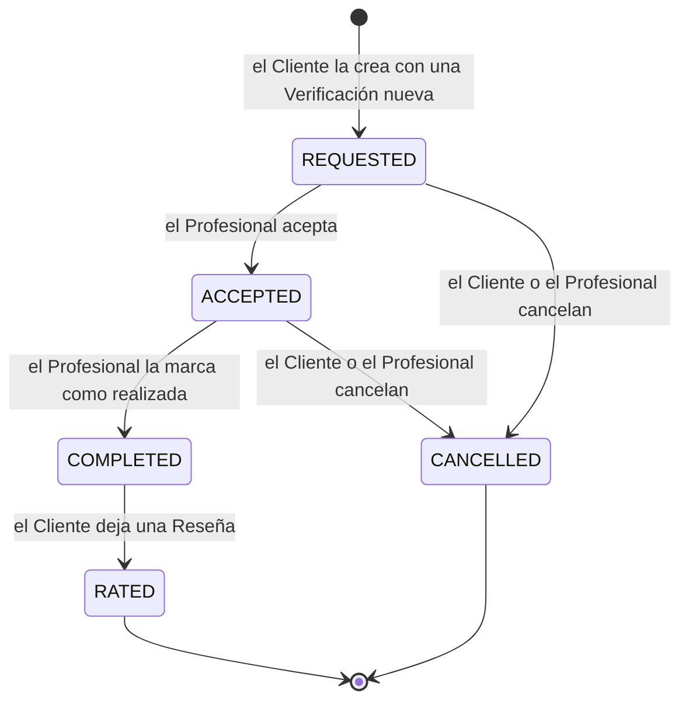

# Modelo de dominio

> Documento de diseño · Segunda entrega, corregido según la devolución v3 · Última revisión: 02/11/2026
> Responde a los puntos 1 ("modelo corregido separando Credencial y Evaluación") y 6 ("tratamiento explícito de NO_ENCONTRADO frente a NO_VERIFICABLE") de la devolución v2. Incorpora de la devolución v3 la zona como Limitación ([ADR-0005](adr/0005-zona-como-limitacion-en-el-p0.md)), las Condiciones decisivas y la Protección de la Fuente ([ADR-0006](adr/0006-lectura-minimizada-y-proteccion-de-la-fuente.md)). Incorpora el hallazgo del 02/11: Ecogas no publica el número de matrícula, así que el gasista se identifica por nombre y localidad ([ADR-0007](adr/0007-identificacion-por-nombre-y-localidad.md)).
> Vocabulario canónico: [`CONTEXT.md`](../CONTEXT.md). Reglas: [`reglas-de-categoria.md`](reglas-de-categoria.md). Persistencia: [`database/README.md`](../database/README.md).

## Índice

1. [La pregunta que responde MatriculAR](#1-la-pregunta-que-responde-matricular)
2. [Credencial no es lo mismo que Evaluación](#2-credencial-no-es-lo-mismo-que-evaluación)
3. [Entidades y relaciones](#3-entidades-y-relaciones)
4. [El recorrido de una Verificación](#4-el-recorrido-de-una-verificación)
5. [NOT_FOUND frente a UNVERIFIABLE](#5-not_found-frente-a-unverifiable)
6. [Cómo se calcula una Evaluación](#6-cómo-se-calcula-una-evaluación)
7. [Estados](#7-estados)
8. [Invariantes](#8-invariantes)
9. [Escenarios](#9-escenarios)
10. [Qué cambió respecto del modelo de la primera entrega](#10-qué-cambió-respecto-del-modelo-de-la-primera-entrega)

---

## 1. La pregunta que responde MatriculAR

Siguiendo la devolución del tutor, el núcleo del sistema no es "consultar padrones", sino poder responder con precisión:

> **qué sabemos, de dónde lo sabemos, cuándo lo verificamos, qué podemos concluir con esa evidencia y qué no podemos afirmar.**

Cada parte de esa frase corresponde a un elemento del modelo:

| Parte de la pregunta | Elemento del modelo |
|---|---|
| Qué sabemos | **Credencial**: nombre, categoría, provincia y localidad informados, tal como los publicó la Fuente y normalizados. La Fuente de Ecogas **no publica el número de matrícula**. |
| De dónde lo sabemos | **Fuente**: el padrón de una Distribuidora. |
| Cuándo lo verificamos | **Consulta**: cuándo se leyó, con qué Intentos y la Huella del recurso leído. |
| Qué podemos concluir | **Evaluación**: el resultado de aplicar un Tipo de trabajo, Criterio por Criterio, con su fundamento. |
| Qué no podemos afirmar | **Limitaciones** de cada Evaluación, más los resultados `UNVERIFIABLE` e `INDETERMINATE`. |

**Invariante rectora** (propuesta por el tutor y adoptada): *si el sistema no dispone de evidencia suficiente para afirmar algo, debe expresar la incertidumbre y no completar la respuesta por inferencia.* La ausencia de evidencia no se convierte en certeza.

---

## 2. Credencial no es lo mismo que Evaluación

|  | **Credencial** | **Evaluación** |
|---|---|---|
| Qué es | Evidencia sobre un gasista que figura en una Fuente. | Resultado de aplicar las reglas de un trabajo a esa evidencia. |
| Qué responde | "PERSONA FICTICIA UNO figura en el padrón de Ecogas con categoría 2ª, provincia informada Córdoba y localidad Río Cuarto, según la Consulta del 26/09/2026 a las 15:40." | "La categoría informada es compatible con este tipo de trabajo según la regla aplicada (2ª admitida, NAG-200 8.3.1). La vigencia de la matrícula no pudo verificarse. La Fuente no permite determinar si la matrícula habilita a trabajar en San Luis." |
| ¿De qué depende? | Solo de la Fuente y del momento de la Consulta. | De la Credencial, **de los Tipos de trabajo posibles** según las Condiciones decisivas y, para las Limitaciones, de la provincia del trabajo. |
| ¿Tiene estado de aptitud? | **No.** No existen "credencial vencida", "credencial fuera de jurisdicción" ni "credencial con categoría insuficiente". | Sí: `COMPATIBLE`, `INCOMPATIBLE` o `INDETERMINATE`, más un resultado por Criterio. |
| ¿Cambia? | **Nunca.** Es inmutable. Una Consulta posterior crea una Credencial nueva y la anterior queda en el historial. | Nunca se recalcula. Guarda una copia de la regla que aplicó. |
| Multiplicidad | Una por cada Coincidencia de una Consulta exitosa. | Una por cada Credencial de la Verificación. **La misma Credencial puede ser compatible con un trabajo y no con otro.** |

Ejemplo de por qué la separación importa: la Credencial "PERSONA FICTICIA TRES, categoría 3ª" es `COMPATIBLE` con A1 (vivienda unifamiliar) y `INCOMPATIBLE` con A2 (departamento). Si "categoría insuficiente" fuera un estado de la Credencial, habría que elegir uno de los dos, y los dos serían falsos para alguno de los trabajos.

---

## 3. Entidades y relaciones



**Módulos posteriores (P1 y P2)**, que se apoyan en el núcleo:



Descripción de cada entidad, con sus campos y tipos: [`database/README.md`](../database/README.md).

**Una Consulta ya no se hace "para una o más matrículas".** Lee la Fuente, y varias Verificaciones pueden apoyarse en ella durante la **Ventana de reutilización** (15 minutos), gracias a la **Lectura minimizada**: Identificador interno de la Fuente, nombre, categoría, provincia y localidad, crudos y normalizados, sin email, teléfono ni barrio, que se descarta al día siguiente ([ADR-0006](adr/0006-lectura-minimizada-y-proteccion-de-la-fuente.md)). Toda respuesta informa la fecha real de la Consulta en la que se apoya, nunca la del pedido.

---

## 4. El recorrido de una Verificación

Este es el recorrido vertical que pidió el tutor: *adaptador → obtención/extracción → normalización de credencial → persistencia de fuente, fecha y resultado → evaluación con una regla documentada → respuesta del backend*.



Detalle técnico de cada paso: [`fuentes-y-adaptadores.md`](fuentes-y-adaptadores.md) (adaptador) y [`api.md`](api.md) (contrato y secuencias).

**Una Consulta fallida no es un error del sistema.** Es un resultado del dominio: la API responde `201 Created` con una Verificación cuyo resultado es `UNVERIFIABLE`. Los errores HTTP quedan para los problemas del pedido del cliente (datos inválidos o trabajo no cubierto) o del propio sistema (base de datos caída).

**El gasista se identifica por nombre, no por matrícula.** El padrón de Ecogas no publica el número de matrícula: su campo `id` es un Identificador interno de la Fuente (1, 2, 3…) y el buscador oficial filtra por provincia, localidad, categoría y nombre ([ADR-0007](adr/0007-identificacion-por-nombre-y-localidad.md)). Una **Coincidencia** es un registro cuyo nombre normalizado (mayúsculas, sin tildes, espacios colapsados) contiene todas las palabras buscadas, en cualquier orden; si el Cliente indica la localidad, también tiene que coincidir. Si hay varias, cada una tiene su Credencial y su Evaluación, y **el Cliente elige con el carné del gasista: MatriculAR nunca elige por él**.

**Un trabajo no cubierto se rechaza antes de consultar la Fuente.** Si las Condiciones decisivas no dejan ningún Tipo de trabajo posible, no hay regla documentada, así que no hay nada que evaluar y descargar el padrón sería un pedido inútil a la Fuente ([reglas § 3.5](reglas-de-categoria.md#35-condiciones-decisivas-cómo-se-describe-el-trabajo)).

---

## 5. NOT_FOUND frente a UNVERIFIABLE

|  | `NOT_FOUND` | `UNVERIFIABLE` |
|---|---|---|
| Qué pasó | La Consulta fue **exitosa** (las cinco validaciones pasaron) y **ningún registro coincide** con el nombre (y la localidad) buscados. | La Consulta **falló** (`SOURCE_UNAVAILABLE` o `EXTRACTION_FAILED`) o **no se realizó** (Fuente no automatizable, o Fuente protegida por MatriculAR después de una falla reciente). |
| Qué afirma el sistema | Un **resultado negativo respecto de una Fuente concreta, en una fecha concreta**. | **Incertidumbre:** hoy no sabemos nada nuevo. |
| ¿Genera Credencial? | No. | No. |
| ¿Genera Evaluación? | No. | No. |
| ¿Muestra evidencia previa? | No hace falta: la evidencia de hoy es negativa. | Sí: si existen Credenciales anteriores para el mismo nombre y localidad, se muestran **con su fecha** como contexto, pero **no se usan para concluir**. |
| Mensaje al Cliente | "**Nadie con el nombre** PERSONA FICTICIA CUATRO figura en el padrón de Ecogas según la consulta exitosa del 26/09/2026 a las 15:45. Revisá cómo está escrito el nombre. Esto no dice nada sobre otras distribuidoras." | "**No pudimos consultar** el padrón de Ecogas (26/09/2026 15:30): el formato del recurso cambió. No podemos afirmar nada con evidencia de hoy. Última evidencia disponible: figuraba con categoría 2ª según la consulta del 20/09/2026." |
| Qué nunca dice | "No está matriculado" / "no aparece en ningún padrón". | "No encontrado" / "0 matriculados". |

`TOO_MANY_MATCHES` es una tercera respuesta: la Consulta fue exitosa, pero **más de 10 registros** coinciden con lo buscado. No es `NOT_FOUND`, porque la persona puede estar entre ellos, y no genera Credenciales. El mensaje pide precisar la búsqueda: *"Hay más de 10 gasistas que coinciden con «PEREZ JUAN» en el padrón de Ecogas. Agregá la localidad o el nombre completo."*

Para MetroGAS, el mensaje es: *"MetroGAS no permite consultas automáticas: su buscador exige un captcha. Podés verificar la matrícula manualmente en el buscador oficial: https://www.metrogas.com.ar/colaboradores/listado-de-gasistas-con-matricula/."*

Cuando rige la Protección de la Fuente (`SOURCE_RATE_LIMITED`), el mensaje es: *"Ecogas se consultó hace instantes sin éxito; reintentá en un minuto."*

---

## 6. Cómo se calcula una Evaluación

Una Evaluación se calcula **solo** cuando la Verificación tiene Credenciales nuevas, y se calcula **una por cada Credencial** (una por Coincidencia). El algoritmo es **fijo en el código**. Las reglas que usa (categorías admitidas, combinaciones de Condiciones decisivas, áreas de concesión, Limitaciones) son **datos versionados**.

### 6.1 Criterio de categoría

En el P0 hay **un solo Criterio**, la categoría. Se calcula para cada Tipo de trabajo posible:

| Criterio | Entrada | `MET` | `NOT_MET` | `INDETERMINATE` |
|---|---|---|---|---|
| **Categoría** | Categoría informada por la Credencial y Categorías admitidas del Tipo de trabajo | La categoría está en la lista. | Es una categoría conocida del catálogo que no está en la lista. | La categoría está vacía o no figura en el catálogo. |

Ni la **Vigencia** ni la **zona** son Criterios. Se informan siempre como Limitaciones y no participan del resultado (ver [reglas § 4](reglas-de-categoria.md#4-zona-por-qué-es-una-limitación) y [§ 5](reglas-de-categoria.md#5-vigencia-por-qué-no-es-un-criterio)).

### 6.2 Resultado global

El Cliente describe el trabajo con las cinco **Condiciones decisivas** (Sí, No o No sé). El sistema recorre todas las combinaciones posibles de las respuestas No sé ([reglas § 3.5](reglas-de-categoria.md#35-condiciones-decisivas-cómo-se-describe-el-trabajo)):

```
para cada combinación:
    si cae en un Tipo de trabajo:
        Criterio de categoría MET            → COMPATIBLE
        Criterio de categoría NOT_MET        → INCOMPATIBLE
        Criterio de categoría INDETERMINATE  → INDETERMINATE
    si no cae en ningún Tipo de trabajo      → INDETERMINATE

si ninguna combinación cae en un Tipo de trabajo → no hay Evaluación: 422 WORK_NOT_COVERED, antes de consultar la Fuente
si todas las combinaciones dan el mismo resultado → ese resultado
si no                                            → INDETERMINATE, con las Condiciones decisivas que lo resolverían
```

Un No sé **nunca se toma como Sí**. Si el dato desconocido no cambia la respuesta (por ejemplo, una 2ª con No sé en `unica_vivienda`), el resultado es el mismo para todas las combinaciones y el Cliente no recibe un `INDETERMINATE` innecesario.

### 6.3 Limitaciones

Cada Evaluación lleva la unión de:

1. **Las Limitaciones de la Fuente**, por ejemplo: *"La Fuente no informa la vigencia de la matrícula…"*, *"Ecogas no publica el número de matrícula: la identificación es por nombre y localidad. Confirmala con el carné del gasista."* y *"La provincia informada corresponde al domicilio del matriculado, no a la zona donde puede trabajar"*.
2. **La Limitación de zona**, que siempre está: *"La Fuente no permite determinar si la matrícula habilita a trabajar en <provincia>"* o, fuera del Área de concesión, *"<provincia> está fuera del área de concesión de Ecogas; el gasista podría estar registrado en otra distribuidora que MatriculAR no consultó"*.
3. **Las Limitaciones del Tipo de trabajo**, por ejemplo, en B, la excepción de la NAG-200 8.3.1.
4. **Las Condiciones decisivas declaradas:** *"Esta evaluación se basa en lo que respondiste sobre el trabajo: [lista]"*.
5. **Si hay varias Coincidencias:** *"Hay N gasistas que coinciden con lo que buscaste. Elegí el que corresponde con su carné."*

### 6.4 Cómo se presenta `COMPATIBLE`

`COMPATIBLE` afirma la compatibilidad técnica de la categoría, no una habilitación actual. El texto es siempre:

> *"La categoría informada es compatible con este tipo de trabajo según la regla aplicada. La vigencia de la matrícula no pudo verificarse."*

Nunca se usan frases como "puede realizar este trabajo" o "está habilitado".

### 6.5 Qué se guarda

La Evaluación guarda una **copia completa** de lo que usó, para seguir siendo explicable aunque las reglas cambien:

- la referencia exacta a la Credencial (Fuente, nombre y localidad normalizados, y `consultada_en`; la clave definitiva se diseña con DynamoDB el 9/11, [ADR-0007](adr/0007-identificacion-por-nombre-y-localidad.md));
- las Condiciones decisivas respondidas y los Tipos de trabajo posibles;
- cada Tipo de trabajo posible con su **versión**, más una copia de las categorías admitidas, las condiciones y el fundamento;
- el Área de concesión usada para la Limitación de zona, copiada de la versión de la Fuente;
- el resultado y el fundamento del Criterio de categoría por cada Tipo de trabajo posible;
- las Condiciones decisivas que resolverían un `INDETERMINATE`, si las hay;
- las Limitaciones, como textos finales.

---

## 7. Estados

### 7.1 Consulta



- `FAILED` siempre lleva un **motivo**: `SOURCE_UNAVAILABLE` (red, tiempo agotado, HTTP 5xx, 429 o 403) o `EXTRACTION_FAILED` (recurso no encontrado, marcador ausente, parseo fallido, registros vacíos o inválidos, caída brusca de la cantidad de registros).
- Una Consulta que queda en `IN_PROGRESS` después de su plazo máximo (por ejemplo, porque la función se cortó o no se pudo escribir en la base) se lee como `FAILED` con motivo **`INTERRUPTED`**. Es una falla de MatriculAR, no de la Fuente, así que **no cuenta en la salud de la Fuente**. El intento queda registrado igual.
- `NOT_ATTEMPTED` lleva el motivo `SOURCE_NOT_AUTOMATABLE` (la Fuente exige captcha) o `SOURCE_RATE_LIMITED` (una lectura falló hace menos de un minuto y MatriculAR no vuelve a pedir, para proteger a la Fuente).
- Una Consulta `SUCCEEDED` guarda una **Lectura minimizada** que responde nuevas Verificaciones durante la Ventana de reutilización (15 minutos) y se descarta al día siguiente.
- Los estados finales no cambian nunca.

### 7.2 Resultado de verificación

No tiene transiciones: se determina una sola vez por Verificación. Si la Consulta se reutiliza, el Gasista buscado se busca en su Lectura minimizada.

| Estado de la Consulta | Coincidencias en el recurso | Resultado de verificación |
|---|---|---|
| `SUCCEEDED` | De 1 a 10 | `FOUND` |
| `SUCCEEDED` | Ninguna | `NOT_FOUND` |
| `SUCCEEDED` | Más de 10 | `TOO_MANY_MATCHES` |
| `FAILED` | — | `UNVERIFIABLE` |
| `NOT_ATTEMPTED` | — | `UNVERIFIABLE` |

### 7.3 Vínculo (P1)



- `VERIFIED` significa **vínculo verificado mediante el email publicado por la Fuente**: prueba que el Profesional controla ese email, no su identidad legal como titular de la matrícula. Hasta validar esa propiedad con la distribuidora, el sistema no lo presenta como "titularidad".
- El email de la Fuente **se usa en el momento y no se guarda**. Si la Fuente no publica un email en ese registro, el Vínculo queda `UNVERIFIED` y se muestra así.
- Un registro solo puede tener **un** Vínculo `VERIFIED` a la vez. Se garantiza con una escritura condicional en la tabla `TitularesMatricula`, dentro de la misma transacción que confirma el código.

### 7.4 Contratación (P2)



Regla de creación (ver [módulos](modulos.md)): si la Verificación da `INCOMPATIBLE`, la Contratación **no se crea**. Con `INDETERMINATE`, `NOT_FOUND` o `UNVERIFIABLE`, el Cliente ve una **advertencia** y decide. Con `COMPATIBLE`, se crea sin advertencias.

---

## 8. Invariantes

| # | Invariante | Por qué |
|---|---|---|
| INV-1 | Una **Credencial nunca se modifica ni se borra**. Cada Coincidencia de una Consulta exitosa agrega una Credencial nueva al historial de (`fuente`, nombre normalizado, localidad normalizada). | Devolución v2: "sin borrar ni transformar incorrectamente la última evidencia válida disponible". |
| INV-2 | Una **Evaluación solo existe si la Verificación tiene Credencial**. | Una Evaluación aplica un Tipo de trabajo *a una Credencial*; sin Credencial no hay nada que evaluar. |
| INV-3 | `NOT_FOUND` **solo** puede salir de una Consulta `SUCCEEDED`. Una falla **nunca** produce `NOT_FOUND`. | Distinción entre un resultado negativo e incertidumbre. |
| INV-4 | Una extracción vacía, parcial o con una caída brusca de registros es `EXTRACTION_FAILED`, **nunca** "0 matriculados". | Devolución v2: el adaptador no debe interpretar "se encontraron cero matriculados". |
| INV-5 | El sistema **nunca afirma la Vigencia**. Se informa siempre como Limitación. | Ninguna Fuente la informa y figurar en el padrón no la prueba. |
| INV-6 | La zona **nunca participa del resultado**: se informa siempre como Limitación. | El padrón no dice en qué licenciataria está registrado el gasista, y la incertidumbre I4 sigue abierta ([ADR-0005](adr/0005-zona-como-limitacion-en-el-p0.md)). Una pregunta pendiente hacia la Fuente no se convierte en una afirmación positiva. |
| INV-7 | Las categorías **no se comparan por orden**. | Son alcances técnicos, no niveles (errata E2). |
| INV-8 | Una Evaluación **conserva una copia** de la regla que aplicó y **nunca se recalcula**. | Las normas están en revisión; una Evaluación vieja tiene que seguir siendo explicable. |
| INV-9 | Los **datos de contacto** que publica la Fuente (email, teléfono, barrio) **nunca se persisten**, ni en la Credencial ni en la Lectura minimizada. | Minimización de datos personales. |
| INV-10 | Toda respuesta dice **de qué Fuente** y **de qué fecha** es la evidencia: la fecha real de la Consulta, aunque se haya reutilizado. | "De dónde lo sabemos, cuándo lo verificamos". |
| INV-11 | El sistema **nunca generaliza** a "ningún padrón": los resultados se informan por Fuente. | Devolución v2. |
| INV-12 | En los datos del producto **no hay Fuentes simuladas**. Los datos ficticios se usan solo en la documentación y en los tests. | Distinguir lo que el sistema puede conocer de lo que solo puede simular. |
| INV-13 | Una Condición decisiva respondida **No sé nunca se toma como Sí**. | Devolución v3: una condición necesaria desconocida no se convierte silenciosamente en verdadera. |
| INV-14 | Una Verificación de un trabajo no cubierto **no consulta la Fuente**. | Sin regla no hay Evaluación posible, y cada lectura es un pedido a un tercero. |
| INV-15 | MatriculAR lee una Fuente **como máximo una vez por Ventana de reutilización** si la lectura fue exitosa, y espera un minuto después de una falla. | Devolución v3: no amplificar consultas anónimas contra un tercero ([ADR-0006](adr/0006-lectura-minimizada-y-proteccion-de-la-fuente.md)). |
| INV-16 | El **Identificador interno de la Fuente** nunca se presenta como número de matrícula ni identifica a un gasista. | La Fuente no publica la matrícula y su `id` puede cambiar entre publicaciones ([ADR-0007](adr/0007-identificacion-por-nombre-y-localidad.md)). |
| INV-17 | Si hay varias Coincidencias, **MatriculAR nunca elige** una: muestra todas, cada una con su Evaluación. | Con homónimos, elegir sería afirmar una identidad que la evidencia no prueba. |

---

## 9. Escenarios

Todos los datos de estos escenarios son **ficticios** (nombres de la serie "PERSONA FICTICIA UNO" a "SEIS", con localidades reales). Reemplazan a la matriz de casos de la investigación, que tenía los errores E1, E2, E5, E7 y E12. Salvo que se diga otra cosa, la búsqueda da **una sola Coincidencia**.

En la columna "Pedido", **"condiciones de A1"** significa que el Cliente respondió las cinco Condiciones decisivas sin ningún No sé, y que la única combinación posible es A1. Lo mismo vale para A2 y B.

| # | Pedido | Resultado de la Consulta | Resultado de verificación | Evaluación | Qué muestra el sistema |
|---|---|---|---|---|---|
| S1 | Ecogas, "PERSONA FICTICIA UNO", **condiciones de A1**, Córdoba | `SUCCEEDED` | `FOUND` (2ª, Córdoba, Río Cuarto) | **`COMPATIBLE`**: categoría `MET` (2ª admitida, 8.3.1) | "La categoría informada es compatible con este tipo de trabajo según la regla aplicada. La vigencia de la matrícula no pudo verificarse." Más la fecha de la Consulta y las Limitaciones de vigencia y zona. |
| S2 | La misma persona, pero **condiciones de B** | `SUCCEEDED` | `FOUND` (2ª) | **`INCOMPATIBLE`**: categoría `NOT_MET` (B solo admite 1ª, 8.3.1) | No compatible, con la cita y la Limitación de la excepción 8.3.1. **La misma evidencia (categoría 2ª) da otro resultado con otro trabajo.** |
| S3 | Ecogas, "PERSONA FICTICIA DOS" (**1ª**), **condiciones de A2**, Mendoza | `SUCCEEDED` | `FOUND` (1ª) | **`COMPATIBLE`** | Corrige el caso "categoría insuficiente" de la investigación (E2): la 1ª es compatible con este trabajo. |
| S4 | Ecogas, "PERSONA FICTICIA UNO" (provincia informada **Córdoba**), condiciones de A1, **San Luis** | `SUCCEEDED` | `FOUND` (2ª) | **`COMPATIBLE`** por categoría, con la **Limitación de zona**: "La Fuente no permite determinar si la matrícula habilita a trabajar en San Luis." | Corrige el caso "jurisdicción incorrecta" (E1): la provincia informada no se usa para evaluar. Corrige también la segunda entrega, que daba zona `MET`: el padrón no dice si el gasista está registrado en Centro o en Cuyana (I4, [ADR-0005](adr/0005-zona-como-limitacion-en-el-p0.md)). |
| S5 | Ecogas, "PERSONA FICTICIA TRES" (3ª), condiciones de A1, **Buenos Aires** | `SUCCEEDED` | `FOUND` (3ª) | **`COMPATIBLE`** por categoría, con la **Limitación de zona** fuera del área | "Buenos Aires está fuera del área de concesión de Ecogas; el gasista podría estar registrado en otra distribuidora que MatriculAR no consultó." |
| S6 | Ecogas, "PERSONA FICTICIA CUATRO", condiciones de A1, Córdoba | `SUCCEEDED` (5.031 registros) | **`NOT_FOUND`** | — | "Nadie con ese nombre figura en el padrón de Ecogas según la consulta exitosa del [fecha]." |
| S7 | Ecogas, "PERSONA FICTICIA UNO", condiciones de A1, Córdoba, **con el recurso cambiado** | `FAILED` · `EXTRACTION_FAILED` (1 Intento, sin reintento) | **`UNVERIFIABLE`** | — | "No pudimos consultar Ecogas." Se muestra la Credencial del 20/09 como contexto, sin concluir nada. |
| S8 | Ecogas, **sin conexión** durante los 3 Intentos | `FAILED` · `SOURCE_UNAVAILABLE` (3 Intentos registrados) | **`UNVERIFIABLE`** | — | Igual que S7, con motivo "la fuente no respondió". |
| S9 | **MetroGAS**, "PERSONA FICTICIA CINCO", condiciones de A1, CABA | `NOT_ATTEMPTED` · `SOURCE_NOT_AUTOMATABLE` (0 Intentos) | **`UNVERIFIABLE`** | — | Link al buscador oficial de MetroGAS. |
| S10 | Ecogas, "PERSONA FICTICIA SEIS", **condiciones de A1**, San Juan, con categoría informada **vacía** | `SUCCEEDED` | `FOUND` (categoría "") | **`INDETERMINATE`**: categoría `INDETERMINATE` | "La Fuente informa la categoría vacía, que MatriculAR no reconoce. No se puede determinar si es compatible con este tipo de trabajo." |
| S11 | Ecogas, "PERSONA FICTICIA TRES" (**3ª**), Córdoba, **No sé** en `unica_vivienda` y el resto como A1 | `SUCCEEDED` | `FOUND` (3ª) | **`INDETERMINATE`**: A1 `COMPATIBLE`, A2 `INCOMPATIBLE`. Resuelve: `unica_vivienda` | "Si el terreno tiene una única vivienda, la categoría informada sería compatible." El No sé no se toma como Sí. |
| S12 | Ecogas, "PERSONA FICTICIA UNO" (**2ª**), Córdoba, **No sé** en `unica_vivienda` y el resto como A1 | `SUCCEEDED` | `FOUND` (2ª) | **`COMPATIBLE`**: A1 y A2 admiten la 2ª | El dato desconocido no cambia la respuesta, así que no hay `INDETERMINATE`. |
| S13 | Ecogas, "PERSONA FICTICIA UNO", **comercio sin artefactos de más de 50.000 kcal/h** | — (no se consulta) | — | — | `422 WORK_NOT_COVERED`: "Este tipo de trabajo todavía no está cubierto; MatriculAR solo evalúa conexiones de artefactos en viviendas y comercios con gas natural por red." |
| S14 | Ecogas, "PERSONA FICTICIA DOS", condiciones de A2, Mendoza, **10 minutos después de S3** | Se reutiliza la Consulta de S3 (`SUCCEEDED`), sin descargar de nuevo | `FOUND` (1ª) | **`COMPATIBLE`** | La respuesta informa la fecha real de la Consulta de S3, no la del pedido. |
| S15 | Ecogas, "PERSONA FICTICIA UNO", condiciones de A1, Córdoba, **30 segundos después de S8** | `NOT_ATTEMPTED` · `SOURCE_RATE_LIMITED` (0 Intentos) | **`UNVERIFIABLE`** | — | "Ecogas se consultó hace instantes sin éxito; reintentá en un minuto." |
| S16 | Ecogas, "PERSONA FICTICIA SIETE" **sin localidad**, condiciones de A1, Córdoba. Hay **dos homónimos**: uno de 2ª en Villa María y otro de 3ª en Río Tercero | `SUCCEEDED` | **`FOUND` con 2 Coincidencias** | Una por Coincidencia: **`COMPATIBLE`** (2ª) y **`COMPATIBLE`** (3ª) | Las dos Coincidencias, cada una con su localidad, categoría y Evaluación, más la Limitación "Hay 2 gasistas que coinciden con lo que buscaste. Elegí el que corresponde con su carné." MatriculAR no elige. Si el Cliente agrega "Villa María", queda una sola. |
| S17 | (a) Ecogas, búsqueda **"JUAN"** sola. (b) Ecogas, búsqueda **"PEREZ JUAN"** sin localidad, con más de 10 registros que contienen las dos palabras | (a) — (no se consulta). (b) `SUCCEEDED` | (a) —. (b) **`TOO_MANY_MATCHES`** | — | (a) `400 INVALID_REQUEST`: "Escribí al menos nombre y apellido." (b) "Hay más de 10 gasistas que coinciden con «PEREZ JUAN» en el padrón de Ecogas. Agregá la localidad o el nombre completo." No es `NOT_FOUND`: la persona puede estar entre ellos. |

Los ejemplos concretos de estos ítems, en el formato en que se guardan, están en [`database/seed/ejemplos-ficticios/`](../database/seed/ejemplos-ficticios/).

---

## 10. Qué cambió respecto del modelo de la primera entrega

| Primera entrega (README original) | Modelo actual | Motivo |
|---|---|---|
| Máquina de estados del **Profesional**: `pendiente_verificación → verificado / rechazado`, `verificado → vencido → verificado` | El Profesional **no tiene estado de habilitación**. La evidencia vive en las Credenciales (inmutables, con historial) y la conclusión en las Evaluaciones (una por trabajo). | Credencial ≠ Evaluación (devolución v2). |
| Estado `vencido` y degradación automática por vencimiento | **Eliminado.** La Vigencia es una Limitación. | Ninguna Fuente informa vencimientos; no se modelan fechas ficticias. |
| "Verificado" como sello de confianza | Resultado de verificación **por Fuente y por fecha**, más una Evaluación **por Tipo de trabajo**. | Una misma matrícula puede ser adecuada para un trabajo y no para otro. |
| Estados de credencial de la investigación (`fuera_de_jurisdiccion`, `categoria_insuficiente`, `no_encontrado`, `no_verificable`) | Criterio de categoría de la Evaluación, Limitación de zona y Resultados de verificación (`FOUND`, `NOT_FOUND`, `UNVERIFIABLE`). | La misma separación. La zona pasó de Criterio a Limitación en la devolución v3 (ADR-0005). |
| El Cliente elige el Tipo de trabajo (segunda entrega) | El Cliente responde cinco **Condiciones decisivas** y el sistema deduce los Tipos de trabajo posibles. | Devolución v3: elegir A1 sin saber si se cumplen sus condiciones da una respuesta correcta sobre una premisa falsa. |
| El Cliente busca por número de matrícula, que se suponía en el campo `id` del padrón | El Cliente busca por **nombre y apellido**, con la localidad opcional. El `id` es un Identificador interno de la Fuente y nunca identifica a nadie. | Hallazgo del 02/11: Ecogas no publica la matrícula ([ADR-0007](adr/0007-identificacion-por-nombre-y-localidad.md)). |
| Jurisdicción = provincia del padrón | Se separa en **Provincia informada**, **Área de concesión** y **provincia del trabajo**. | Errata E1. |
| Carga de un documento de credencial a S3 | **Eliminada.** La evidencia es la Fuente, y el Profesional se vincula a su registro en la Fuente con un código al email que publica la Fuente (vínculo verificado mediante el email publicado por la Fuente, que prueba control de ese email y no identidad legal). | Una foto del carné no prueba nada que el sistema pueda chequear. |
| Contratación: solicitada → aceptada → realizada → calificada (con cancelación) | **Se mantiene**, y además cada Contratación queda asociada a una Verificación. | — |
